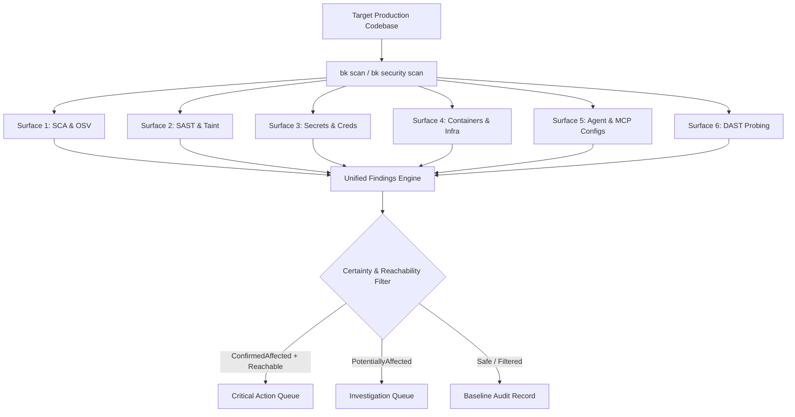

# Production Codebase Security Inspection Playbook

This playbook provides actionable procedures for evaluating any production codebase or containerized deployment using Bug Killer (`bk`).

---

## 1. Scan Profile Selection Matrix

| Profile | Wall Clock Budget | Scope of Analysis | Best For |
|---|---|---|---|
| **`quick`** | < 5 seconds | Fast regex patterns, direct manifest versions, high-entropy secrets, critical CVEs | Pre-commit hooks, local edit loops, rapid triage |
| **`project`** | 10 - 30 seconds | Full SCA lockfile resolution, AST taint analysis on modified files, Dockerfile audit | Pull Request gates, feature branch verification |
| **`ci`** | 30 - 60 seconds | Strict policy evaluation, baseline regression diffing, SARIF export, fail-closed thresholds | Continuous Integration pipelines, deployment gates |
| **`deep`** | 1 - 5 minutes | Multi-ecosystem OSV lookups, cross-file taint graphs, reverse-proxy config parse, binary inspection | Pre-release audits, periodic compliance runs |

---

## 2. Multi-Surface Inspection Sequence



### Surface 1: Software Composition Analysis (SCA) & OSV Lookups
- Scans `package.json`, `package-lock.json`, `composer.json`, `composer.lock`, `Cargo.toml`, `Cargo.lock`, `requirements.txt`, `Pipfile.lock`, `go.mod`, `go.sum`, and SPDX/CycloneDX SBOMs.
- Evaluates version bounds against local CVE database (`cve_db`) and OSV.dev.
- Prevents false alarms by evaluating semantic constraints; range queries are never blindly sent as exact versions.

### Surface 2: Static Application Security Testing (SAST) & Taint Analysis
- Identifies critical runtime vulnerabilities:
  - **PHP2Shell** (`CVE-2026-109618`, `CVE-2026-109619`): Unsafe stream wrappers, `auto_prepend_file` manipulation, unescaped fastcgi pipelines.
  - **Node2Shell** (`CVE-2026-111497`): Unguarded `zlib.createBrotliDecompress()` pipelines, unconstrained stream decompression buffers.
  - **Taint Analysis**: Tracks untrusted user inputs (`req.body`, `$_POST`, `$_GET`, `r.URL.Query()`) flowing into dangerous sinks (`eval`, `exec`, `system`, raw SQL formatting, `fs.readFile` with unvalidated paths).

### Surface 3: High-Entropy Secrets & Credential Leaks
- Scans code and configs for AWS access keys, GitHub personal access tokens, OpenAI/Anthropic/Resend API keys, private Ed25519/RSA keys, and unencrypted JWT secrets.
- Excludes test mock keys and public key identifiers.

### Surface 4: Containers & Reverse Proxies
- **Dockerfiles**: Flags root user execution (`USER root` or missing non-root directive), insecure base image tags (`latest`), and dangerous `curl ... | sh` instructions.
- **Reverse Proxies (Nginx / Apache / HAProxy)**: Inspects configuration files for missing WAF drop rules, insecure header forwarding, and unmitigated decompression attacks.

### Surface 5: AI Agent & MCP Security
- Scans `.cursor/`, `.agents/`, `.claude/`, and `mcp.json` files for:
  - Unpinned or excessive MCP server tool permissions.
  - Arbitrary shell command execution vectors (`run_command` without strict sandboxing).
  - Unsanitized prompt injection vectors in system prompt files.

### Surface 6: Defensive DAST Probing (`bk probe`)
- Only executed if an active HTTP/HTTPS endpoint is supplied.
- Strict safety boundary: Localhost metadata IP (`169.254.169.254`) and embedded credentials are automatically denied to eliminate SSRF risks.
- Audits Content-Security-Policy (CSP), Strict-Transport-Security (HSTS), X-Content-Type-Options, and server technology disclosures.

---

## 3. Interpreting Findings

Every finding returned by `bk` adheres to a strict schema containing:

1. **`id`**: Unique rule identifier (e.g. `RULE-NODE-BROTLI-001`, `RULE-SEC-TAINT-SQLI`).
2. **`severity`**: `Critical`, `High`, `Medium`, `Low`, or `Info`.
3. **`certainty`**:
   - `ConfirmedAffected`: Direct vulnerable API call detected in active execution path.
   - `PotentiallyAffected`: Dependency or framework present, but invocation path not yet proven reachable.
   - `Unknown`: Insufficient AST visibility or obfuscated code.
4. **`reachability`**:
   - `Reachable`: Input path from public entry point to sink is confirmed.
   - `Unreachable`: Sink is guarded by sanitizers or isolated behind dead code.
   - `UnknownReachability`: Call hierarchy exceeds local AST budget.

---

## 4. Production CI/CD Gating Command

When embedding `bk` in a CI/CD pipeline or deployment check:

```bash
# Fail only on Confirmed High or Critical vulnerabilities
bk security scan . --profile ci --fail-on high --json > /tmp/bugkiller-scan-report.json
SCAN_EXIT=$?

if [ $SCAN_EXIT -ne 0 ]; then
    echo "[!] Deployment blocked by Bug Killer security gate."
    exit $SCAN_EXIT
fi
```
