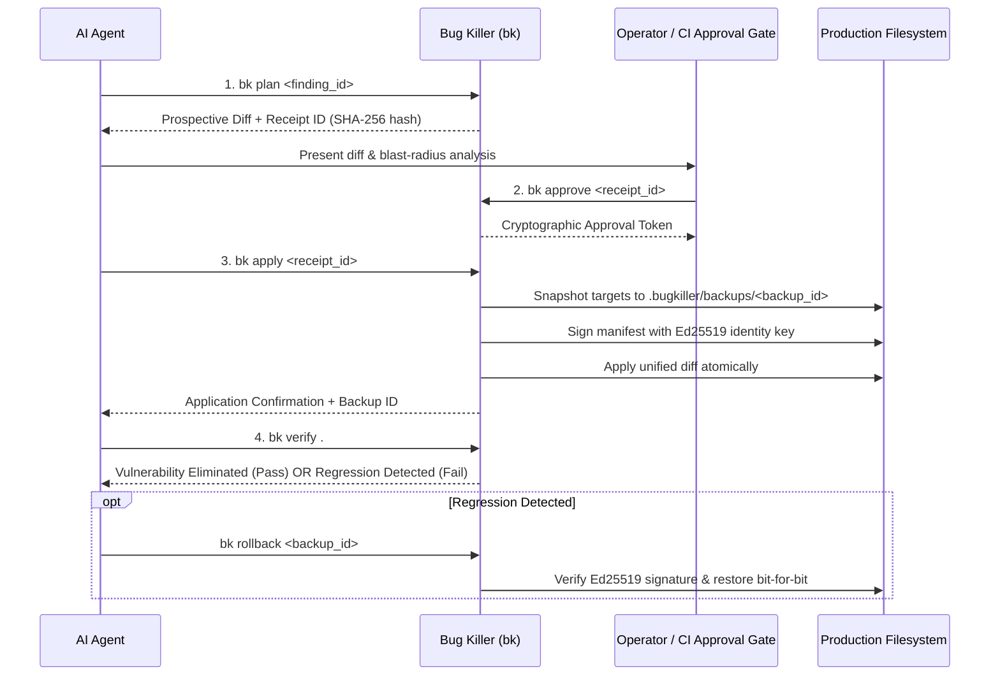

# Supervised Remediation & Cryptographic Rollback Protocol

This reference defines how Bug Killer (`bk`) executes safe, graduated virtual patching, atomic file transactions, cryptographic backup manifests, and bit-for-bit rollbacks without risking production stability.

---

## 1. The 4-Step Remediation Loop



---

## 2. Graduated Remediation Levels

| Level | Name | Behavior | Permitted Actions |
|---|---|---|---|
| **L1** | Advisory | Report vulnerabilities only. Zero filesystem mutations. | Generate patch recommendations, code snippets, guidance. |
| **L2** | Supervised Plan | Produce non-mutating unified diff and generate receipt ID. | `bk plan <finding_id>`. Filesystem remains untouched. |
| **L3** | Approved Apply | Apply planned patch after verifying cryptographic operator sign-off. | `bk apply <receipt_id>`. Enforces atomic backup & Ed25519 sign. |
| **L4** | Autonomous Virtual Patch | Apply reversible virtual patches (WAF rules, HTTP 415 drops) in emergency mode. | `bk heal --level L4`. Snapshot created before any write. |

---

## 3. Cryptographic Backup & Manifest Verification

Whenever `bk apply` or `bk heal` mutates a file:

1. **Snapshot Creation**: The original target file is copied bit-for-bit into `.bugkiller/backups/<backup_id>/`.
2. **Digest Computation**: SHA-256 hashes are calculated for every original file.
3. **Ed25519 Non-Repudiation**: The manifest containing file paths, timestamps, and SHA-256 hashes is signed using the autonomous agent identity key located at `~/.bug-killer/identity/agent.key`.
4. **Failure-Closed Rollback Policy**:
   - Before executing `bk rollback <backup_id>`, `bk` verifies the Ed25519 signature against the agent public key.
   - If any backup file was modified, tampered with, or the signature does not match, rollback aborts immediately with Exit Code `4` (`Signature / Integrity violation`).

---

## 4. Remediation Strategies by Target Type

### Manifest Pinning (`package.json`, `composer.json`, `Cargo.toml`)
- Pins vulnerable dependency versions to patched upstream versions (e.g. updating Node runtime engines or PHP packages).
- Preserves formatting, indent spacing, and existing package constraints.

### Virtual Patching (Reverse Proxy & Middleware)
- Injects HTTP 415 `Unsupported Media Type` rejection rules into Nginx or Apache configuration to drop attack payloads (such as Brotli chunked decompression exploits) before reaching vulnerable runtimes.
- Idempotent: Never duplicates rules if already present.

### Container Hardening (`Dockerfile`)
- Replaces vulnerable base image tags with patched versions.
- Injects non-root user directives (`USER 10001:10001`) to mitigate container breakout risks.

---

## 5. Instant Rollback Procedure

If a test fails or production behaves unexpectedly following a patch:

```bash
# 1. Identify the backup ID
bk history .

# 2. Revert the patch bit-for-bit
bk rollback <backup_id>

# 3. Verify original baseline is restored
bk doctor .
```
