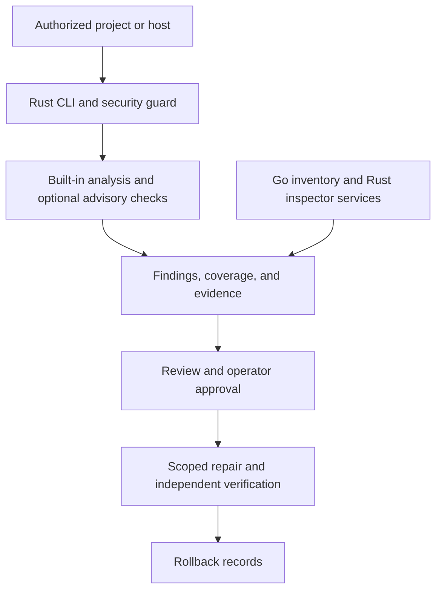

# Bug Killer (`bug-killer` / `bk`)
### Autonomous Vulnerability Discovery & Self-Healing Engine for Deep and Ghosty Bugs

[](https://github.com/imMamdouhaboammar/bug-killer/actions)
[](#polyglot-specialization-matrix)
[](#microservices-architecture)
[](LICENSE)
[](SECURITY.md)

> **"Let Your AI Find The Deep and Ghosty Bugs, Vulnerabilities, Security Issues and Heal From It — Tested & Verified."**

Bug Killer is an offline-first, polyglot defensive security system engineered to discover elusive runtime memory corruptions, verify reachability through static binary disassembly and kernel memory maps, execute atomic self-healing repairs, and guarantee bit-for-bit rollback.

Initial benchmark targets:
- **PHP2Shell (`CVE-2026-109618` & `CVE-2026-109619`):** Zend Engine allocator `longjmp` OOM heap corruption and persistent worker Use-After-Free.
- **Node2Shell (`CVE-2026-111497`):** Bundled Google Brotli decoder out-of-bounds memory write in `node:zlib`.

---

## Start with a read-only scan

Build the Rust CLI and scan your current project. This path does not require the Go services or a running Docker daemon.

```bash
git clone https://github.com/imMamdouhaboammar/bug-killer.git
cd bug-killer
cargo build --release
./target/release/bug-killer security scan . --profile quick
```

Requires a Rust toolchain that supports edition 2024 and a compiler toolchain for native dependencies. The executable is `bug-killer`; the shorter `bk` command is installed by `make install`.

For a machine-readable report:

```bash
./target/release/bug-killer security scan . --profile quick --json
```

To initialize another Git project, use `bk init /path/to/project` after installation. **Initialization writes project security configuration, runs a baseline scan, and installs a Git pre-commit hook by default.** Run a read-only scan first if you only want to inspect the project.

## One place to assess, investigate, and repair

A scanner finding is the start of a security decision. You still need to know which files and dependencies were checked, whether the issue affects the running software, and whether a proposed fix survives verification.

Bug Killer brings those steps together:

1. **Inspect the target.** Inventory source files, manifests, runtimes, and applicable security checks.
2. **Collect evidence.** Record findings, affectedness, uncertainty, and gaps in scan coverage.
3. **Investigate.** Use source analysis, optional advisory lookups, bounded agent investigations, or approved runtime checks.
4. **Plan the repair.** Review a proposed change before granting write access.
5. **Verify the result.** Recheck the affected property and retain rollback evidence when a change is approved.

### What works in the current code

| Capability | Current interface | Important boundary |
|---|---|---|
| Workspace and runtime scanning | `bk scan`, `bk doctor` | Evidence depends on the target and available runtime data |
| Security catalog and guard | `bk security scan`, `bk security catalog`, `bk security verify` | The 373-entry catalog is a taxonomy; supported and executed checks are reported separately |
| Dependency advisories | `bk osv`, `bk scan --osv`, `bk security scan --osv` | OSV queries require network access; a version match does not prove exploitability |
| Source analysis | `bk scan --taint`, structural and built-in engine modules | Language, rule, and analysis depth vary; unsupported paths must remain visible |
| Agent-assisted investigation | `bk agent doctor`, `bk agent investigate` | Investigation is bounded and read-only; remote model access requires configuration and data-export policy |
| Coding-agent access | `bk mcp serve`, `bk mcp config` | Local stdio transport; read-only is the default |
| Supervised remediation | `bk heal --dry-run`, `bk plan`, `bk approve`, `bk apply`, `bk rollback` | Privileged changes require separate operator approval and verification |

The source also contains an analyzer adapter registry, an execution protocol, and a benchmark harness. **Connecting a mature external scanner does not automatically make it part of a released scan profile.** Availability, license, output fidelity, and coverage must be tested per adapter.

## Common workflows

### Check a repository or CI job

```bash
bk security scan . --profile project --json
bk security scan . --profile ci --fail-on high
bk security scan . --profile quick --staged
```

`--staged` evaluates the staged Git snapshot for pre-commit use. CI can block on findings or incomplete mandatory coverage; a report with no findings is not proof that every check ran.

### Investigate a dependency or runtime

```bash
bk doctor . --json
bk scan . --check-runtime --json
bk scan . --osv --taint --json
bk cve-info CVE-2026-109618
```

`--osv` makes external advisory requests. Use it when the workspace and network policy permit those requests. Live endpoint probing is separate and requires authorization for the exact target.

### Get security guidance for a coding task

```bash
bk security guidance "Add a file upload endpoint" --language rust
bk security catalog --json
bk agent doctor --provider local --json
```

Guidance and model-generated hypotheses are inputs for review. They do not certify that code is safe or authorize a fix.

### Preview a fix, then use operator approval

```bash
bk heal . --dry-run
bk evidence <finding-id> .
bk plan <finding-id> .
```

After provisioning a separate operator signing key and reviewing the plan, the authorized operator can use `bk approve` and `bk apply`. See [Operator approval setup](docs/OPERATOR-APPROVAL.md) for the trust and receipt requirements.

`bk heal --apply` and `bk heal --auto-apply` are **deprecated shortcuts that the CLI rejects**. They cannot bypass independent approval. A successful patch command alone does not prove remediation.

### Connect a coding agent through MCP

```bash
bk mcp config --host codex
bk mcp config --host claude
bk mcp serve --transport stdio .
```

The configuration command prints host-specific examples. The MCP server communicates over standard input and output; it does not expose a network listener by default. See the [operator guide](docs/OPERATOR_GUIDE.md) for scope and permission details, and the [sibling tools specification](docs/SIBLING_TOOLS.md) for external engine broker coordination.

## Microservices architecture

The Rust CLI is the main local entry point. Additional services cover inventory, binary inspection, and supervised host changes. They are separate build targets, so ordinary source scans do not require starting the full service stack.



### Polyglot specialization matrix

| Component | Language | Responsibility |
|---|---|---|
| `bug-killer` (`bk`) | Rust 2024 | CLI, security guard, scanning, evidence, MCP, agent investigation, and repair coordination |
| `bug-killer-orchestrator` | Go | Filesystem and host inventory; separate service |
| `bug-killer-inspector` | Rust 2024 | Binary inspection using `goblin` and `memmap2` |
| `bug-killer-healer` | Go | Host-specific supervised remediation service |

### Build the full stack

The full build needs Rust, Go 1.26.5 or a compatible newer toolchain, Make, and platform-specific native dependencies. Inspector and orchestrator builds may require protobuf and libpcap development packages.

```bash
make build
make test
make lint
```

To install the resulting executables, choose an appropriate `PREFIX` and run `make install` with write permission to that directory. The Makefile's default is `/usr/local/bin` and shell completions are installed to `/usr/local/share` (`SHARE_PREFIX`).

### Shell Auto-Completions

Bug Killer distributes pre-generated, drift-checked completion scripts under `completions/` for Bash, Zsh, and Fish:

```bash
# Generate dynamically for any supported shell (bash, zsh, fish, powershell, elvish)
bug-killer completion bash > ~/.local/share/bash-completion/completions/bug-killer
bug-killer completion zsh > ~/.zsh/completion/_bug-killer
bug-killer completion fish > ~/.config/fish/completions/bug-killer.fish

# Or regenerate and install from repository assets
make completions
sudo make install
```

Docker Compose is available for controlled Linux-host deployments. Access to `/var/run/docker.sock` can grant broad host control, even when mounted read-only. Use the service stack only on hosts where that access is explicitly approved.

## The agentic security room roadmap

The [Ultimate Spec](bug-killer-ultimate-spec-v1/README.md) defines Bug Killer's next product direction: an agentic workspace that selects and coordinates mature security tools, keeps their evidence separate, and helps a human approve and verify repairs.

| Planned capability | Why it matters | Current status |
|---|---|---|
| Tool discovery and capability checks | Know which engine is installed, applicable, licensed, and healthy | Specified; not a complete public workflow |
| Multi-tool execution planner | Choose suitable tools for each authorized target and resource budget | Proposed |
| External SAST and SCA adapters | Reuse tools such as Semgrep, CodeQL, Trivy, and OSV-Scanner where suitable | Evaluated as candidates; not claimed as bundled integrations |
| Research tool coordination | Run target-specific fuzzers and experiments under isolation and consent | Proposed research workflow |
| Correlated evidence and independent recheck | Separate repeated signals from genuine corroboration; prove that a fix was tested | Contracts and acceptance criteria specified |

**The goal is coordination over reinvention.** Existing engines do the specialized analysis. Bug Killer selects them, enforces scope and budgets, records what actually ran, and presents evidence that a developer or security reviewer can act on.

The architecture is deliberately incremental. A registered tool, a catalog entry, or an agent's confident explanation is never enough to claim complete security coverage.

- [Operations-room architecture and integration decisions](bug-killer-ultimate-spec-v1/14-AGENTIC-SECURITY-OPERATIONS-ROOM.md)
- [Milestones and implementation gates](bug-killer-ultimate-spec-v1/10-IMPLEMENTATION-PLAN.md)
- [Benchmarks and verification requirements](bug-killer-ultimate-spec-v1/11-TESTING-BENCHMARKS-AND-RELEASE.md)

## Development and verification

```bash
cargo test --workspace
cargo clippy --all-targets -- -D warnings

# Run from each Go service directory
cd services/orchestrator && go test -v ./... && go vet ./...
cd ../healer && go test -v ./... && go vet ./...
```

The separate Rust inspector has its own tests under `services/inspector`. The repository's `make test` and `make lint` targets cover the configured Rust and Go projects.

Security reports need more than a passing build. Detection claims require reproducible fixtures and coverage receipts; repair claims require a fresh recheck of the changed target. See the [contribution instructions](AGENTS.md) and [security policy](SECURITY.md).

## License and responsible use

Bug Killer uses the [Source-Available & Business Attribution License v1.0](LICENSE), copyright © 2026 Mamdouh Aboammar.

- You may inspect, fork, modify, and contribute while retaining the required attribution and license terms.
- Internal use by businesses, non-profits, educational organizations, and government teams is permitted without royalties.
- Selling Bug Killer or derivatives, or offering them as a paid hosted or managed security service, requires separate written commercial authorization.
- Public derivatives must retain the same license terms, copyright, and author attribution.

The [LICENSE](LICENSE) governs use and redistribution. Third-party analyzers and their rules may carry separate terms.

Only assess systems you own or have explicit permission to test. Bug Killer's defensive scope excludes weaponized exploits and unauthorized probing. Report issues in Bug Killer itself through [SECURITY.md](SECURITY.md).
