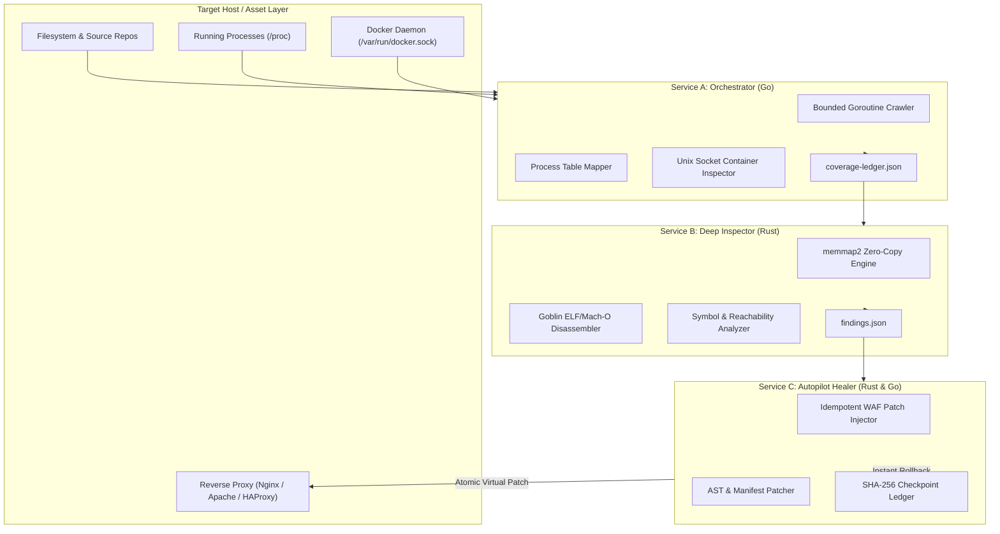

# Bug Killer (`bug-killer` / `bk`)
### Autonomous Vulnerability Discovery & Self-Healing Engine for Deep and Ghosty Bugs

[](https://github.com/imMamdouhaboammar/bug-killer/actions)
[](#polyglot-specialization-matrix)
[](#microservices-architecture)
[](LICENSE)
[](SECURITY.md)

> **"Let Your AI Find The Deep and Ghosty Bugs, Vulnerabilities, Security Issues and Heal From It — Tested & Verified."**

Bug Killer is an offline-first, polyglot defensive security system engineered to discover elusive runtime memory corruptions, verify reachability through static binary disassembly and kernel memory maps, execute atomic self-healing repairs, and guarantee bit-for-bit rollback.

Initial benchmark targets:
- **PHP2Shell (`CVE-2026-109618` & `CVE-2026-109619`):** Zend Engine allocator `longjmp` OOM heap corruption and persistent worker Use-After-Free.
- **Node2Shell (`CVE-2026-111497`):** Bundled Google Brotli decoder out-of-bounds memory write in `node:zlib`.

---

## Architecture & System Design



### Polyglot Specialization Matrix

| Service | Binary | Language | Core Competency & Justification |
|---|---|---|---|
| **Core CLI Engine** | `bug-killer` (`bk`) | **Rust (2024)** | Unified standalone scanner, AST patch planner, atomic transactional file mutator (`tempfile::persist`), and SHA-256 rollback manager. |
| **Service A: Orchestrator** | `bug-killer-orchestrator` | **Go (1.26)** | Concurrent filesystem inventory, Docker socket inspection, and packet analysis using libpcap. |
| **Service B: Deep Inspector** | `bug-killer-inspector` | **Rust (2024)** | Zero-copy memory mapping (`memmap2`) and binary disassembling (`goblin`) for ELF, Mach-O, and PE targets with compile-time memory safety. |
| **Service C: Autopilot Healer** | `bug-killer-healer` | **Go (1.26)** | Idempotent reverse proxy WAF rule injection (Nginx, HAProxy), package manager invocation (`apt`, `apk`, `dnf`), and systemd process supervision. |

---

## Core Product Invariants

Privileged file mutation requires an independently pinned operator signing key. See [Operator approval setup](docs/OPERATOR-APPROVAL.md) before attempting supervised remediation.

1. **Discover Broadly:** Inventory runtime binaries, shared libraries, container layers, and package manifests without premature filtering.
2. **Verify Carefully:** Version strings alone never constitute vulnerability proof; require verified symbol presence or mapped `/proc` memory evidence.
3. **Evidence-First Explanations:** Every finding cites exact byte offsets, symbol signatures (`BrotliDecoderContext`, `zend_hash_destroy`), or line-level configurations.
4. **Active Reachability Prioritization:** Differentiate inactive binaries on disk from active listening processes handling production traffic.
5. **Smallest Effective Repair:** Prefer virtual proxy guards (HTTP 415 on malicious Brotli streams) over sweeping destructive updates.
6. **Deterministic Policy Gating:** Strict enforcement of authorization levels (Level 0 Read-Only to Level 4 High-Risk).
7. **Zero-Loss Safety:** Calculate SHA-256 hashes and create atomic snapshots in `.aegis/backups/` before modifying any byte.
8. **Independent Post-Repair Verification:** Rerun active detectors after mutation; package manager exit code 0 is never accepted as proof of healing.
9. **Tamper-Evident Ledger:** Maintain cryptographically verifiable audit trails across all discovery and healing passes.
10. **Fail-Closed Operations:** Indeterminate evidence or health check regressions abort operations and demand operator intervention.

---

## Installation & Build

### Prerequisites
- Rust 1.99+ (`cargo`)
- Go 1.26.5+
- Make
- `protobuf-compiler` and `libpcap-dev` for Inspector and Orchestrator builds

### Local Compilation
```bash
git clone https://github.com/imMamdouhaboammar/bug-killer.git
cd bug-killer
make build
sudo make install
```

This compiles and installs:
- `/usr/local/bin/bug-killer` (and symlink `bk`)
- `/usr/local/bin/bug-killer-orchestrator`
- `/usr/local/bin/bug-killer-inspector`
- `/usr/local/bin/bug-killer-healer`

### Container Image Build
```bash
docker build -t bug-killer:latest .
```

To start the Orchestrator and Inspector with Compose on a Linux Docker host:

```bash
DOCKER_GID=$(stat -c '%g' /var/run/docker.sock) docker compose up --build
```

The operator must authorize access to the host filesystem and Docker daemon. Mounting `docker.sock` as `:ro` does **not** restrict the Docker API to read-only operations. Use only on trusted, explicitly approved hosts.

---

## CLI Reference

### 1. Standalone Core CLI (`bug-killer` / `bk`)

#### Interactive REPL Shell (`bk shell`)
```bash
# Launch interactive session for workspace
bk shell .

# Supported interactive commands inside the shell:
# bk [silly-kepler] (idle) > doctor
# bk [silly-kepler] (idle) > scan
# bk [silly-kepler] (⚠️ vuln:2) > findings
# bk [silly-kepler] (⚠️ vuln:2) > plan
# bk [silly-kepler] (⚠️ vuln:2) > diff
# bk [silly-kepler] (⚠️ vuln:2) > heal --dry-run
# bk [silly-kepler] (⚠️ vuln:2) > heal
# bk [silly-kepler] (✅ clean) > verify
# bk [silly-kepler] (✅ clean) > rollback <backup_id>
# bk [silly-kepler] (✅ clean) > exit
```

#### System & Runtime Environment Doctor (`bk doctor`)
```bash
# Audit host runtimes (Node.js, PHP), proxies (Nginx, HAProxy), Docker socket, and procfs
bk doctor .

# Machine-readable diagnostic JSON
bk doctor . --json
```

#### Live Surveillance & Continuous Watcher Engine (`bk watch`)
```bash
# Monitor directory for file modifications and trigger audits every 3 seconds
bk watch . --interval 3

# Continuous autonomous healing mode
bk watch /var/www --interval 5 --auto-heal
```

#### Shell Completions
```bash
# Generate shell autocompletion scripts
bk completion bash > ~/.local/share/bash-completion/completions/bk
bk completion zsh > ~/.zsh/completion/_bk
bk completion fish > ~/.config/fish/completions/bk.fish
```

#### Scan Directory or Repository
```bash
# Standard console audit
bk scan .

# Machine-readable JSON output
bk scan /var/www --json > audit-report.json

# Scan filesystem plus host PATH binaries (node, php)
bk scan . --check-runtime
```

#### Preview Remediation Plan (Dry-Run)
```bash
bk heal . --dry-run
```

#### Execute Live Atomic Healing
```bash
bk heal . --auto-apply
```

#### Revert Healing Session (Cryptographic Rollback)
```bash
# List all created backup snapshots
bk history

# Rollback to exact snapshot state
bk rollback 20261024_111448
```

#### CVE Technical Deep Dive
```bash
bk cve-info CVE-2026-109618
bk cve-info CVE-2026-111497
```

---

### 2. Shell Automation Utilities (`scripts/`)

| Script | Purpose | Execution |
|---|---|---|
| [`bk-shell.sh`](scripts/bk-shell.sh) | Interactive REPL launcher with terminal color setup | `./scripts/bk-shell.sh [dir]` |
| [`bk-triage.sh`](scripts/bk-triage.sh) | Automated 3-step rapid incident response triage (Doctor $\to$ Scan $\to$ Dry-run) | `./scripts/bk-triage.sh [dir]` |
| [`bk-watch.sh`](scripts/bk-watch.sh) | Background surveillance loop daemon wrapper | `./scripts/bk-watch.sh [dir] [interval] [--auto-heal]` |

---

### 3. Microservices Pipeline

```bash
# Step 1: Orchestrator maps target environment into structured ledger
./target/bug-killer-orchestrator -path /srv/apps -out /tmp/coverage-ledger.json

# Step 2: Inspector performs zero-copy binary disassembling & symbol audit
./target/bug-killer-inspector --ledger /tmp/coverage-ledger.json --out /tmp/findings.json

# Step 3: Healer injects virtual proxy mitigations & executes verified updates
./target/bug-killer-healer -findings /tmp/findings.json -nginx /etc/nginx/nginx.conf
```

---

## Verification & Quality Gates

```bash
$ make test

==> Running Rust Test Suites...
running 5 tests
test cve_db::tests::test_node_brotli_checks ... ok
test cve_db::tests::test_php_vulnerability_checks ... ok
test test_end_to_end_scan_and_heal_and_rollback ... ok
test result: ok. 5 passed; 0 failed; 0 ignored; finished in 0.04s

==> Running Go Test Suites...
=== RUN   TestFileCrawlerDiscovery
--- PASS: TestFileCrawlerDiscovery (0.00s)
=== RUN   TestWafInjectorNginxIdempotency
--- PASS: TestWafInjectorNginxIdempotency (0.00s)
=== RUN   TestWafInjectorHAProxy
--- PASS: TestWafInjectorHAProxy (0.00s)
PASS

$ make lint
==> Running Linters...
cargo clippy --workspace --all-targets -- -D warnings
cd services/inspector && cargo clippy --all-targets -- -D warnings
cd services/orchestrator && go vet ./...
cd services/healer && go vet ./...
```

---

## Licensing & Intellectual Property Terms

This project is licensed under the **Bug Killer Source-Available & Business Attribution License (Version 1.0)**.

### Summary of Rights and Restrictions

- **Forking and Development Permitted:** Anyone is free to fork, clone, inspect, modify, and contribute to this repository.
- **Mandatory Attribution Retention:** All forks and derivative works must prominently preserve the original copyright notice (`Copyright (c) 2026 Mamdouh Aboammar`) and author credits across all source files, documentation, UI, and packages. Removing original copyright notices is strictly forbidden.
- **Internal Business Use Permitted (Free of Charge):** Commercial enterprises and businesses are fully permitted to run and use Bug Killer internally to audit, protect, and heal their own company's systems, codebases, and servers at zero cost.
- **Commercial Paid Service / Resale Prohibited:** Offering Bug Killer or derivative works as a paid commercial product, hosted Software-as-a-Service (SaaS), Security-as-a-Service, or managed commercial security offering to third parties is strictly prohibited without prior explicit written authorization from Mamdouh Aboammar.

### ملخص ترخيص الاستخدام وحفظ الحقوق (Arabic Summary)

- **حفظ الحقوق الأصلية إلزامي:** يُسمح لأي مطور أو جهة بعمل Fork للريبو وتطويره مع وجوب الاحتفاظ الكامل بحقوق الملكية الفكرية الأصلية ونسبها إلى المطور الأساسي (`Mamdouh Aboammar`). يُحظر تماماً إزالة أو طمس الحقوق الأصلية من أي ملف أو واجهة.
- **الاستخدام التجاري الداخلي مسموح ومجاني:** يحق للشركات والمؤسسات استخدام الأداة داخلياً لفحص وحماية أنظمتها وخوادمها الخاصة دون دفع أي رسوم.
- **حظر إعادة البيع أو تقديمها كخدمة مدفوعة:** يُمنع منعاً باتاً استغلال هذه الأداة أو مشتقاتها تجارياً عن طريق إعادة بيعها أو تحويلها إلى خدمة سحابية مدفوعة (SaaS / Managed Security Service) للغير دون الحصول على تصريح وموافقة خطية مسبقة من صاحب الحقوق (`Mamdouh Aboammar`).

See [LICENSE](LICENSE) for the complete legal text.

---

## Security Policy

Bug Killer operates strictly as a defensive discovery and auto-remediation tool. It never packages, generates, or transmits weaponized exploits. See [SECURITY.md](SECURITY.md) for vulnerability disclosure procedures.
