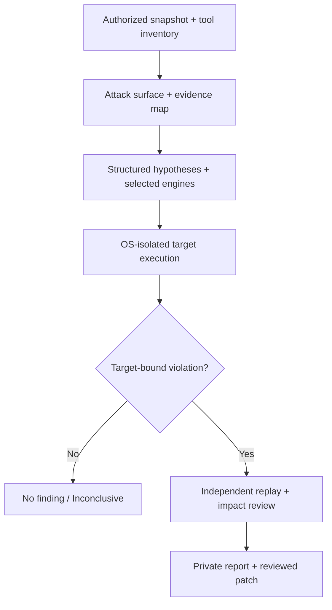

# Bug Killer: Verified Novel Vulnerability Discovery

> [!NOTE]
> **Historical Execution Archive (Tier 3):** This roadmap documents the historical transition to execution-backed verification from 2026-10-26. For active implementation and runtime architecture, consult the [Documentation Map](../docs/DOCUMENTATION_MAP.md) and [lat.md Knowledge Graph](../lat.md/architecture.md).

**Execution roadmap and source-grounded audit**  
**Prepared:** 2026-10-26  
**Repository:** https://github.com/imMamdouhaboammar/bug-killer  
**Inspected baseline:** `master` at `06b24f2d9328de4d55868519f59e8591afbe9781`  
**Status:** proposed implementation plan, not a statement that the research system is production-ready.  
**Scope:** authorized defensive testing of owned or explicitly approved local projects. No public exploit generation, unapproved target probing, arbitrary code execution from model text, automatic disclosure or unattended privileged remediation.

## 1. Executive decision

Bug Killer already contains substantial Rust/Go scanning, evidence, approval, and research-domain code. The next milestone is not a larger rules catalog. It is a **truthful research loop that can identify and independently reproduce a vulnerability in the actual target program**.

The currently wired `bk hunt` command is **not a valid security proof engine yet**. Its `AutonomousHunter` derives hypotheses from simple source-text heuristics, generates hardcoded inputs, tests a local synthetic predicate instead of executing the target, then replays that predicate three times and can promote the result to a signed `Verified` finding. Signing a receipt verifies its integrity, not the truth of its claim.

**Immediate release decision:** mark autonomous research output experimental/simulation-only; disable `Verified`, `NOVEL_RESEARCH`, severity promotion and private-vulnerability-report generation for simulated outcomes until independent target-bound proof exists. Preserve legitimate ordinary read-only scanners and their behavior.

### Product modes

| Mode | User job | Allowed evidence | Default |
| --- | --- | --- | --- |
| Quick / Prevent | Catch known vulnerabilities and coding pitfalls while building | Rules, dependency advisories, local structural signals, scoped coverage receipts | Enabled, read-only |
| Deep / Investigate | Assess reachability and correlate specialist tools | Tool-specific outputs, graph traces, optional approved network data | Opt-in, read-only |
| Research / Hunt | Find previously unreported vulnerability candidates in authorized software | Real target execution, independent reproduction, security impact and provenance | Explicit opt-in; restricted execution |

Discovery outcomes must be `HYPOTHESIS`, `ANOMALY`, `REPRODUCED_BEHAVIOR`, `VERIFIED_SECURITY_ISSUE`, or `INCONCLUSIVE`, with novelty tracked separately as `KNOWN`, `NOT_ESTABLISHED`, or `POTENTIALLY_UNREPORTED`. Never automatically equate `not in OSV` with `zero-day`.

## 2. Source-grounded current-state audit

| ID | Evidence from inspected `master` | Finding / effect | Priority |
| --- | --- | --- | --- |
| F-01 | [Latest CI run](https://github.com/imMamdouhaboammar/bug-killer/actions/runs/40375564187), [CI config](https://github.com/imMamdouhaboammar/bug-killer/blob/master/.github/workflows/ci.yml) | Rust quality gate failed at `cargo fmt --all -- --check` involving `src/scanner/mem_temp.rs` and `tests/mem_temp_test.rs`; Go passed; dependent E2E skipped. Do not call current master green. | P0 |
| F-02 | [`src/hunter/orchestrator.rs`](https://github.com/imMamdouhaboammar/bug-killer/blob/master/src/hunter/orchestrator.rs), [`tests/hunter_autonomous_test.rs`](https://github.com/imMamdouhaboammar/bug-killer/blob/master/tests/hunter_autonomous_test.rs) | `run_sandboxed_experiment()` feeds canned test bytes to a predicate that does not invoke target code; `verify_candidate_three_pass()` repeats the same synthetic checks. `hunt()` can produce `Verified` findings and disclosure packets. This is the top research-integrity defect. | P0 |
| F-03 | [`src/hunter/sandbox.rs`](https://github.com/imMamdouhaboammar/bug-killer/blob/master/src/hunter/sandbox.rs) | Proxy/TLS environment changes do not establish OS-level network isolation; raw sockets may bypass them. `run_closure()` runs inside the host process and evaluates its timeout only after return. `peak_memory_bytes` currently receives captured output size, not process RSS; `network_egress_prevented` is set true without a measured enforcement receipt. | P0 |
| F-04 | [`src/hunter/orchestrator.rs`](https://github.com/imMamdouhaboammar/bug-killer/blob/master/src/hunter/orchestrator.rs), [`src/hunter/novelty.rs`](https://github.com/imMamdouhaboammar/bug-killer/blob/master/src/hunter/novelty.rs) | Hunt calls novelty check with an empty known-advisories slice. The `NoveltyChecker` is limited to a local set and string/identifier comparisons. Absence of a match is not evidence of novelty. | P0 |
| F-05 | [`tests/fixtures/benchmark/benchmark_manifest.json`](https://github.com/imMamdouhaboammar/bug-killer/blob/master/tests/fixtures/benchmark/benchmark_manifest.json) | The checked benchmark corpus has **17 synthetic cases**, 9 labeled vulnerable, in Python and JavaScript only. It does not establish real-world precision, recall or novel discovery. | P1 |
| F-06 | [`src/scanner/node.rs`](https://github.com/imMamdouhaboammar/bug-killer/blob/master/src/scanner/node.rs) | A Brotli source-text regex can label a call `ConfirmedAffected` and `ConfirmedReachable` without checking the actual Node runtime version or execution reachability in that path. Calibrate confidence separately from pattern detection. | P1 |
| F-07 | [`src/deep`](https://github.com/imMamdouhaboammar/bug-killer/tree/master/src/deep), [`docs/solutions/curated-security-assets-integration.md`](https://github.com/imMamdouhaboammar/bug-killer/blob/master/docs/solutions/curated-security-assets-integration.md) | Broker, Semgrep, CodeQL, Joern, Nuclei and skill-catalog surfaces exist in various forms, but file presence, mock adapters and registry counts do not prove supported, installed, exercised detectors. Each tool needs real execution receipts. | P1 |
| F-08 | [`README.md`](https://github.com/imMamdouhaboammar/bug-killer/blob/master/README.md), [releases](https://github.com/imMamdouhaboammar/bug-killer/releases) | Read-only scan and supervised repair pathways are documented; no GitHub Release was returned during inspection. Distribution, platform coverage and external pilot evidence are incomplete. | P2 |

Repository tree snapshot contained approximately 5,680 tracked files and 40 MB of blobs, dominated by catalog/rule/skill assets. **Asset count is not executed security coverage.** Existing Rust/Go tests and a previously green CI run are real engineering work, but they are orthogonal to research validity.

### What to keep, not rebuild

- Keep `FleetScanner`, structural analysis, OSV/advisory foundations and existing approved remediation flows.
- Keep versioned Finding/Coverage/ToolReceipt contracts; extend their provenance requirements.
- Keep `AutonomousHunter` as a coordinator interface, but replace synthetic proof logic with target-bound experiments.
- Keep `DifferentialFuzzer` for bounded properties and regression tests; prefer mature native fuzzers for deep runtime discovery.
- Keep `NovelResearchReceipt` only after separating host-observed evidence from model-authored hypotheses.
- Reuse the existing [Ultimate Spec v1.1](https://github.com/imMamdouhaboammar/bug-killer/tree/master/bug-killer-ultimate-spec-v1), particularly Sections 05, 06, 10, 11 and 14. This roadmap supersedes stale descriptions of features that landed after 2026-10-25.

## 3. Narrow first target

**Release R1:** Node.js/TypeScript web APIs and app backends on local test builds (Express and a validated Next.js route subset). Add Python/FastAPI as R1.1 after measured success, followed by native parser/memory safety research as R2.

Reason: target relevance to vibe-coded apps, deterministic authentication/authorization test fixtures, available application test runners, and a small enough scope to measure honest coverage. Do not attempt universal language and bug-class support in the first release.

**First invariant families:** (a) cross-user / cross-tenant authorization and protected mutation; (b) untrusted input reaching sensitive operations; (c) parser and deserializer contracts in locally executable code. Classify missing guards as hypotheses, never confirmed findings.

**R1 success is not a guaranteed zero-day.** Success is an external, target-bound security issue discovered without intentionally seeding it in the hunt invocation, reproduced independently, with exact source snapshot, impact explanation, a non-weaponized regression and an approved private handoff. Novelty remains a qualified human-reviewed assessment.

## 4. Trusted research execution contract

### Hypothesis record (proposed v1)

Required fields: `hypothesis_id`, `target_snapshot_sha256`, `asset_id`, `language`, `framework`, `entrypoint`, `boundary`, `invariant`, `experiment_adapter`, `preconditions`, `execution_budget`, `permissions`, `source_evidence`, `model_or_rule_provenance`, `verification_requirements`.

No LLM-authored shell command is a permissible executable tool instruction. The model may select only typed, host-allowlisted actions. A code comment, dependency manifest or tool result cannot alter permissions.

### Experiment receipt (proposed v1)

Required fields: `host_run_id`, `target_snapshot_sha256`, `build_digest`, `harness_digest`, `tool_name/version/binary_digest`, `real_execution=true`, `sandbox_policy_digest`, `isolation_mechanism`, `network_state`, `time/CPU/RSS/pid limits`, `exit_status`, `coverage`, `input_digest`, `observed_behavior`, `logs_artifact_digest`, `repeatable_command_template`, `privacy_class`, `status`.

`real_execution` is host-attested, never model-provided. `SIMULATED`, `NOT_RUN`, `UNSUPPORTED`, `BLOCKED`, `TIMEOUT`, `ERROR` cannot transition to `VERIFIED_SECURITY_ISSUE`. A signed report from an inaccurate recorder is still inaccurate.

### Verification and novelty

1. Rebuild exact authorized target snapshot in a fresh isolated environment.
2. Replay minimized benign test input against the real program, not the discovery oracle.
3. Establish security consequence through approved negative/positive controls and, when relevant, unaffected version comparison.
4. Use an independent test method or independent reviewer for the final verification; three repetitions of one predicate do not qualify as three independent proofs.
5. Check OSV, GHSA, CVE, upstream advisories, fixed commits and maintainer context through approved sources with recorded timestamps. Unknown results remain unresolved.
6. Prepare a private, redacted report; require explicit user approval for reporting and fixes.

## 5. Ordered PR implementation cards

Each card is **one independently reviewable PR** with its own issue, base-commit snapshot, failing tests before implementation, an explicit rollback/feature flag, source-linked test evidence and CI success. No artificial commit quotas. Do not merge a failing PR merely because another job passed.

| Sequence | PR / issue title | Main files/modules | Acceptance gate | Dependencies |
| --- | --- | --- | --- | --- |
| **BK-ND-00** | Restore current CI baseline | `src/scanner/mem_temp.rs`, related test, CI | `cargo fmt`, clippy, workspace tests, Go checks and dependent E2E all pass on latest master; no behavior regression from formatting | None |
| **BK-ND-01** | Quarantine simulated research proof | `src/hunter/orchestrator.rs`, `src/hunter/hypothesis.rs`, `src/main.rs`, tests | Simulated experiments **cannot** yield `Verified`, `NOVEL_RESEARCH`, a High/Critical security finding or private disclosure draft; outputs are `SIMULATION_ONLY` / hypothesis with honest coverage | 00 |
| **BK-ND-02** | OS-backed research sandbox | `src/hunter/sandbox.rs`, execution host, adversarial tests | Direct-socket egress denied; writes outside allowed directory denied; CPU/RSS/PID ceilings enforced; full process tree terminated; unsupported host blocks; receipts report measured enforcement truthfully | 01 |
| **BK-ND-03** | Immutable target snapshot and research scope | `src/engine`, new research protocol, `src/hunter` | Outside-root and symlink escapes denied; source snapshot and tool binary pinned; project owner opts in; incomplete inventory marked partial; inputs cannot alter allowed scope | 02 |
| **BK-ND-04** | Real tool broker and execution ledger | `src/deep/broker.rs`, adapter contracts, `src/engine` | At least two actual installed tools exercised in CI/pinned environment; missing tools produce `NOT_RUN`; no mock result passes as real; timeout/cancel child process cleanup proven | 03 |
| **BK-ND-05** | Node/TS attack-surface map with honest confidence | `src/hunter/orchestrator.rs`, AST/dataflow, framework adapters | Route/middleware/auth context traced across files on pinned examples; comments and name-only matches do not certify auth; unsupported routing is recorded | 03 |
| **BK-ND-06** | Target-bound authz test harness | New research harness adapter and local API fixtures | Harness builds/starts the actual authorized app, uses synthetic users/tenants, asserts response+state invariants, creates only local traffic, stores replay evidence; deliberate decoy safe cases remain unverified | 04,05 |
| **BK-ND-07** | LLM hypothesis planner with bounded structured tools | `src/agent`, `src/hunter`, host policy | Structured hypotheses derive from code facts; LLM cannot rewrite oracle, invent executed coverage, authorize cloud source export or choose arbitrary commands/targets; deterministic fallback works offline | 05,06 |
| **BK-ND-08** | Independent replay and security consequence gate | `src/hunter`, `src/disclosure`, evidence schemas | Fresh process/snapshot required; artifact plus actual negative/positive controls recorded; no `Verified` from a crash or string match alone; tampered/partial receipts rejected | 06,07 |
| **BK-ND-09** | Novelty triage and private disclosure | `src/advisory`, `src/hunter/novelty.rs`, `src/disclosure` | No empty-advisory lookup passes as proven novel; duplicate known issues classified; unresolved aliases remain uncertain; zero external reports without explicit permission | 08 |
| **BK-ND-10** | Blind evaluation and differential baseline | `src/benchmark`, hidden corpus, scripts, CI | Published counts with TP/FP/FN/TN, recall/precision/FPR, CIs, runtime and cost; compare composed Bug Killer against component tools on same pinned dataset; no fake all-green from mocks | 06,08 |
| **BK-ND-11** | External pilot and experimental release | release scripts, docs, public CLI | 5–10 authorized pilot repos, documented supported/unsupported platforms, evidence from independent reviewers, no unverified disclosures, signed reproducible artifacts; explicit beta disclaimer | 09,10 |

### Immediate batch: BK-ND-00 to BK-ND-03

1. Capture current failing CI run and fix the exact formatting mismatch with no unrelated rewrite.
2. Add a red test: a route that is never executed must never produce a `Verified` research finding. Confirm red on current master.
3. Change simulated research results to `HYPOTHESIS` or `SIMULATION_ONLY`, preserve CLI compatibility, and show green verification.
4. Add negative sandbox tests for direct socket access, memory allocation, process descendants, host path writes and local secrets; build OS-backed isolation with fail-closed platform detection.
5. Pin source snapshots and enforce an allowlisted local target before activating real research adapters.

### Next batch: BK-ND-04 to BK-ND-08

Focus on a single, real Node/TS harness. The verifier must evaluate a property of **the target app** such as cross-tenant access denial, not an invented function that says a magic string is a bug. Run two safe control cases: one designed to be vulnerable, one safe; then on independent projects where the ground truth was not authored by the detector team. Confirm that the first two establish harness correctness, not zero-day ability.

### Research extension after first gated pilot

Connect `cargo-fuzz`/libFuzzer, AFL++/Sanitizers or language-native fuzz tools through existing-tool adapters when the target is eligible; add grammar seeds, coverage introspection and crash minimization. Do not recreate a general-purpose fuzzer. Use [OSS-Fuzz](https://google.github.io/oss-fuzz/), [Fuzz Introspector](https://google.github.io/oss-fuzz/advanced-topics/fuzz-introspector/) and [oss-fuzz-gen](https://github.com/google/oss-fuzz-gen) as first-party engineering references, respecting license and supported targets.

## 6. Evaluation program and release gates

### Corpora

- **Contract corpus:** current 17 synthetic cases plus explicit negative assertions for simulated proof, missing tools, authz bypass-shaped false positives, harmless parser failures and partial reports.
- **Open standard corpus:** selected reproducible subsets of [OWASP Benchmark](https://owasp.org/www-project-benchmark/) and [NIST SARD](https://samate.nist.gov/SARD/), recording label provenance and platform fit.
- **Holdout corpus:** independent maintainers prepare genuine vulnerable and safe neighboring versions of real projects; sealed labels, pinned snapshots and no prompt or test-set access during detector development.
- **Pilot corpus:** explicit user permission for each real repository, with private finding storage and a redaction/disclosure process.

### Quantitative metrics (publish denominators)

- Detection: TP, FP, FN, TN, recall, precision, FPR, coverage status and unsupported share by CWE/language/engine.
- Research: unique target-executed anomalies, unique reproduced behaviors, independently verified security issues, unresolved novelty candidates, findings per CPU-hour, cost per independently verified issue, and clean replay rate.
- Isolation: attempted/denied raw-socket egress, external path writes, descendant process escape, timeout and memory ceiling violations; fail-closed platform coverage.
- UX: clean install rate, supported-platform test rate, median time to first report, false-alarm burden per project.

**Non-negotiable release gates:**

1. No simulation-only or mock execution produces confirmed findings, disclosure packets, or security claims.
2. Zero known containment failures on the selected experimental runner platform; if containment cannot be attested, research execution blocks.
3. Independently reproduced results are supported by exact target snapshot and observed behavior; incomplete verification cannot become `Verified`.
4. No public zero-day claim without independent human assessment and coordinated disclosure approval.
5. Benchmarks include clean neighbors and holdouts; targets for recall and precision are chosen after a measured baseline, never invented retroactively.
6. Rust/Go/inspector checks, actual adapter integration, reproducible release builds and relevant privacy/license checks pass for the shipped scope.

Passing CI means *the implementation is internally consistent*. Passing independent evaluation means *the detection claim has evidence*. These are different gates.

## 7. Delivery sequence and time estimates

| Window | Expected output | What it does **not** promise |
| --- | --- | --- |
| Week 1 | Green baseline, simulation-proof quarantine, scope contract | No novel security findings |
| Weeks 2–3 | Hardened and tested isolated runner, signed truthful receipts | No universal sandbox on every OS |
| Weeks 4–6 | First Node/TS target-bound harness, tool broker, attack-surface evidence | No universal web app coverage |
| Weeks 7–9 | Structured hypothesis planner, independent replay, novelty review | No guaranteed zero-day |
| Weeks 10–12 | Holdout results, pilot data, experimental release decision | No production-grade certification without evidence |

These are **planning estimates**, assuming at least a Rust/platform security engineer, an AppSec/test engineer and independent security review capacity. A single maintainer may need substantially longer. A validated zero-day discovery cannot be scheduled.

## 8. Governance, rollback and safety

- Preserve existing authorized Quick scanning. Research cannot start from ordinary pre-commit, `bk init`, or a coding agent by default.
- Require explicit authorized target path, source export policy, maximum runtime/CPU/RAM/concurrency budget, sandbox identity and an isolated scratch workspace.
- Never execute arbitrary LLM-authored commands or untrusted repository instructions. Use typed allowlisted adapters and immutable plans.
- No external production probes, live credentials, weaponized payloads, privilege escalation, persistence, lateral movement or automatic vulnerability publication.
- No broad auto-heal while research mode is experimental; remediation must retain signed operator approval, independent verification and rollback.
- A failed isolation precondition must yield `BLOCKED`, not a degraded claim of successful sandboxing.
- Each PR has a kill switch. Research mode remains disabled or simulation-only until the gate is passed. On runtime errors, retain sanitized evidence and refuse confirmed labels.
- Review large ingested rule/skill datasets for provenance and license; don't assume a data file is an executable engine or a validated rule.

## 9. Agent execution brief (copy into the repository issue or coding agent)

> Implement **BK-ND-00 first** against the latest `master`. Do not start a general refactor. Inspect the current CI run and repository instructions; reproduce the failed Rust quality gate; fix only the format failures; verify Rust fmt, clippy, tests, Go tests/vet and full E2E; open one PR with evidence and wait for review. Next implement **BK-ND-01** in a separate PR using red/green tests that demonstrate `AutonomousHunter::hunt` currently produces `Verified` results without running target code. Preserve reporting compatibility while preventing synthetic test outcomes from becoming confirmed security findings or private disclosure packets. Demonstrate the failing old test, the passing new test and negative controls. Then proceed to **BK-ND-02** for OS-level sandbox containment with actual raw-socket, process, memory and filesystem negative tests. Do not mark a feature done based on mocks, comments, counts, receipts or a green CI alone. No unauthorized targets, no public exploit generation, no agent-created permissions, no external disclosure. One issue, one PR, minimal coherent commits, documented limitations, and independent review for each gate. Stop for genuine permission or environment blockers.

## 10. Source references and audit limitations

Project evidence: [README](https://github.com/imMamdouhaboammar/bug-killer/blob/master/README.md), [AGENTS.md](https://github.com/imMamdouhaboammar/bug-killer/blob/master/AGENTS.md), [M5 research spec](https://github.com/imMamdouhaboammar/bug-killer/blob/master/bug-killer-ultimate-spec-v1/05-NOVEL-VULNERABILITY-HUNTER.md), [Implementation plan](https://github.com/imMamdouhaboammar/bug-killer/blob/master/bug-killer-ultimate-spec-v1/10-IMPLEMENTATION-PLAN.md), [Testing and release](https://github.com/imMamdouhaboammar/bug-killer/blob/master/bug-killer-ultimate-spec-v1/11-TESTING-BENCHMARKS-AND-RELEASE.md), [AutonomousHunter](https://github.com/imMamdouhaboammar/bug-killer/blob/master/src/hunter/orchestrator.rs), [Sandbox](https://github.com/imMamdouhaboammar/bug-killer/blob/master/src/hunter/sandbox.rs), [CI run](https://github.com/imMamdouhaboammar/bug-killer/actions/runs/40375564187).

Research precedents: [Google Project Zero Big Sleep](https://projectzero.google/2024/10/from-naptime-to-big-sleep.html), [Google OSS-Fuzz AI target generation](https://security.googleblog.com/2024/11/leveling-up-fuzzing-finding-more.html), [DARPA AIxCC results](https://www.darpa.mil/news/2025/aixcc-results), [Anthropic CVD ledger](https://red.anthropic.com/2026/cvd/).

This is a source audit and execution plan, not a local runtime penetration test. No Rust toolchain was available in the planning workspace, so the maintainer's CI logs and source inspections support current-state statements. Recheck commit SHA, issues, PRs, CI and build flags before each implementation card.
