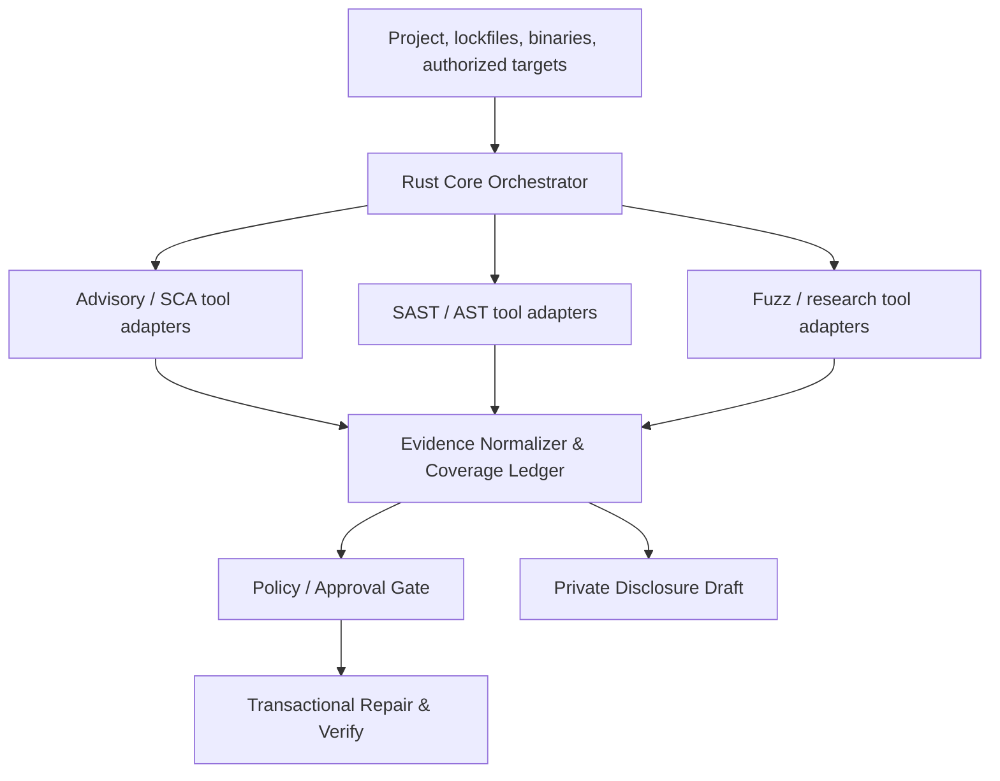

# 02. Target architecture and architectural decisions

## Topology

The following are **logical desks**, not instructions to implement a new analyzer per desk. See [Section 14](14-AGENTIC-SECURITY-OPERATIONS-ROOM.md) for the orchestrator-first plan, execution broker and mature-tool roster.

## Major components

### Rust Orchestrator

Stable entry point for CLI, MCP, CI and agent integrations. Owns target resolution, work quotas, task scheduling, cancellation, scanned artifact hashes, normalized result production, and aggregation. Default read-only. System-access work is delegated only under a constrained authorization token.

**Primary implementation rule:** orchestrate already proven external engines when available, eligible and measured. Native Rust is the trust/control plane. Any proposed native detector beyond existing code requires a documented gap and comparative benchmark; registry membership alone does not make an external engine approved or usable.

### Workspace Inventory / SBOM

Provides canonical project roots, Git snapshot ID, resolved package identities (PURL, ecosystem, normalized versions), transitive dependencies, lockfile provenance, selected runtime packages and coverage exclusions. Inventory errors are emitted as typed incomplete records, not empty success.

### Analysis Adapter Registry

Each engine advertises immutable metadata: engine ID/version, capabilities, languages, supported evidence level, local dependencies, required permission classes, deterministic or experimental flags, and output schema. Engine runs receive read-only snapshot inputs or scoped sandbox mounts and output normalized evidence. Dynamic engine-provided text is untrusted.

The **Capability Broker** verifies the actual installed engine, digest, health, platform, entitlement, license and data-sharing requirements before scheduling. A **Planner** chooses complementary tools by check/target applicability, benchmarked independence, cost and coverage. An **Execution Supervisor** owns timeout, isolation and cancellation. Each attempt, including `NOT_RUN` or `BLOCKED`, produces a host-authored `ToolExecutionReceipt v1`. See `schemas/tool-capability.schema.json` and `schemas/tool-execution-receipt.schema.json`. See Section 14 for required fields and mandatory-vs-optional tool fallback semantics.

### Fast Structural Analysis

Embedded Tree-sitter grammars with ast-grep structural search/rewrite for selected languages. Cache keyed by source hash, grammar version, pattern pack version and mode. Fall back to explicitly labelled text patterns when a grammar is unavailable; do not silently imply semantic completeness.

### Deep Dataflow Analysis

Optional Joern sidecar in a bounded worker process with network denied by default. Import code, request CPG/dataflow queries, receive trace edges and coverage metadata. Compiler-specific frontends or Babel may supplement language precision. CodeQL is a separately licensed optional adapter, not the default engine.

### Known Vulnerability Intelligence

Existing OSV client evolves to advisory normalizer, immutable feed snapshot, package/version matcher, direct/transitive SBOM correlation and optional patch fingerprint matcher.

### Research Runner

Bounded hypothesis queue, isolated ephemeral workspace, reproducible build/test/fuzz jobs, crash triage and deduplication. No host mutation or unapproved remote network. Hypotheses are not findings until independently checked.

### Verification + Policy

Consumes normalized findings, actual rule-target coverage receipts and test artifacts. Prevents privileged apply when evidence or authorization is insufficient. Produces stable exit codes and audit records. Existing Go and Rust services use one named trust policy via adapters, not implicit trust in each other's local private keys.

## Contracts and lifecycle

- `Finding v1`: schema in `schemas/finding.schema.json`. Unknown novel candidate must be explicit and cannot have `CONFIRMED` without reproducible proof.
- `CoverageReceipt v1`: `schemas/coverage-receipt.schema.json`, unique per actual check and target.
- `RepairPlan v1`: `schemas/repair-plan.schema.json`, with exact preimage digests and authorizations.
- `AnalysisRequest/AnalysisResult v1`: `schemas/analysis-request.schema.json` and `schemas/analysis-response.schema.json`, stable sidecar adapter boundary.
- `ResearchCandidate` example: `examples/research-candidate.json`.
- `ToolCapability v1`: `schemas/tool-capability.schema.json`, discoverable but not a claim of execution.
- `ToolExecutionReceipt v1`: `schemas/tool-execution-receipt.schema.json`, one per attempted/skipped invocation, separate from per-rule-target `CoverageReceipt`.
- All records carry `schema_version`, `run_id`, source snapshot hash, engine ID/version and UTC timestamps. Prefer canonical JSON serialization for signed receipts; ignore presentation order for semantic comparisons.
- Use bounded queues and cancellation; a timed-out engine reports `PARTIAL` or `ERROR`, never "clean".

### Adapter request and response boundary

The proposed host protocol is length-bounded JSON over isolated stdio or a local authenticated socket. The Rust orchestrator constructs an immutable analysis request with:

- a source snapshot digest and opaque read-only mount/ref resolved by the host;
- engine-specific checks to run, not executable user strings;
- a validated profile and resource budget;
- explicit network/privilege policy and an authorization reference only if required;
- deterministic run ID plus cancellation token held by the host.

The sidecar responds with a schema-versioned envelope containing findings, **actual** coverage receipts, outcome, resource usage, source snapshot echo, engine version and sanitized diagnostics. The host rejects mismatched run ID, wrong snapshot, invalid findings, duplicate receipt IDs, malformed JSON, unexpectedly huge output and missing required checks. It independently enforces timeout/kill and cannot delegate privileges based on its own response.

The adapter transport is an internal implementation detail; no external plugin is permitted to bind arbitrary host network interfaces by default.

## Architecture decision records

| ADR | Status | Decision | Rationale and reversal trigger |
|---|---|---|---|
| ADR-001 | ACCEPTED | Rust Core remains authoritative | Preserves existing CLI/MCP/healer integration; revisit only with demonstrated blocking performance issue |
| ADR-002 | ACCEPTED | Tree-sitter + ast-grep for fast structural checks | No bespoke parser; native integration and rule rewriting; downgrade when grammar or precision proves inadequate |
| ADR-003 | ACCEPTED | Joern optional deep CPG sidecar | Dataflow capability without mandatory JVM; keep a generic adapter boundary if empirical results disappoint |
| ADR-004 | ACCEPTED | Semgrep CE as external adapter, not vendor-copied core | Complementary rule ecosystem; LGPL compliance and interfile limitations |
| ADR-005 | ACCEPTED | CodeQL optional/license gated | Separate engine licensing; never silently bundle with private-source distribution |
| ADR-006 | ACCEPTED | Babel only for JS/TS rich AST and rewriting | JS-specific precision; avoid Node runtime as universal dependency |
| ADR-007 | ACCEPTED | LLM proposes hypotheses, never certifies findings | Security assertions require reproducible evidence |
| ADR-008 | ACCEPTED | Authorization and agent signing identity are separate roots | Compromised agent key cannot manufacture operator approval |
| ADR-009 | ACCEPTED | Local-first, offline quick path | Developer usability, privacy, repeatability |
| ADR-010 | ACCEPTED | No automatic public novelty disclosure | Responsible coordination and false-positive protection |
| ADR-011 | PROPOSED | Versioned JSON/SARIF import/export | Backward compatibility and integration; confirm target SARIF version in spike |
| ADR-012 | PROPOSED | Source hash and engine version keyed caching | Incremental performance, invalidation required |
| ADR-013 | ACCEPTED | **Orchestration-first security operations room** | Connect measurable mature engines; build narrowly scoped adapters/controls before inventing detection algorithms; Section 14 |
| ADR-014 | PROPOSED | Tool capability, health and license preflight | Installed, suitable, licensed and available are distinct states; block missing mandatory capability |
| ADR-015 | PROPOSED | Host-issued per-tool execution receipt and correlated evidence | Tool output is untrusted; preserve raw provenance, independence and conflicting outcomes |
| ADR-016 | PROPOSED | Immutable security task plans and resource/cost budgets | Agent proposes, operator approves privileged scope, supervisor enforces execution |

## Deployment profiles

| Profile | Dependencies | Default rights | Network |
|---|---|---|---|
| Local Quick | Rust binary and bundled grammars | Workspace read; no mutation | Off |
| Local Project | Above plus pinned feed cache | Workspace read | Feed refresh opt-in |
| CI | Pinned binary/ruleset and isolated project checkout | Read; exit policy | Configured only |
| Deep | Optional Joern/Semgrep/Babel/CodeQL adapters | Explicit sandbox grants | Denied unless target scoped |
| Research | Ephemeral containment, test/fuzz engines | Copy-on-write workspace | Denied except explicit test endpoint |
| Privileged Repair | Approved scoped mutator | Exact granted paths/operations | Only relevant approved operations |

## Isolation invariants

1. Source code, advisories, plugin results and discovered markdown are data, not policy or agent commands.
2. No engine adapter receives ambient Docker socket or host root by default.
3. No restore crosses the authorization root even when a signed manifest says otherwise.
4. Redirect/DNS target validation is repeated at the actual connection boundary.
5. Local import of upstream dependencies does not imply authorization to probe their external services.
6. A successful optional engine may add evidence; a failed mandatory one cannot be ignored when computing overall assurance.
7. No engine is auto-downloaded, given vendor credentials, allowed to upload private code or treated as an approved repairer from a repository-supplied manifest.
8. Plan, receipt and engine-output provenance are independently generated or verified by the host; an external tool cannot assert its own eligibility or operator permission.

## Compatibility migration

Maintain current `security scan` and `security fix` entry points. Add `--engine` and `--profile` only in a non-breaking way. Introduce schema adapters before changing `src/types.rs` serialization. Gate experimental novel hunting behind a feature and explicit opt-in until sandbox, memory bounds and evidence contracts pass end-to-end tests.
