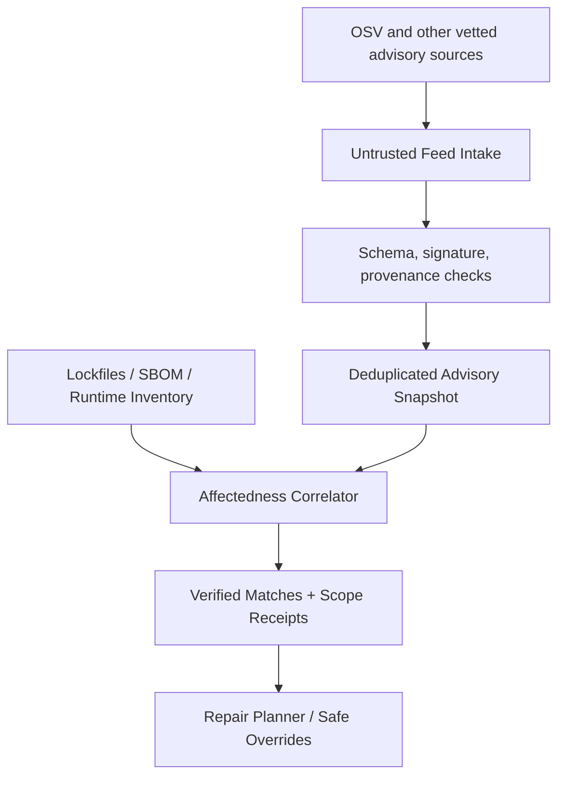

# 03. Known Vulnerability Intelligence: CVE/GHSA/OSV response

## Goal and boundaries

Identify the user's actual installed/vendored/executed software artifacts affected by publicly disclosed vulnerabilities, generate actionable repair plans, then independently verify the affectedness and fix. Advisory ingestion is not permission to execute an advisory's PoC, fetch arbitrary URLs from it, or scan upstream infrastructure.

This is an **orchestrated response workflow**, not a request to build every inventory or SCA scanner. Reuse existing OSV code and evaluate mature OSV-Scanner/Trivy/SBOM providers where they supply measurable distinct coverage; normalize their advisory/feed lineage and prevent duplicate results from becoming two independent confirmations. See Sections 09 and 14.

## Feed ingestion architecture



### Source-of-truth strategy

1. Start with the existing OSV client (`src/osv/mod.rs`), OSV API, and GitHub Advisory Database. Use a source identifier and immutable retrieval timestamp.
2. Treat CVE IDs, GHSA IDs, OSV IDs, related CWEs and vendor advisory IDs as aliases linked to a canonical internal advisory entity, **not interchangeable vulnerability types**.
3. Record publication time vs last-modified time; deduplicate updates and withdrawn/rejected records.
4. Prefer official structured affected version/commit ranges, patched release and source commit evidence over prose-derived estimates.
5. Cache normalized inputs with content digests. Offline scans report advisory snapshot age; CI can demand a freshness threshold.
6. External network access is opt-in and endpoint allowlisted for feeds; defend fetches against redirects, embedded URLs, archives, oversized bodies and poisoned TLS endpoints.
7. Never execute downloaded advisory code, installers or "example exploit" commands. Advisory content is untrusted data.

OSV API reference: https://google.github.io/osv.dev/api/  
OSV schema/quality guidance: https://google.github.io/osv.dev/data_quality.html  
GitHub Advisories: https://docs.github.com/en/code-security/concepts/vulnerability-reporting-and-management/repository-security-advisories

### Feed record (internal contract, PROPOSED)

```json
{
  "schema_version": "1.0",
  "advisory_id": "osv:OSV-EXAMPLE-001",
  "aliases": ["CVE-YYYY-NNNN", "GHSA-EXAMPLE"],
  "source": {"provider": "OSV", "url": "https://osv.dev", "retrieved_at": "2026-10-25T00:00:00Z"},
  "source_sha256": "<sha256>",
  "published_at": null,
  "modified_at": null,
  "withdrawn_at": null,
  "affected": [{"purl": "pkg:npm/example", "ecosystem": "npm", "ranges": [], "fixed_versions": []}],
  "references": [],
  "status": "ACTIVE"
}
```

Use validated IDs only and normalized canonical versions. `affected_range_status = KNOWN | UNKNOWN_RANGE` is a separate field, not an affectedness classification. `UNKNOWN_RANGE` requires `INCONCLUSIVE` unless another authoritative source establishes affectedness. The example above is schematic and does not claim a real vulnerability.

## Inventory / SBOM

### Required inventory sources

- npm: package-lock, pnpm lock, yarn lock and declared package metadata.
- Python: resolved lockfiles/installed distributions where available; requirement ranges alone are not an exact resolved build.
- Rust: Cargo.lock and actual feature selection when known.
- Go: go.mod/go.sum and module graph or resolved build information.
- PHP: composer.lock and installed package manifest.
- Additional: container base image digest/packages, OS packages, vendored sources, binary runtime identity and generated SBOMs when compatible.

### Package identity

`PackageIdentity = { ecosystem, name, resolved_version?, commit?, purl?, origin?, direct?, path?, source_digest?, resolution_kind }`

Resolution kinds: `LOCKED_EXACT`, `INSTALLED_EXACT`, `GIT_COMMIT`, `DECLARED_RANGE`, `UNKNOWN`. Only exact version/commit identities can yield high-confidence version-based matches. Transitive graph edges retain originating manifest and scope (dev/test/prod), but "dev dependency" does not automatically mean zero impact.

### Coverage

Each manifest, lockfile, SBOM and runtime probe emits separate receipts with discovered package count, unresolved count, parser failures, excluded branches, version ambiguity, active feature flags where determinable, and fetch freshness.

If package inventory is partial, the scan cannot report complete supply chain assessment.

## Affectedness correlation

### Classification states

1. `NOT_PRESENT`: dependency/package not found **and the relevant ecosystem/target inventory is complete**. Partial or failed inventory must yield `INCONCLUSIVE`, even if no match was seen.
2. `VERSION_AFFECTED`: exact package version/commit falls in an authoritative affected range.
3. `REACHABILITY_SUSPECTED`: affected version plus a plausible call/reference path, not proof.
4. `REACHABILITY_CONFIRMED`: deterministic source/runtime evidence reaches the vulnerable function/behavior under test.
5. `NOT_AFFECTED`: evidence conclusively excludes affected range or behavior under the specified scope.
6. `INCONCLUSIVE`: missing lockfile, ambiguous version, unsupported ecosystem, unavailable code or incomplete scan.

Affectedness evidence hierarchy:

`Verified package identity < exact range match < code reachability trace < isolated behavior reproduction`.

No claim of exploitability from version match alone. Store sanitized advisory URL as provenance, not as active instructions.

## "Trending" vulnerability handling

Polling cadence is configurable (e.g. 6–24 hours) with ETag/last-modified, backoff, and signed cached snapshots. New/changed advisories enqueue **re-evaluation of impacted package identities**, not blind rescan of every project or automatic upgrade of all dependencies. Dedup by source ID, alias graph and content fingerprint. Alert priority considers public advisory severity, dependency scope, environment reachability, actual usage and user policy.

An advisory can have no known fix: return mitigation, test, isolation or compensating control advice; never invent a safe package version.

## Repair

1. Select exact affected inventory item; require tested patched version or bounded source patch.
2. Calculate dependency solver impact and lockfile delta; produce a reviewable graph of version changes.
3. Prefer smallest compatible update; reject forced broad system/package upgrades by default.
4. Generate a risk explanation: breaking change, API incompatibility, transitive churn, license implications.
5. Preview, request approval appropriate to risk, apply on isolated branch or copy-on-write workspace.
6. Compile/build, run relevant tests, re-resolve dependency graph, re-query the advisory snapshot, rerun impacted checks.
7. Record fixed/failed/partial and rollback artifacts truthfully. No "fixed" state if verification did not run.

## Negative tests / acceptance

- Same advisory imported under OSV/CVE/GHSA aliases yields one canonical finding and preserves provenance.
- npm/PHP/Rust/Go transitive exact fixture matches affected ranges, a patched neighbor and a non-affected neighbor.
- Declared requirement without lockfile yields `INCONCLUSIVE` rather than a fake exact version.
- Yanked/withdrawn advisory updates remove active failure status while keeping history.
- Malicious advisory URL/redirection never results in unscoped fetch, command execution or secret exposure.
- Offline cache returns `NOT_RUN` or `PARTIAL` for freshness-required profile after TTL expiry.
- A repair that upgrades the direct dependency but leaves a transitive vulnerable copy is **not** verified fixed.
- Benchmarks cover resolver edge cases, SemVer prerelease, ecosystem-specific version ordering, backports and fixed commits.

## Implementation seam

Extend `OsvClient` through an `AdvisoryProvider` interface and a separate `AffectednessCorrelator`. Do not couple provider HTTP response structures directly to the user-facing Finding JSON. Enable offline synthetic feed fixtures and injected HTTP clients; never rely on live public OSV for red/green tests.
