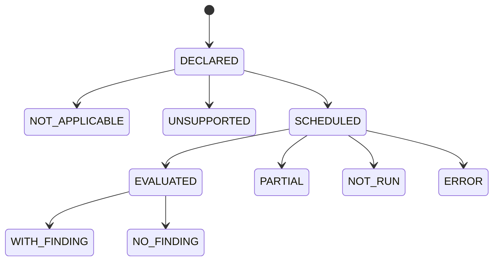

# 04. Catalog Guard: structural parsing, taint, and 373-rule semantics

## Design goal

Treat the 373 existing catalog rules as a requirement set; evaluate applicable rules against actual targets with typed receipts. Improve analysis incrementally through Tree-sitter, ast-grep and optional deep flows, while preserving fast developer checks.

**Selection preference:** map each catalog requirement to a proven installed analyzer and verified ruleset first, where applicable; keep native checks for existing compatibility, speed or demonstrated uncovered behavior. The catalog is a weakness taxonomy and expected-work ledger, **not a reason to reinvent hundreds of mature SAST rules**. Use the capability/coverage distinction from Sections 06 and 14; compare actual rule lineage before claiming independent corroboration.

## Engine selection

1. **Tree-sitter**: AST/CST extraction, language grammar errors and incremental parse cache; the parser alone does not prove dataflow, reachability or security properties.
2. **ast-grep**: deterministic structural search and scoped codemods; use for syntactic patterns and bounded fixes.
3. **Native Rust heuristics**: permitted only with explicit `PATTERN_INDICATOR` evidence classification.
4. **Joern**: optional CPG query and taint path when a rule needs cross-function/multi-file reasoning.
5. **Semgrep CE**: optional independent engine, results normalized and appropriately capped by engine depth.
6. **Babel**: JS/TS-specific AST and transform adapter where Tree-sitter results lack necessary syntax fidelity.
7. **CodeQL**: optional evidence source when license/environment permits, not a prerequisite for an open developer installer.

## Rule capability contract

```yaml
id: BK-AI-EXAMPLE
version: 1
category: injection
applicable_languages: [javascript, typescript]
detector:
  engine: ast-grep
  query_ref: security/injection/example.yml
  engine_min_version: "<pinned tested range>"
evidence_level: PATTERN_INDICATOR
requires:
  parser: tree-sitter
  build: false
  network: false
  source_to_sink_flow: false
profiles: [quick, project, ci, deep]
autofix:
  allowed: false
  risk: unknown
tests:
  positive: [fixtures/positive/example.js]
  negative: [fixtures/negative/example.js]
  evasions: [fixtures/variants/example.js]
```

This schema is a **design example**, not existing repository YAML. Each rule references source-controlled fixtures; missing fixtures or executor are a declared `NOT_RUN` or `UNSUPPORTED`, never counted as evaluated. The rule metadata itself must be parsed as untrusted configuration if loaded from a project.

## Detector execution semantics

`RuleTargetKey = hash(run_id, rule_id, target_id, source_digest, engine_id, engine_version, profile)`.

State machine:



- `SUPPORTED` is static capability information only. It never implies execution.
- `EVALUATED` requires a target-specific receipt, successful parser/analysis and known scope. `DECLARED` and `SCHEDULED` are workflow states; `WITH_FINDING` and `NO_FINDING` are assessed outcomes, not coverage statuses.
- `NO_FINDING` means no match **within this executed scope**, not "safe".
- `PARTIAL` includes skipped sources, budget exhaustion, unresolved imports, unsupported syntax or optional engine failure.
- `ERROR` includes scanner panic, invalid rule, parse failure or broken provider contract.
- `NOT_APPLICABLE` needs an auditable reason, e.g. an identified language or missing runtime feature.
- `UNSUPPORTED` means analyzer cannot assess relevant rule/target under available installation.

## AST and incremental indexing

- Inventory files via existing crawler, preserving symlink and ignore policy; hash content before parsing.
- Determine language from extension, shebang, content and project metadata, with ambiguity receipt.
- Tree-sitter grammar versions are pinned with binary digests and license notices.
- Index functions/classes/imports and syntax nodes with byte/span/source hashes. Never use source offsets from stale cache snapshots.
- Optional AST graph is a **navigation index**. Build semantic call/dataflow edges only where independently justified; label unresolved and inferred edges.
- Cache key: `(source_sha256, grammar_id/version, rule_pack_digest, engine_version, parser_config)`. Edits invalidate affected nodes/dependent analyses.
- Code generated by an AI agent must not inject new executable detection logic or modify global rules without trusted provenance approval.

## Dataflow upgrade

### Model

`Source`: untrusted HTTP input, headers, environment, CLI, files, LLM responses, external network.  
`Sink`: SQL execution, command process spawn, filesystem access, URL fetch, HTML emission, unsafe native memory access.  
`Sanitizer`: language/framework-specific, context-aware and proven applicable to the exact sink.  
`Propagator`: assignments, calls, parameter/return bindings, object field flows, async callbacks and module boundaries.

Analyze:

1. Intraprocedural def-use edges; pure transfer functions with deterministic semantics.
2. Resolved cross-function calls and returns; report unknown dynamic dispatch rather than assuming no flow.
3. Framework-specific route/handler models, tested on real code fixtures.
4. Path conditions and conditional guards when enough semantics is available.
5. Sanitizer qualification in context: SQL parameterization does not automatically neutralize filesystem path traversal.
6. Multi-file and optional runtime trace overlays. A runtime trace shows observed paths only, not all possible paths.

### Certainty caps

Regex-only adjacency -> at most `PATTERN_INDICATOR`.  
AST match -> `SUSPECTED` unless rule is a direct syntactic invariant.  
Valid dataflow chain -> `STRONGLY_SUPPORTED` under declared assumptions.  
`CONFIRMED` requires proof matching the check's required-evidence definition, such as an invariant violation reproduced in isolation.

## Rollout: rule-by-rule migration

1. Snapshot current 373 IDs, categories, metadata and findings.
2. Group by language × check mechanism × evidence requirement.
3. Prioritize top-risk categories and frequently-triggered false positives.
4. For each rule, create good/bad/evasion fixture triplets and show old scanner failure.
5. Implement ast-grep/Tree-sitter adapter plus precise spans.
6. Run old/new as shadow detectors against sanitized sample corpora; compare mismatches.
7. Flip active detector only after fixture and benchmark gates, preserve a reversible feature flag.
8. Record coverage at execution time, not registry initialization.

## Remediation codemods

AST rewrites must target an identified node in the exact source snapshot, preserve comments/formatting where possible, avoid unrelated scopes, and generate a diff. Reparse the output, compile/typecheck, run tests and rescan. For non-trivial security fixes, prefer supervised patch proposals over blind auto-rewrite.

## Benchmarks and acceptance

- Good/bad/test variants for every migrated rule; minimum two evasive variations plus one non-vulnerable neighbor before promotion.
- Cross-file SQL injection, SSRF, path traversal and authz fixtures where a single-line Regex must demonstrably fail.
- Same text in comments, documentation or test names does not generate code-execution evidence.
- Parse error in one source returns partial receipt without inventing a clean project.
- Exact AST node localization remains correct under Unicode, mixed line endings, macros and nested functions.
- Incremental cached result equals clean full re-analysis over the same pinned fixture matrix.
- Old JSON consumers remain able to read legacy findings during migration.

## Risk boundaries

No new external grammar, rule pack or analyzer runs automatically from project-controlled metadata. Rule packs have provenance, lock versions and an operator policy. CodeQL and licensed engines are never bundled without license eligibility verification.
