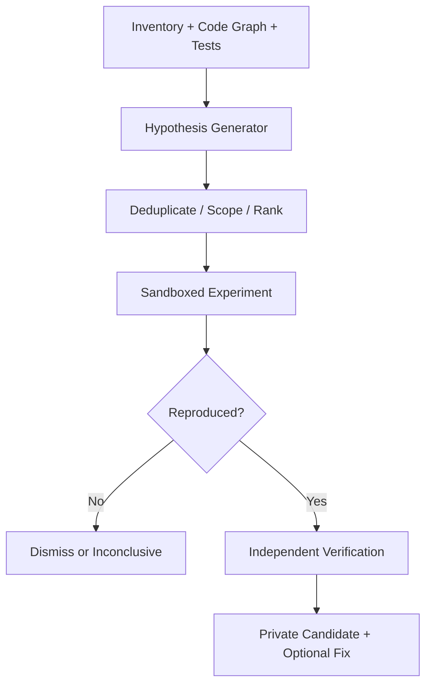

# 05. Novel Vulnerability Hunter: safe research specification

## Mission

Discover plausible unreported weakness candidates in the user's approved code and locally available dependency sources, then establish whether they are reproducible security issues. "Novel" describes the available evidence after searching current sources, never a guaranteed global absence of prior disclosure. Fully automated zero-day claims are prohibited.

This research mode is separate from daily prevention and must be explicitly opted into because it can be expensive and may execute malformed inputs in a sandbox.

## Threat-hypothesis families

| Family | Example test hypothesis | Required evidence |
|---|---|---|
| Trust boundary | Untrusted input reaches a privileged operation despite expected validation | Source/sink trace + bounded reproduction |
| Authentication/authorization | Tenant/role/resource invariant fails under an authorized local test fixture | Role matrix + failing assertion |
| Parser/decoder | Malformed input causes panic, memory fault, hang, unbounded allocation or inconsistent interpretation | Minimized deterministic crash/invariant |
| State machine/concurrency | Reordered events violate an authenticated lifecycle or resource ownership invariant | Deterministic scheduled trace |
| Cryptography | Unexpected nonce reuse, signing ambiguity, weak entropy or invalid verification conditions | Cryptographic invariant tests |
| Supply chain | Dependency's reachable parser/API violates promised invariant, despite no known matching advisory | Local vendored source + bounded repro |
| Build/CI | Untrusted workflow input crosses privilege boundary | Synthetic CI policy fixture, no live pipeline compromise |
| Agent/MCP | Tool result, prompt injection or untrusted project rule escalates authority | Sandboxed permission-contract test |

## Research pipeline

### Stage 1: Establish baselines

Inventory code/dependencies, authenticated test scenarios and expected invariants. Record repository commit, build flags, features, environment and test seed. A candidate must have a specific property to falsify; vague suspicions are not research tasks.

### Stage 2: Candidate generation

Deterministic detectors first; optionally LLM assists with threat-model brainstorming, distinguishing candidate rationale from facts. Generate structured hypotheses:

`{asset, trust_boundary, input_class, invariant, affected_path, experiment_kind, preconditions, evidence_requirements}`

Models cannot change policy, assign their own permissions, choose an unapproved network destination or rewrite ground-truth tests. Limits on tokens, wall time and concurrent experiments must be enforceable independent of the model.

### Stage 3: Prioritization and dedup

Rank with an explainable rubric: reachable exposure, privilege boundary, potential impact, proof feasibility, novelty evidence, affected package fanout and uncertainty. Do not rank by social trend alone. Search OSV/GHSA/CVE and internal findings; uncertain alias matches remain unresolved rather than silently "new".

### Stage 4: Sandbox

Isolated temporary snapshot; no ambient secrets/credentials; private writable temp; read-only source image; limits on CPU, memory, files, process count, generated input size, wall time and concurrent jobs; network off by default. If working on untrusted third-party package code, run with syscall/resource containment and retain only minimal sanitized evidence. Validate sandbox teardown and artifact retention.

Research tests must be non-weaponized: no deployment-time exploitation, persistence, lateral movement, real credential use, or external production traffic. Local deterministic mocks and user-owned test deployments are allowed when specifically scoped.

### Stage 5: Experiments

- Property-based tests derived from contracts (e.g. parse/serialize roundtrip, ownership boundaries, no panics on malformed input).
- Grammar/mutation fuzzing of local parsers and protocol handlers, seeded by harmless conforming fixtures.
- Differential tests comparing allowed reference implementations/versions to locate behavioral divergence, not automatically declaring one vulnerable.
- Metamorphic tests where transformations should preserve critical invariants (e.g. normalization, encoding, tenant boundary checks).
- Targeted stress/concurrency schedules with deterministic clocks and injected scheduling.
- Patch difference and regression mining for suspected locally used dependency variants, respecting upstream source terms.

Fuzz output alone reports an anomaly. Independent reproduction, root-cause inspection and impact testing determine security relevance.

### Stage 6: Verification

1. Minimize and reproduce in a fresh sandbox with exact source digest and seed.
2. Compare against non-affected neighbor or patched version when available.
3. Eliminate environmental and test-harness artifacts.
4. Associate affected source path, preconditions, consequence and confidence.
5. Check known databases and maintainer advisories again.
6. Generate a non-weaponized regression and bounded repair/mitigation candidate.
7. Enter `VERIFIED_CANDIDATE` only after reviewer-independent reproduction; enter `CONFIRMED_SECURITY_ISSUE` only when security consequence is established.

### Stage 7: Handoff

User sees private evidence summary, diff, testing steps, affected range estimate and limitations; chooses local repair, private report draft or dismissal. No background external reporting. Section 12 specifies disclosure governance.

## Candidate state machine

`HYPOTHESIS -> TRIAGED -> EXPERIMENT_SCHEDULED -> REPRODUCED -> VERIFIED -> PRIVATE_REPORT_READY -> REPORTED_PRIVATELY -> FIXED_AND_VERIFIED`.

Alternative terminal states: `DUPLICATE_KNOWN`, `FALSE_POSITIVE`, `NOT_REPRODUCIBLE`, `INCONCLUSIVE`, `BLOCKED_BY_SCOPE`, `EXPIRED`. Every transition includes actor, timestamp, source hash and supporting artifact digest.

## Safety controls

- `bk hunt` (proposed CLI) is opt-in and disabled in regular pre-commit.
- No automatic arbitrary third-party internet scanning; local package research does not authorize upstream hosts.
- Reject hypothesis-generated shell commands from untrusted advisories or code comments. Experiments use typed allowlisted runners, not concatenated free-form shell.
- No LLM service receives source, secrets, vulnerability evidence or user data unless configured and explicitly approved.
- An experiment producing private vulnerability proof cannot upload it to telemetry by default.
- A failed isolation or approval precondition is `BLOCKED`, not merely a warning.

## Novelty assessment

Local OSV/GHSA negative result is insufficient to assert novel/unreported. Check authoritative vendor/maintainer advisories, compare known aliases, affected patch lineage and public discussions through allowed sources. State the exact data sources, timestamps and limits. Every user-facing novelty label remains qualified unless independently researched.

## Fuzz infrastructure

Start with `cargo-fuzz`/libFuzzer for Rust and standard Go fuzzing where applicable. Evaluate OSS-Fuzz/ClusterFuzzLite later for eligible public components. Keep CI smoke tests bounded, scheduled long tests resource-controlled and minimized reproductions versioned.

Reference: https://google.github.io/oss-fuzz/

## Milestone acceptance

- Synthetic deliberately unknown parser invariant fault is reported as `HYPOTHESIS`, reproducibly minimized, verified and triaged without pretending to issue a CVE.
- A known advisory-matching seeded bug is deduplicated into known vulnerability workflow.
- An environmental crash and a benign behavioral difference do not become confirmed security reports.
- Crash/hang/timeout/OOM/sandbox escape attempts are typed results, never silent failures.
- Network egress denied in the default sandbox and experiment cancellation leaves no leaked process or modified source.
- Human approval required before any external disclosure event; dry-run draft has no outbound side effects.
- Benchmarks record findings-per-CPU-hour, unique reproducible violations, false-positive rate and source coverage rather than "zero-days found" vanity count.
