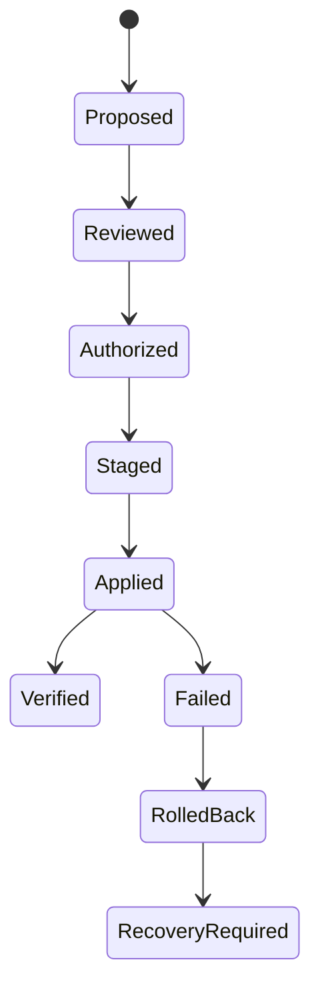

# 07. Safe remediation, approval, isolation and rollback

## Outcome

Repair detected issues automatically **only within the authority actually granted by the operator**, while preserving data integrity and the ability to prove that modifications were effective. Maximal capability with explicit consent is not equivalent to unchecked agent privilege.

## Trust and authority model

Entities:

- **Operator:** human or trusted automation account capable of granting scope.
- **Agent:** automated task proposer/executor; its signing key identifies activity but does not confer approval.
- **Policy engine:** deterministic authority evaluator with allowlist, time and resource budgets.
- **Engine adapter:** untrusted evidence producer by default.
- **Privileged worker:** narrow mutator with only approved operations and paths.
- **Workspace:** code and rules treated as untrusted inputs.

Authorization receipt binds:

`operator_identity; operation_types; workspace_root_digest; target_paths/hosts; allowed_network_destinations; allowed_mutation_class; risk_level; plan_digest; preimage_digests; issued_at; expires_at; nonce; policy_version; approval_signature`.

The operator signing root is separate from `~/.bug-killer/identity/agent.key`. Stolen agent key cannot sign a valid operator grant.

Risk classes:

| Level | Example | Default authorization |
|---|---|---|
| L0 | Read-only analysis, rule listing | Workspace-scoped read |
| L1 | Safe local patch proposal, dry-run | Read only |
| L2 | Narrow approved source/manifest modification | Explicit apply/standing policy with guardrails |
| L3 | Package upgrade, WAF change, service restart, privileged host file mutation | Fresh scoped operator approval, syntax and rollback tests |
| L4 | Live network research or sensitive target probing | Separate target-specific authorization and experiment plan |

No automatic escalation from L0/L1 to L3/L4 just because an advisory or model describes a severe issue.

## Repair lifecycle

Transitions are transactional with write-ahead records; a `ROLLBACK_FAILED` / `RECOVERY_REQUIRED` state cannot be reported as success. Partial commit across multiple files must have explicit recovery logic.

### Plan

Plan from a verified finding and exact source digest. Record `target_root`, canonical allowed destinations, symlink strategy, file permissions/ownership, proposed byte patches, digest of original bytes, expected outputs, verification steps, rollback strategy and idempotency key.

### Stage

Copy-on-write/sandbox dry run, syntax/formatter and build prechecks. No command lines composed from user strings. External package managers use typed parameterized arguments with allowlisted subcommands. Rule packs loaded from project are untrusted until approved/signed and verified.

### Approve

Validate scope, user identity, plan digest, nonce, expiry, current path containment and preimages at time of execution. Identity rotation, replay and TOCTOU must be tested. Human-readable approval text is not itself a security token.

### Apply

Revalidate canonical paths immediately before each write, use safe file descriptor strategies, no symlink escape, atomic temp write+sync+rename where applicable, preserve mode/ownership/ACL where supported, and record postimage digests. Refuse writes with drifted preimage.

### Verify

Run language format/typecheck/build/tests, impacted security rule, affectedness and coverage receipt; separate "repaired on disk" from "verified secure for the assessed property". Preserve evidence of failures.

### Rollback

Use signed manifests bound to exact destination and backup identity, authenticated encryption/secure directories as policy demands, target preimage/postimage safety, complete recovery ledger and explicit irrecoverable states. Do not suppress rollback errors. Records must be atomically stored.

## Domain-specific policy

- **Dependency upgrade:** version-specific pin, solver dry-run, no forced global upgrade by default, reproducible lockfile update and post-upgrade verification.
- **WAF rule:** stage config, run native parser/syntax check, atomically deploy, health-check/reload, roll back on failure. Do not mutate unrelated existing rules.
- **Binary/runtime patching:** avoid in-place reverse engineering and blind binary writes; prefer supported package updates and controlled restart with operator approval.
- **Git workspace:** patch exact staged/checked-out snapshots; avoid overwriting user's unrelated dirty work and preserve file history.
- **AI-generated patch:** treat as proposal only; deterministic tests, manual review above threshold, no model granting itself approval.
- **Secrets:** no dumping tokens or sensitive config in generated diffs, logs or model prompts.

## Existing risk gates and issue links

[#10](https://github.com/imMamdouhaboammar/bug-killer/issues/10), [#11](https://github.com/imMamdouhaboammar/bug-killer/issues/11), [#12](https://github.com/imMamdouhaboammar/bug-killer/issues/12), [#15](https://github.com/imMamdouhaboammar/bug-killer/issues/15), [#18](https://github.com/imMamdouhaboammar/bug-killer/issues/18), [#23](https://github.com/imMamdouhaboammar/bug-killer/issues/23) are preconditions for unattended privileged healing. Reassess latest code before claiming any are fixed.

## Testing matrix

- Path canonicalization: relative/absolute, Unicode, dot segments, symlink chains, hardlinks, mount boundaries, inherited permissions.
- Preimage drift: edit between plan and apply, change between staged file and final rename, swapped symlink.
- Authority: expired, replayed, altered, wrong-root and forged agent signatures all rejected.
- Transaction: fail on Nth file, out-of-space, interruption/restart, unwriteable directories and partial verification.
- WAF: syntax invalid, reload failure and rollback failure are distinct typed results.
- Dependency: locked transitive vulnerable dependency remains => plan cannot be labelled fully repaired.
- Confidentiality: no secret bytes appear in logs, SARIF, issue body or export.

## Release blocker

No "unattended system heal" mode is considered production-ready while any required mutation authorization, safe backup, WAF or rollback gate fails. Scan-only mode can release independently with honest coverage constraints.
