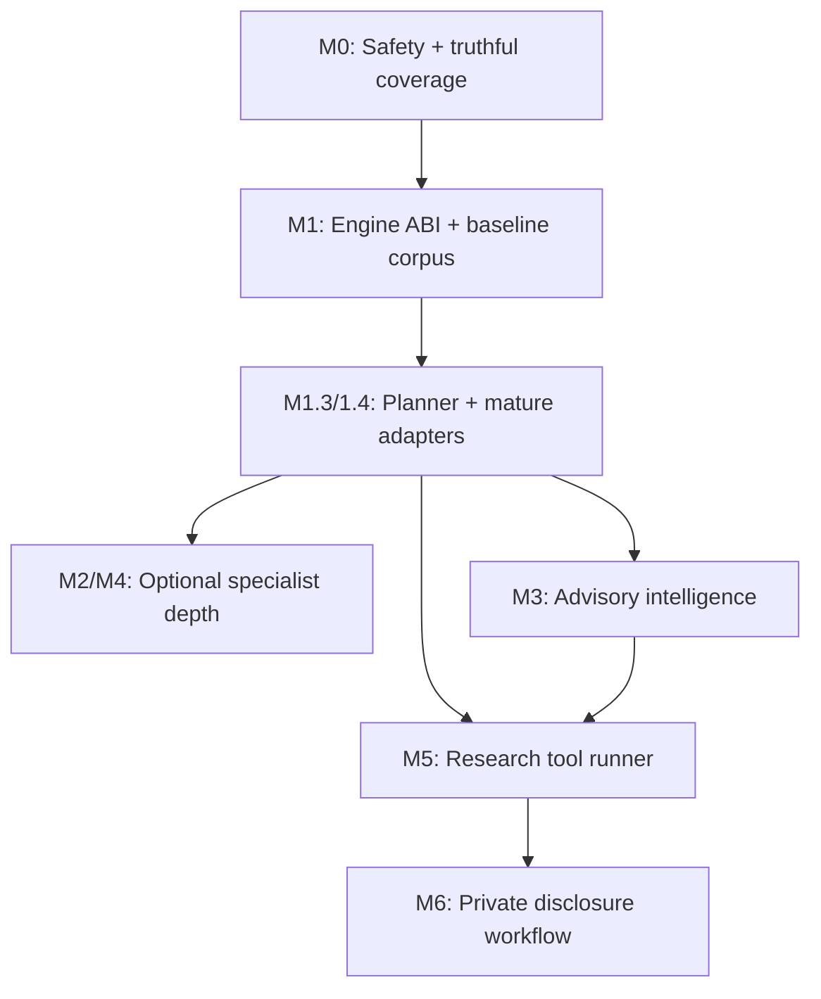

# 10. Execution plan: dependency graph, PR work cards and acceptance

## Integration principle

**One independently reviewable objective per PR** with TDD red/green and a measured integration gate. **Deliver the agentic control plane and working adapters to existing tools first; new proprietary detection algorithms are the exception and require gap evidence.** Never create a large monolithic branch for all product missions or a quota of arbitrary commits. At each card, rebase on latest master, revalidate assumptions, preserve dirty work, and document unreached acceptance explicitly. Section 14 defines the product and acceptance contract.

## Milestone M0: Non-negotiable safety and baseline

**Objective:** no privileged mutation without trusted operator authority, and no false "secure" result from partial scans. This depends on reconciling existing issue tracker #22, #10–#24 after PR #25.

### Card M0.1: Privileged remediation contract

- **Why:** R-004/R-005/R-014, existing #10/#11/#12/#15/#18/#23.
- **Owns:** authorization schema, immutable plan binding, scoped paths, trusted rule provenance, healing guards, backup/rollback tests.
- **Must not change:** read-only scanning semantics, unrelated host configs, externally accessible endpoints.
- **Depends:** none; use existing tests/interfaces and isolate sub-PRs by one boundary.
- **Acceptance:** forged/expired/replayed/wrong-root approvals fail; preimage drift fails; Nth-file failure recovers or returns `RECOVERY_REQUIRED` without claiming success.
- **Rollback:** feature gate privileged unattended apply until all red/green tests pass.
- **Integration owner:** Rust+Go healer maintainer verifies combined transaction.

### Card M0.2: Evidence and inventory completeness

- **Why:** R-002/R-003, existing #13/#20/#24.
- **Owns:** per-rule-target coverage receipts, crawler skip/error reporting, CI mandatory check mapping and serialization compatibility.
- **Must not change:** catalog metadata semantics without migration.
- **Depends:** M0.1 authorization types only where receipts reference privileged scope, otherwise independent.
- **Acceptance:** partial scan with zero findings fails mandatory CI; staged blob test catches worktree/index divergence; crawling two roots where one errors reports partial.
- **Rollback:** switch to legacy renderer only; keep internal receipts authoritative.
- **Integration owner:** core Rust CLI/MCP + Go crawler reviewer.

## Milestone M1: Engine protocol and measurement corpus

### Card M1.1: Versioned engine registry + fixture baseline

- **Why:** R-006/R-008/R-009/R-012.
- **Owns:** `AnalyzerAdapter`, capability discovery/preflight, sandbox process launcher, normalized Finding v1 / CoverageReceipt v1, ToolCapability/ToolExecutionReceipt v1, parser result to old type converter.
- **Depends:** M0.2 receipt contract.
- **Must not change:** existing CLI behavior or healing.
- **Acceptance:** synthetic successful, timeout, malformed JSON, unsupported language, cancellation and partial engine produce typed test outputs. Missing/unlicensed/incompatible tool is explicit and policy-required absence blocks. A skipped tool has execution receipt but no evaluated coverage. Golden compatibility tests unchanged.
- **Rollback:** new registry behind feature flag, legacy detector path unaffected.
- **Integration owner:** Rust core, one owner for schema+converters.

### Card M1.2: Security benchmark harness

- **Why:** establish baseline before replacing scanners.
- **Owns:** labelled fixture corpus, TP/FP/FN/TN scoring and source-level reproducibility manifests.
- **Depends:** M1.1 normalization.
- **Must not change:** scan behavior; read-only evaluation.
- **Acceptance:** intentionally bad detector fails metric gates; perfect synthetic classifier passes; dataset mutations invalidate results; deterministic report includes version, denominator and confidence.
- **Rollback:** standalone test harness, no runtime impact.
- **Integration owner:** security QA.

### Card M1.3: Agentic security room planner + execution ledger

- **Why:** R-015/R-016/R-017/R-019; mature tools need a trusted scheduler and observable handoffs.
- **Depends:** M0 authorization/coverage and M1.1 contracts; M1.2 fixture corpus supplies tool comparison data.
- **Owns:** inventory-based capability matching, immutable plan IDs, selected/skipped rationale, engine health and entitlement checks, resource/cost ceilings, dependency DAG, per-invocation host receipt and cancellation. A plan is advisory until every relevant scope and permission condition passes.
- **Must not change:** read-only Quick startup, existing CLI/MCP schemas, automatic public disclosure, external credentials without explicit configuration.
- **Acceptance:** two mocked tools with overlapping capability select correctly; unlicensed/missing required tool blocks with exact reason; optional tool is skipped visibly; unsupported target is never claimed evaluated; invalid tool metadata, unsafe arguments, over-budget plan, forged approval and unauthorized source egress are denied. Cancellation produces a terminal receipt without processes left running.
- **Rollback:** planner behind additive versioned API; existing scan remains.
- **Integration owner:** Rust orchestration/trust boundary owner.

### Card M1.4: First mature external tool adapters and evidence correlation

- **Why:** R-015/R-018; validate the real product value before spending months on new detector implementation.
- **Depends:** M1.1/M1.2/M1.3.
- **Owns:** at least two independent, externally installed open-source analyzer integrations chosen from evaluated candidates (for example Semgrep CE and Trivy on applicable fixtures), JSON/SARIF normalizers, raw artifact digest preservation, overlapping/contradicting result correlation and independent verification selection.
- **Must not change:** vendor binaries/licenses, unapproved private-code export or low-latency Quick budgets.
- **Acceptance:** reproducible pinned fixture with actual installed tools where available; fallback/missing tool fixtures are deterministic offline; normalized results retain original IDs and distinct source spans; two reports from the same shared rule do not count as independent proof. Show real measured coverage, cost and tool limits. No fake successful integration if binaries unavailable.
- **Rollback:** individual adapters feature-gated; keep original findings and run ledger.
- **Integration owner:** integrations + security QA.

## Milestone M2: Structural and source-analyzer composition

The following native structure components are **optional measured additions** alongside mature adapters, not prerequisite reinventions before the operations room can deliver value. The M1.4 adapter work can ship before M2.1/M2.2 if controls and benchmark gates pass.

### Card M2.1: Tree-sitter ingestion and source hash cache

- **Why:** fast language-aware source model.
- **Depends:** M1.1 and M1.2.
- **Owns:** grammar version registry, parser errors, AST/CST extraction and source span handling.
- **Must not change:** current rule detection path initially.
- **Acceptance:** mixed languages, invalid syntax, nested scopes, Unicode offsets and incremental/full parity fixtures; no hidden network.
- **Rollback:** disable new feature flag, clear disposable cache.
- **Integration owner:** Rust core.

### Card M2.2: ast-grep rule execution and staged catalog migration

- **Why:** R-006/R-008, reduced regex false positives and precise codemods.
- **Depends:** M2.1 and M1.2.
- **Owns:** structure rule compiler, good/bad/evasion tests, rule-target receipts, first high-value catalog category migration.
- **Must not change:** all 373 rule implementations in one diff.
- **Acceptance:** red/green parity for selected rules, no comments-only finding, fixed source spans, benchmark improvement or documented precision tradeoff, fallback status truthful.
- **Rollback:** per-rule feature flag, compare shadow results.
- **Integration owner:** detector registry owner.

**Build decision check:** before extending bespoke AST/taint features, compare mature tool adapters for the same labels, language support, cost and precision. Reuse an external engine where adequate; custom rules address documented residual gaps only.

## Milestone M3: Known advisory intelligence

### Card M3.1: Provider/cache and normalized SBOM

- **Why:** R-007.
- **Depends:** M0.2, M1.1; independent of M2.
- **Owns:** OSV and GHSA providers, alias normalization, immutable feed cache, exact package resolver, PURL identities and transitive graph.
- **Must not change:** host package manager operations.
- **Acceptance:** offline fixture works; wrong/ambiguous version returns inconclusive; stale feed surfaced; duplicate aliases dedupe; malicious advisory content cannot run.
- **Rollback:** revert to existing OSV query path via adapter.
- **Integration owner:** known vulnerability owner.

### Card M3.2: Verified package repair

- **Why:** R-014, known vulnerabilities must be repaired not only flagged.
- **Depends:** M0.1 and M3.1.
- **Owns:** bounded package update plan, resolver dry-run, lockfile diff and post-fix verification.
- **Acceptance:** updated direct dependency with remaining transitive vulnerable copy cannot claim fixed; incompatible update requires review; rollback recovers.
- **Rollback:** plan-only mode.
- **Integration owner:** healer + package intelligence.

## Milestone M4: Deep graph and taint through specialist tools

### Card M4.1: Joern sandboxed adapter and flow proof

- **Why:** R-009, cross-file security signals.
- **Depends:** M1.1/M1.2/M2.1.
- **Owns:** pinned sidecar, CPG query normalization, resolved vs inferred edges, resource/time limits, capability receipt.
- **Must not change:** Quick profile startup or installer dependency footprint.
- **Acceptance:** multi-file source-to-sink fixture is detected; safe sanitizer negative clean; unresolved dynamic dispatch yields uncertain trace; kill/cancel tested; no network.
- **Rollback:** disable adapter, old quick scanner remains functional.
- **Integration owner:** analysis integration owner.

### Card M4.2: Independent analyzer adapter comparison

- **Why:** avoid circular self-confirmation and check licensing.
- **Depends:** M4.1.
- **Owns:** Semgrep CE optional adapter, CodeQL adapter only for licensed environment, optional Babel/Probe research spike.
- **Acceptance:** identical source snapshot, comparable SARIF, no dropped evidence, no false "complete" if tools missing; license checks explicit.
- **Rollback:** modular adapter uninstall.
- **Integration owner:** adapter maintainer.

## Milestone M5: Novel Hunter

### Card M5.1: Hypothesis and sandbox contracts

- **Why:** R-010.
- **Depends:** M0.1/M0.2, M1.1/M1.2/M1.3 and selected tested research adapters; known advisory correlation M3.1 required for novelty check. **M4.1 Joern is optional** unless a specific research task requires its proven capabilities.
- **Owns:** candidate state machine, allowed experiment types, sandbox budgets, private artifact store and cancellation.
- **Must not change:** default scan/pre-commit, upstream live services.
- **Acceptance:** speculative LLM result not confirmed; sandbox escape/egress forbidden; tests produce deterministic triage and minimized evidence.
- **Rollback:** research feature disabled without touching developer scanning.
- **Integration owner:** security research owner and independent security reviewer.

### Card M5.2: Existing fuzzers, bounded experimentation and differential proof

- **Why:** produce defensible new findings.
- **Depends:** M5.1 and existing #21.
- **Owns:** adapters for eligible existing language-native/LLVM/AFL++ fuzzers, language-specific harmless fuzz harnesses, property invariants, reproducibility and crash dedupe. Evaluate OSS-Fuzz/ClusterFuzzLite and AIxCC projects as infrastructure/specialist integration candidates; do not start by cloning their orchestration and vulnerability algorithms.
- **Acceptance:** synthetic unknown fault reproduces in fresh workspace, benign behavior change is discarded, no real external target hit, deterministic bounded CI smoke test.
- **Rollback:** stop sandbox jobs, archive only sanitized reproducible artifacts.
- **Integration owner:** security QA plus research maintainer.

## Milestone M6: Disclosure and release

### Card M6.1: Private report drafts + release gates

- **Why:** R-011/R-012, safely translate discoveries into user action.
- **Depends:** M5.1/M5.2 and M0 safety.
- **Owns:** dedup advisory lookup, private markdown/JSON draft, operator approval, redaction, audit events and release docs.
- **Must not change:** public issue/advisory state without separate explicit user action.
- **Acceptance:** private draft contains no secret or weaponized payload, no network to upstream on draft, approval required for actual reporting, audit trace complete.
- **Rollback:** drafts remain local; no external side effects.
- **Integration owner:** release/security owner.

## Integration checkpoints

**Gate A:** M0 complete before any unattended privileged healing.  
**Gate B:** M1 metrics established before declaring improved detection.  
**Gate B2:** capability broker and execution ledger prove real tool selection, denial and correlation; one vendor-reported scan does not certify workspace security.
**Gate C:** M2 structural path compares favorably on good/bad/evasion corpus before rule migration expansion.  
**Gate D:** M3 advisory path correct under offline and ambiguous dependency fixtures.  
**Gate E:** M4 extra depth demonstrated, Quick remains lightweight.  
**Gate F:** M5 research fully sandboxed, findings evidence truthful and private.  
**Gate G:** M6 disclosure explicit consent and release checklist.

## Work packet protocol

For every PR: current master review; bounded spec extraction; failing test on base; implementation; green test; independent review; Rust/Go and CI checks as applicable; no invented measurements; required scope permission verified; update docs; backout plan; resolve all review threads; merge only if all branch policies are satisfied. Do not accumulate unrelated issues or artificially inflate commit counts.

## Order under parallel work

M2 and M3 may proceed concurrently after M1 if they only depend on the stable evidence interface. M0 healer security and M5 experimental runner should not share mutable trust-policy contracts in flight. A named integrator owns end-to-end schema/version/CLI verification before either feature ships.
