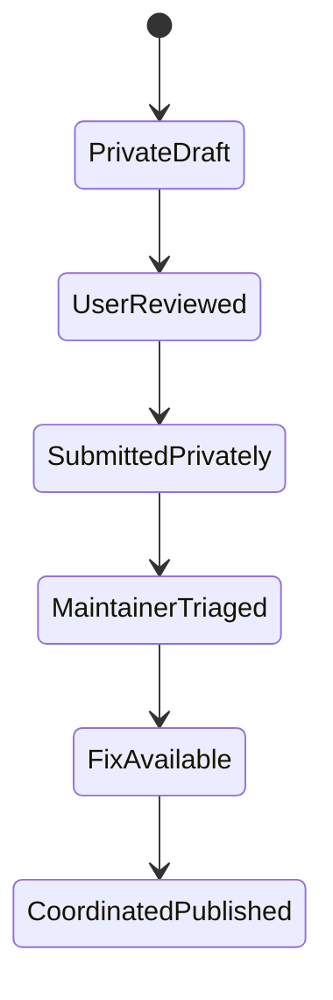

# 12. Responsible disclosure, feed governance, operations and privacy

## Principles

Bug Killer discovers and verifies issues on the user's authorized assets. Potential vulnerabilities in upstream open source components require private coordination with responsible maintainers, not automated public disclosure or scanning unrelated public infrastructure. The user chooses whether to submit a report, to whom, and when.

Official guidance: https://docs.github.com/en/code-security/concepts/vulnerability-reporting-and-management/coordinated-disclosure and https://docs.github.com/en/code-security/how-tos/report-and-fix-vulnerabilities/report-privately

## Reporting lifecycle

Alternative states: `WITHDRAWN`, `DUPLICATE`, `REJECTED`, `AWAITING_RESPONSE`, `HOLD_FOR_SAFETY`. No automatic transition from reproduced candidate to submitted/public.

## Private disclosure packet

- Finding type and qualified novelty status.
- Affected package/commit range and exact source snapshot.
- Security impact statement including prerequisites and assumptions.
- Safe minimized reproduction through offline unit/property test (omit weaponized payload where inappropriate).
- Root-cause explanation, evidence hashes, trace and baseline vs fixed tests.
- Scope proof and test authorization; distinguish code owned by user from third-party repositories.
- Suggested patch or mitigation, compatibility notes and affected versions.
- Contact path from upstream SECURITY.md, GitHub private reporting or maintainer-approved channel.
- Reporter credit preferences, embargo preferences and coordination timeline, with no automatic CVE issuance claim.

## External communication control

`disclose draft` may produce a **local artifact only**. Sending a private report requires:

1. Verified reporter identity and explicit recipient.
2. Review of findings, attachments and sensitive data redaction.
3. Operator approval bound to content digest and recipient.
4. No pre-publication of sensitive findings to telemetry, AI providers or public issues.
5. Append-only audit of request, acknowledgment, status and any later authorized publication.

Never treat "the user has enabled deep scanning" as consent to publish or notify third parties. If no private channel is available, generate a neutral public inquiry asking for a security contact without vulnerability details, but only after approval.

## Privacy and storage

- Source files remain local by default; optional engine and AI access are explicit and logged.
- **Vendor/cloud adapters:** run preflight on endpoint ownership, agreement, entitlement, data residency, source/artifact classes, upload and retention terms; require a specific operator grant for any private code or vulnerability evidence leaving the approved local boundary. Tool availability does not imply upload consent.
- Finding evidence is minimized and content-addressed. Store secret references or redacted summaries rather than raw credentials.
- Private research candidates are isolated from ordinary aggregated usage metrics and user reports.
- Define configurable retention per class: scan summaries, raw traces, crash artifacts, backups, approval receipts, advisory cache.
- Support encrypted sensitive artifacts and secure deletion/expiration processes without obscuring audit requirements.
- Exports must include a redaction manifest and machine-readable classification.
- Crash reproduction should not accidentally embed user PII, access tokens or production datasets.

## Vulnerability intelligence governance

Trust-advisory sources through pinned domains and schemas. Validate external signatures when offered, retain raw source digests, and prevent source text from influencing executor policy. Rules imported from workspace, marketplace or advisory content remain untrusted until approved provenance workflow; issue #23 tracks this boundary.

Signed rule-pack lifecycle: author identity -> review -> static validation -> corpus test -> signed release -> digest pin -> explicit enablement -> revocation. Revocation must not erase audit history. Do not auto-install "fix scripts" from an advisory.

## Operations

- Health: provider freshness, engine version drift, cache validity, unfinished jobs, partial inventory, auth failures, backup consistency.
- Orchestration desk: capability health, license/entitlement drift, actual skipped/running/cancelled receipts, vendor quota/cost and tool output lineage; never interpret a missing engine as a clean scan.
- Reliability: bounded retries, exponential backoff for feeds, cancellation propagation, per-job resource quotas and idempotent job IDs.
- Observability: structured local logs with redaction; metrics by mode/language/engine, not user code content.
- Incident response: disable bad adapter/rule pack, halt mutation, preserve tamper-evident logs, restore approved snapshot, inform operator.
- Offline support: data freshness visible, no unannounced remote connections.
- Supply chain of Bug Killer itself: SBOM, dependency review, signed releases, pinned CI actions, provenance and sanitizer/fuzz testing for parsers.

## Legal and ethical considerations

The Bug Killer repository itself has project-specific source-available/business-attribution licensing, distinct from upstream engines. Apache/MIT upstream licenses do not automatically extend to unrelated packages, models, rulesets or paid API services. Semgrep CE is LGPL-2.1; CodeQL CLI is separately licensed. Review redistribution, cloud/internal commercial uses and platform-specific notices before packaging.

Research scope requires owner authorization for live systems. Never auto-run novel-candidate experiments against external services merely because local code contains an endpoint. Respect vulnerability coordination timelines and maintainers' reporting policies.

## Acceptance

- Disconnected draft generation yields zero outbound network operations.
- Invalid disclosure approval or changed recipient/content digest blocks submission.
- Private artifact not in standard public SARIF/repo CI logs.
- Upstream security contact selection relies on verified repository policy, not an arbitrary link embedded in code.
- A withdrawn candidate cannot be exported as a verified public vulnerability.
