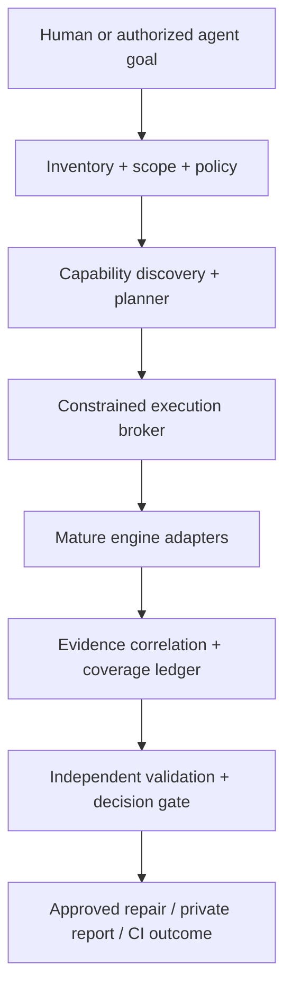

# 14. Agentic Security Operations Room: orchestration-first product architecture

**Status:** PROPOSED target architecture, not a description of shipped Bug Killer functionality.

## Product decision

**Bug Killer is the trusted conductor of a cybersecurity workspace, not a competing reimplementation of every security engine.** The value is selecting, securely operating, correlating and verifying mature tools on behalf of authorized developers, AppSec teams, vibe coders and researchers. A tool's maturity does not make its output automatically correct.

The three missions in Section 00 are **product workflows**, not three bespoke scanners:

1. **Known vulnerability response:** inventory, mature dependency scanners/advisory feeds, affectedness and reachability checks, approved remediation, independent rescan.
2. **Code security prevention:** existing SAST, SCA, secrets, IaC and other applicable tools plus selectively embedded primitives, aggregated coverage and agent/CI policy gates.
3. **Unknown weakness research:** domain-specific fuzzers, sanitizers, dynamic/symbolic/property-based testing and bounded AI hypotheses where useful, followed by independent reproduction and private triage. No universal zero-day detector is claimed.

The distinguishing product is an **agentic security room**: a shared, auditable place where agents plan work, hand tasks to proven tools, reconcile evidence and coordinate human decisions under one security policy. The user should not need to learn every engine's separate CLI to understand the resulting risk or take an approved next step.

## Build-versus-orchestrate rule

For each capability, apply this order:

1. **Reuse** a credible installed/native/external engine through an adapter when legal, compatible and measurable.
2. **Compose** complementary tools where multiple independent methods add signal, with explicit latency and budget costs.
3. **Write a small bridge** for discovery, versioned execution, output translation, coverage and proof, or permission isolation.
4. **Build a native detector only** when no suitable mature option exists or a measured gap justifies its maintenance and security cost. Record the benchmark and reversal trigger.

No vendor source copying, implicit cloud dependency, automatic installation or license circumvention. Existing native Rust security catalog and analyzer code remain useful; migrate only when parity and user value are demonstrated. Embedded Tree-sitter/ast-grep primitives are implementation choices, **not** requirements to replace established SAST suites.

## Operations-room control plane

| Component | Owned by Bug Killer | Delegated to tools |
|---|---|---|
| Workspace inventory | Canonical asset, language, dependency, trust boundary and snapshot inventory; applicability | Parsers, SBOM collectors, package resolvers where credible |
| Capability broker | Tool discovery, checksums, compatible platforms, license/entitlement and consent checks | Static/dynamic analyzers, advisory engines, fuzzers and specialist repairers |
| Security planner | Explicit goals, task DAG, prerequisite checks, mandatory/optional coverage, tool selection rationale and bounded budgets | Tool-specific scanning/research algorithms |
| Execution supervisor | Isolated jobs, typed arguments, minimum privileges, timeouts, cancellation, output caps and redaction | The actual engine process or approved remote service |
| Evidence desk | Normalize outputs, preserve raw artifact digests, dedupe/correlate, track disagreements and unassessed scope | Native SARIF, JSON, crash artifacts, test and advisory evidence |
| Verification desk | Independent check choice, fresh snapshot, candidate lifecycle, severity/certainty cap | Reproduction, tests, independent analyzers and regression suites |
| Remediation desk | Human approval, exact diff/preimage, transactional apply, recheck, rollback state | Native package managers/repair engines only within permission policy |
| Operator experience | CLI, MCP, CI, readable explanations, room timeline and approvals | Optional adapters and their specialist frontends |

### Every run is an explicit plan

An orchestration plan is immutable once approved for execution and records: `plan_id`, source snapshot digest, user goal, authorized targets, required capabilities, chosen engines and their versions, dependencies between steps, maximum resources/cost, network/secret/data-sharing policy, evidence thresholds, stop conditions and approval reference. An agent can propose a new plan but cannot self-authorize elevated scope.

Workflow states: `PLANNED -> PREFLIGHTED -> APPROVED_IF_REQUIRED -> RUNNING -> CORRELATING -> VALIDATING -> COMPLETE | PARTIAL | BLOCKED | CANCELLED | ERROR`. Intermediate and terminal states carry event timestamps and artifact references. Resume is a **new** bounded attempt referencing the original plan, never a way around expired approval or budget.

### Tool discovery and selection

The registry describes **what an engine can actually do on this machine and version**, not what marketing says it can do. `schemas/tool-capability.schema.json` defines a proposed capability record. Required preflight dimensions:

- Engine ID, exact installed binary/container/API version and verified digest or authenticated endpoint; adapter version and provenance.
- Platform, languages, asset types, capabilities (`SAST`, `SCA`, `SBOM`, `SECRETS`, `IAC`, `DAST`, `FUZZ`, `SYMBOLIC`, `RUNTIME`, `REPAIR`, `ADVISORY`, etc.), output formats and **supported check IDs**.
- Installation state: `AVAILABLE`, `MISSING`, `INCOMPATIBLE`, `UNLICENSED`, `UNHEALTHY` or `DISABLED`; distinguish configured from verified usable.
- Local/remote execution, data export, credentials/entitlement, license and redistribution restrictions, cost/rate limits, isolation requirements, memory/CPU/time and expected runtime.
- Evidence limitations (for example pattern-only versus interprocedural dataflow, harness-only fuzz coverage); capabilities are claims until fixture-validated.

Selection is policy-driven: first filter authorization, health, eligibility, target and budgets; then choose complementary tools by **measured** fixture performance, coverage, independence and cost. Maintain a reason for selected, skipped and unavailable engines. An optional missing tool creates a disclosed capability gap. A policy-required missing tool creates `BLOCKED_INCOMPLETE`; do not silently substitute a weaker method unless the policy explicitly allows a labelled fallback.

### Execution and handoff

- Adapters receive `AnalysisRequest v1` or another **versioned typed request** with scoped snapshot handles and allowlisted options; never paste LLM text into a shell or treat repository instructions as tool authority.
- Support local CLI/container, library, CI, MCP and **explicitly configured** vendor APIs as separate transports with the same policy. No implied subscription, redistribution right or public API.
- A supervised tool invocation produces `ToolExecutionReceipt v1` (`schemas/tool-execution-receipt.schema.json`), even on denied, timed-out, failed, empty or cancelled runs. Log what actually executed, by whom, under what authorization and source digest, plus redacted references to raw artifacts.
- For long-running research, schedule bounded jobs with backpressure, crash dedup and checkpoint references. Safe interrupt/cleanup is a required contract, not a convenience.
- All tool results, web pages, repository rules and model outputs remain **untrusted data**. The orchestrator independently verifies run IDs, immutable snapshot hashes, receipt and findings schema, and permission limits.

### Correlation is not voting

Correlation joins tool outputs by source snapshot, package/version, weakness semantics, normalized file span and flow or runtime artifact. It must preserve each engine's raw ID, rule version, severity, uncertainty and provenance. Duplicate outputs do not become independent confirmations. Two tools sharing the same rule source, database or model may be correlated evidence, **not two independent witnesses**.

The workspace may show: `CONFIRMED_AFFECTED_VERSION`, `SUSPECTED_REACHABILITY`, `STATIC_DATAFLOW_SUPPORTED`, `RUNTIME_REPRODUCED`, `CONTRADICTED`, `INCONCLUSIVE`, and unassessed areas. These are **claim-specific labels**, mapped without silently promoting the `EvidenceCertainty` scale in Section 06. A tool reporting clean with skipped paths must not clear a finding or an incomplete mandatory check.

## Tool landscape: integration candidates, not shipped features

| Tool / project | Potential desk role | Adoption boundary |
|---|---|---|
| [Semgrep CE](https://github.com/semgrep/semgrep) | General rule-driven static analysis | External adapter; separate CE limitations/rule licenses; measure semantics |
| [CodeQL](https://codeql.github.com/) | Query-based semantic and dataflow evidence | Optional CLI with explicit use/licensing eligibility and database build cost |
| [Joern](https://github.com/joernio/joern) | CPG/dataflow analysis | Optional isolated sidecar; expensive startup/coverage vary by language |
| [Trivy](https://github.com/aquasecurity/trivy) | SCA, containers, IaC, SBOM and related checks | External adapter; pin scanner/DB snapshots and track target-type gaps |
| [OSV-Scanner](https://github.com/google/osv-scanner) | Open-source dependency vulnerability evidence | External comparator/adapter alongside existing OSV ingestion; avoid false equivalence of package identification and reachability |
| [AFL++](https://github.com/AFLplusplus/AFLplusplus), [libFuzzer](https://llvm.org/docs/LibFuzzer.html), language-native fuzzers | Runtime fuzzing for available harnesses | Harness/target-specific, bounded sandboxes; crash needs triage |
| [OSS-Fuzz](https://github.com/google/oss-fuzz), [ClusterFuzzLite](https://github.com/google/clusterfuzzlite) | Fuzzing infrastructure and CI patterns | **Infrastructure/reference or eligible hosted program**, not a universally embedded local binary or on-demand entitlement |
| [Buttercup](https://github.com/trailofbits/buttercup), [Team Atlanta Atlantis](https://github.com/Team-Atlanta/aixcc-afc-atlantis), [FuzzingBrain](https://github.com/o2lab/afc-crs-all-you-need-is-a-fuzzing-brain) | AI-assisted vulnerability discovery/patch workflow benchmarks and possible specialized adapters | Research evaluation only; Buttercup AGPL-3.0, Atlantis root MIT and FuzzingBrain's documented host Docker-socket mount require particular legal/isolation scrutiny; confirm target/runtime/model costs before adoption |
| [Google Project Zero Big Sleep](https://projectzero.google/2024/10/from-naptime-to-big-sleep.html) | Research on AI-aided discovery | **Research example**, not a generally installable vendor tool with an assumed API |
| [XBOW](https://xbow.com/) | Commercial agentic security testing comparator | Commercial/authorized scope; **do not assume integration API, export rights or subscription** |

The initial roster is a shortlist for validation. Decisions in Section 09 remain gates, not binding promises. Mature tools can disagree, go offline or change licensing. The product must stay useful in Quick mode with only the installed baseline.

## End-to-end rooms

### A. Known CVE response

Inventory and SBOM → OSV and, when available, independent SCA engine → exact-version and advisory alias match → optional reachability/dataflow check → affectedness with evidence/uncertainty → approved package update or mitigation → fresh rescan and test → repair receipt. If a newer version is installed but vulnerable transitive copies remain, mark `PARTIAL`.

### B. Continuous developer/agent guard

On init, scan **authorized current source** using installed Quick engines, record gaps and safe fixes. Agent hooks/MCP and CI checks select fast checks for changed/staged content; security policy, not any agent, determines blocking thresholds. A missing hook or absent engine must be visible; Bug Killer cannot promise to intercept every agent or every edit unless integration is actually installed and enforced.

### C. Novel weakness investigation

Operator-approved hypothesis → planner checks source/harness/runtime eligibility → domain-appropriate fuzz/sanitizer/property/static engines → crash or invariant triage → fresh independent reproduction → known-advisory check → privately held candidate and optional supervised patch → independent post-fix validation. A novel *candidate* is never automatically an exploitable zero-day.

## Security-room user experience

Each workspace run presents:

1. **Scope:** approved assets, commit, environments and excluded paths.
2. **Plan:** which tools were selected, why, what they require, estimates and approvals.
3. **Activity:** event timeline, live/cancelled/blocked jobs, budgets and connection status.
4. **Findings:** consolidated cases with raw independent evidence, confidence, contradictions and coverage gaps.
5. **Actions:** safe suggestions, diff and tests; approval for privileged actions; verify and rollback reports.
6. **Audit:** exportable machine receipts with hashes and redaction; no secrets or raw vulnerability proofs uploaded by default.

A dashboard is optional presentation, not a dependency for CLI/MCP/CI or an excuse to remove useful native tool output.

## Phasing and acceptance

1. **Foundation:** capability registry, availability/preflight, policy, `ToolExecutionReceipt`, adapter fixture harness, traceable run plan and negative tests. Must remain backward compatible and truthful about unavailable tools.
2. **Useful default room:** choose and run at least two **independent available external analyzers** alongside baseline native tools for an authorized fixture; correlate and de-duplicate without losing raw evidence, record cost/coverage and independently verify one repair.
3. **Specialist rooms:** add SCA/infra/advisory and bounded research fuzz workflows one adapter at a time, each only if licensing, value and sandbox tests pass.
4. **Agent-assisted coordination:** planning, explanation and review of alternatives, but the agent never serves as its own approval issuer, evidence verifier, sandbox or safety authority.

Acceptance must demonstrate a good tool, unavailable tool, deceptive/invalid tool response, conflicting tools, shared-rule correlated tools, cost or policy rejection, mid-run crash/cancel, fresh-snapshot recheck and a failed rollback. The expected result is a transparent, recoverable operation, **not** a manufactured clean bill of security.

**Explicit non-goals:** inventing scanner/fuzzer algorithms already provided by appropriate tools; recreating all AIxCC systems; hosting unauthorized attacks; fully automatic exploitation, zero-day guarantee, or fully autonomous destructive remediation.
