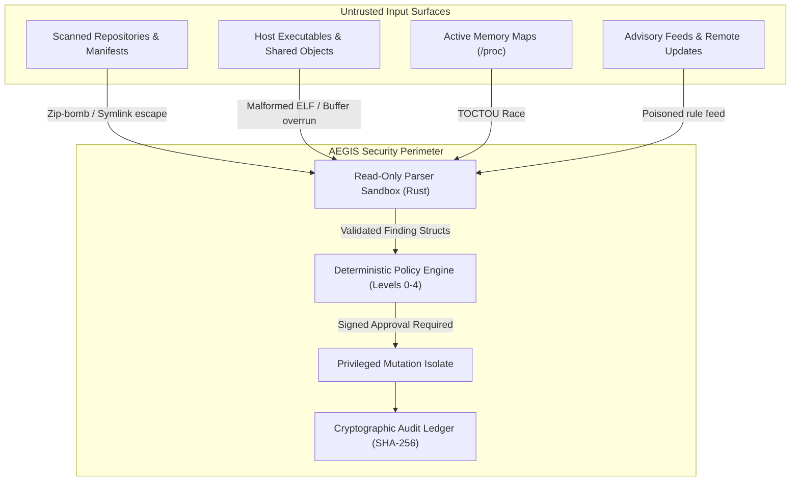

# Project AEGIS: Autonomous Vulnerability Finder, Remediation & Recovery System
## Comprehensive System Specification, Architecture Decision Record & Security Dossier

---

## 1. Executive Overview & Product Invariants

Project **AEGIS** is an evidence-driven, local-first defensive security platform designed to discover vulnerabilities across diverse host assets, rigorously establish actual runtime reachability, plan atomic remediations, execute policy-gated repairs, and verify post-remediation recovery.

### The 10 Core Product Principles

1. **Discover Broadly:** Scrape filesystems, process tables, container layers, and package databases without premature filtering.
2. **Verify Carefully:** Version strings alone never constitute proof of exploitability; require static call-graph reachability, symbol presence, or mapped memory evidence.
3. **Explain with Evidence:** Findings must cite content hashes, memory offsets, symbol tables, or line-level AST paths.
4. **Prioritize Genuine Exposure:** Distinguish inactive code on disk from actively listening server runtimes serving production traffic.
5. **Recommend Smallest Effective Repair:** Prefer virtual proxy patches or targeted version pins over sweeping destructive rewrites.
6. **Enforce Strict Authorization:** Execute only actions permitted by deterministic, immutable policy gates (Levels 0–4).
7. **Preserve Availability & Recovery:** Always compute cryptographic checkpoints (SHA-256) prior to any mutation.
8. **Verify Every Repair Independently:** A package manager exit code of 0 is insufficient; re-run active detectors and health checks to confirm remediation.
9. **Retain Tamper-Evident Ledger:** Maintain persistent, auditable records in `coverage-ledger.json` and `.aegis/backups/`.
10. **Fail Safely:** When permissions, evidence, or health checks are indeterminate, abort mutation and demand human operator review.

---

## 2. Phase 0: Research Findings & Reference Repositories

### Vulnerability Mechanics & Upstream Advisories

#### PHP2Shell (`CVE-2026-109618` & `CVE-2026-109619`)
- **Advisories:** GHSA-w8hw-w9fx-j79w, GHSA-6wmf-4rv5-p3rp.
- **CVE-2026-109618 (Out-of-Memory Longjmp Heap Corruption):** The PHP Zend Engine aborts requests on allocation failure via `longjmp()`. When memory exhaustion occurs during `php_url_encode` or multipart parsing, internal request-bound structures remain half-initialized. The subsequent cleanup loop traverses uninitialized pointers, granting remote code execution.
- **CVE-2026-109619 (Stale Global State UAF):** In persistent SAPIs (PHP-FPM, Apache `mod_php`), global state pointers retain dangling references to request memory (`PS(id)`) if an abnormal abort occurs. Subsequent requests handled by the same worker process dereference freed memory.
- **Upstream Fixed Releases:** PHP 8.2.35, 8.3.36, 8.4.27, 8.5.12 (PHP $\le 8.1$ are EOL).

#### Node2Shell (`CVE-2026-111497`)
- **Advisory:** Node.js October 2026 Security Releases.
- **Root Cause:** Out-of-bounds write in Google's reference Brotli decoder (`libbrotli` v1.0.3–1.2.0) statically compiled into Node's `node:zlib` C++ bindings. Malformed compressed streams with corrupted distance codes write past the output buffer.
- **Exposure Paths:** Inbound HTTP requests auto-decompressed by Express `body-parser` or Fastify when `Content-Encoding: br` is supplied; outbound `fetch()` consuming untrusted Brotli responses.
- **Upstream Fixed Releases:** Node.js v22.23.4, v24.22.1, v26.12.1 (Node $\le 20$ are EOL).

### Reference Implementation Comparison Matrix

| Repository | Purpose & Mechanics | Applicable Concepts | Rejected Concepts |
|---|---|---|---|
| **openai/php2shell-checker** | Fast version-bound header profiling & environment checks. | Rapid banner grabbing & SAPI fingerprinting. | Blind reliance on `X-Powered-By` HTTP headers (causes false negatives when stripped). |
| **9bie/php2shell-bypass-aslr-exp** | Multi-stage HTTP exploitation (multipart chunking, OOM induction, dangling pointer leak). | Understanding offensive prerequisites to establish definitive defensive reachability criteria. | Weaponized payloads, ASLR bypass scripts, offensive shellcode. |
| **trailofbits/brotli-checker** | Static binary mapping, cross-arch disassembly, and Trailmark AST reachability. | Zero-copy binary symbol inspection (`BrotliDecoderContext`), stripped binary code matching. | Heavy proprietary analysis pipelines with high execution latency. |
| **cloudflare/security-audit-skill** | Six-phase formal audit loop: Recon $\to$ Coverage $\to$ Validation $\to$ Findings $\to$ Verification $\to$ Patching. | Formal state machine, `findings.json` schema, adversarial validation. | Monolithic execution assumptions; lack of atomic local rollback. |
| **SnailSploit/Claude-Red** | Context-aware offensive tradecraft & binary mutation analysis. | Identifying memory evasion techniques and binary hook patterns. | Autonomous offensive evasion payloads. |
| **anchore/grype** | Vulnerability matching against SBOMs and package databases. | Ecosystem-specific CPE matching and Syft SBOM ingestion. | Shallow package-only checks that ignore custom-compiled or stripped binaries. |

---

## 3. Phase 1: Architecture Decision Record (ADR-0001)

### Language Evaluation Matrix

| Vector | Rust 🦀 | Go 🐹 | Zig ⚡ | Modern C++ ⚙️ | Python 🐍 | TypeScript / Bun 🌐 |
|---|---|---|---|---|---|---|
| **Memory Safety** | Compile-time guaranteed | GC-managed (safe) | Manual / Allocators | Manual (high risk) | Memory safe | Memory safe |
| **Binary Disassembly** | Zero-copy (`memmap2`, `goblin`) | Good (`debug/elf`) | Excellent | Strong | Slow | Impractical |
| **Filesystem & I/O** | Atomic (`tempfile`) | Bounded Goroutines | Raw syscalls | Standard | High overhead | Fast async I/O |
| **Distribution** | Single static binary | Single static binary | Single static binary | Dynamic link issues | Requires runtime | Large executable |
| **Service Role** | **Deep Inspection & Healer** | **Fleet Orchestrator** | Specialized Kernel | Legacy Only | Research / Adapters | **API Gateway & CLI** |

### Three-Vector Fable Architecture Evaluation
- **Vector 1: Scale & Load (3/10):** Initial volume is single-host or local fleet, but multi-threaded file walking requires concurrency.
- **Vector 2: Domain Decoupling (8/10):** Read-only inspection must have strictly zero mutation privileges; remediation executor must run in an isolated capability sandbox.
- **Vector 3: Resource Intensity (8/10):** Binary parsing is CPU/memory intensive; network orchestration is I/O intensive.
- **Composite Score:** $(0.35 \times 3) + (0.40 \times 8) + (0.25 \times 8) = 6.25 \ge 6.0 \implies$ **Microservices Enforced**.

---

## 4. Phase 2: Threat Model of AEGIS Itself



### Threat Mitigations

1. **Archive Decompression Bombs:** Strict ratio bounding (max 100:1) and total uncompressed size limits (max 500 MB).
2. **Symlink Traversal Attacks:** Path canonicalization using `std::fs::canonicalize` and verification that targets remain within authorized root roots.
3. **Malformed Binary Parsers:** Rust `goblin` with safe slices and bounded bounds checks; zero `unsafe` pointer dereferencing on untrusted ELF/PE buffers.
4. **TOCTOU Races in File Healing:** Atomic temporary file creation in the same target filesystem (`NamedTempFile::new_in`) followed by atomic rename (`temp.persist`).
5. **Prompt Injection Resistance:** LLMs are strictly advisory; they generate candidate plans, but cannot execute commands directly or modify the deterministic Rust policy engine.

---

## 5. Phase 3: Protocol & Domain Model Contracts

### Finding State Machine
```
   [ DISCOVERED ]
          │
          ▼
   [ ASSESSED ]
   ┌──────┴──────────────────────────────────────┐
   ▼                                             ▼
[ VULNERABLE ]                           [ POTENTIALLY_AFFECTED ]
   │                                             │
   ├──────────────────────────┐                  │
   ▼                          ▼                  ▼
[ PLAN_CREATED ]      [ NOT_APPLICABLE ]  [ REQUIRES_REVIEW ]
   │
   ▼
[ POLICY_CHECKED ] ──(Fail)──> [ BLOCKED ]
   │
   ▼
[ APPROVED ] ──(Stale/Changed)──> [ NEEDS_REVIEW ]
   │
   ▼
[ PRECHECKED ]
   │
   ▼
[ CHECKPOINT_CREATED ]
   │
   ▼
[ APPLYING ] ──(Error)──> [ ROLLING_BACK ] ──> [ ROLLED_BACK ]
   │                             │
   ▼                      (Rollback Fail)
[ VERIFYING ]                    │
   │                             ▼
   ├──(Pass)──> [ VERIFIED ]   [ RECOVERY_REQUIRED ]
   └──(Fail)──> [ ROLLING_BACK ]
```

### Authorization Levels
- **Level 0 (Read-Only):** System crawl, binary disassembly, AST parse, findings generation.
- **Level 1 (Non-Destructive):** Dry-run plan compilation, patch diff generation.
- **Level 2 (Reversible Local Repair):** Virtual proxy configuration injection, container base tag updates, manifest version pinning.
- **Level 3 (Service-Affecting):** Native package manager upgrade (`apt-get`, `brew`), daemon restarts (`systemctl`).
- **Level 4 (High-Risk):** Kernel updates, persistent firewall changes, credential mutations (Requires manual multi-party signoff).

---

## 6. Implementation Deliverables Summary

The implementation in the workspace comprises:
1. **`proto/aegis.proto`**: IPC contract defining `AuditBinary`, `AuditProcessMemory`, and `ExecutePlan`.
2. **`services/orchestrator` (Go)**: Concurrent file-crawler, `/proc` process mapper, and `/var/run/docker.sock` client.
3. **`services/inspector` (Rust)**: Zero-copy `memmap2` and `goblin` binary auditor detecting PHP Zend engine offsets and Node.js Brotli symbols.
4. **`services/healer` (Go)**: Waf injector (Nginx, HAProxy, Apache), package upgrader, and supervisor reload engine.
5. **`src/` & `tests/` (Rust Core)**: Standalone zero-dependency CLI with atomic backups, dry-run planner, and SHA-256 rollback ledger.
6. **`.agents/skills/aegis-healer/`**: Universal skill package integrated into the Omni-Skill system router.
