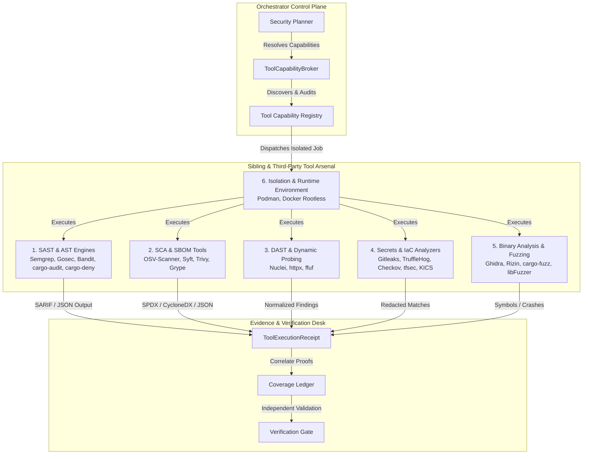
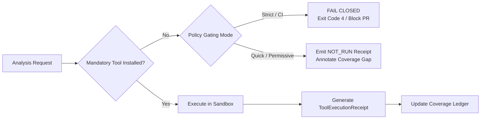
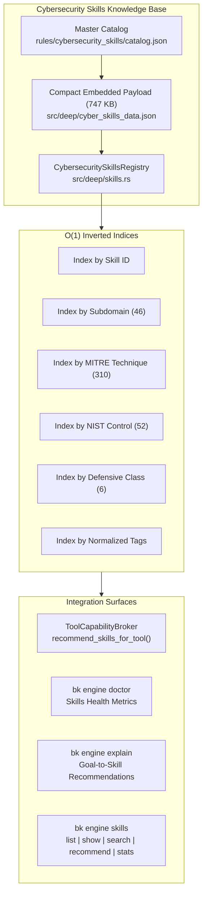
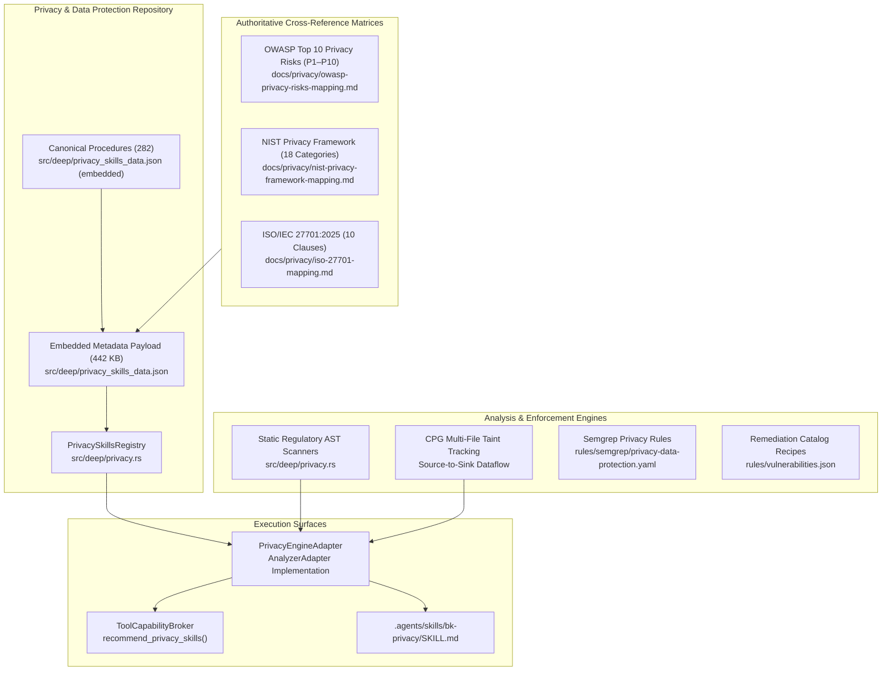

# Bug Killer (`bk`) — Sibling & Third-Party Security Tools Specification

This specification defines the authoritative taxonomy, capabilities, governance boundaries, and execution contracts for external and sibling security tools orchestrated by Bug Killer (`bk`) under the [Bug Killer Ultimate Spec v1](file:///Users/mamdouhaboammar/Documents/antigravity/silly-kepler/bug-killer-ultimate-spec-v1/README.md), the [`ToolCapabilityBroker`](file:///Users/mamdouhaboammar/Documents/antigravity/silly-kepler/src/deep/broker.rs#L401), and the [Agentic Security Operations Room](file:///Users/mamdouhaboammar/Documents/antigravity/silly-kepler/bug-killer-ultimate-spec-v1/14-AGENTIC-SECURITY-OPERATIONS-ROOM.md).

---

## 1. Architectural Scope & The Tool Broker Principle

Bug Killer functions as the **trusted conductor** of a cybersecurity operations environment rather than a monolithic reimplementation of existing security scanners. Proven external analyzers, fuzzers, and verifiers are coordinated through standardized, versioned adapters to establish multi-angle reachability, enforce evidence correlation, and generate auditable proofs.



### Core Broker Invariants

1. **Defensive Perimeter Guarantee:** All coordinated tooling operates exclusively within authorized target scopes for discovery, virtual patching, runtime hardening, and cryptographic rollback. Weaponized exploit delivery and destructive operations are prohibited.
2. **Deterministic Discovery & Integrity:** Every tool binary registered with [`ToolCapabilityBroker`](file:///Users/mamdouhaboammar/Documents/antigravity/silly-kepler/src/deep/broker.rs#L401) must have its cryptographic SHA-256 digest recorded (`binary_sha256`) and compared against pinned manifests before execution.
3. **Fail-Closed Governance:** Unlicensed engines (e.g. CodeQL without verified entitlement), missing binaries, or unvetted rules fail closed with explicit reason codes (`EngineMissing`, `UnlicensedEnvironment`, `Blocked`) in the [`ToolExecutionReceipt`](file:///Users/mamdouhaboammar/Documents/antigravity/silly-kepler/src/deep/broker.rs#L276).
4. **Anti-Collusion Evidence Rule:** Findings from multiple tools sharing the same upstream database or rule logic are classified as correlated evidence, not independent corroborations.
5. **Zero-Trust Sandboxing:** External tools run in unprivileged containers or restricted process namespaces with dropped capabilities, read-only root filesystems, and strict memory/CPU quotas.

---

## 2. Tool Capability Classification & Registry Matrix

External tools conform to the [`tool-capability.schema.json`](file:///Users/mamdouhaboammar/Documents/antigravity/silly-kepler/bug-killer-ultimate-spec-v1/schemas/tool-capability.schema.json) contract and are classified across six technical domains:

| Category | Canonical Tool | Tool ID | Kind Enum | Execution Transport | Default Evidence Limit | Primary License |
|---|---|---|---|---|---|---|
| **1. SAST & AST** | Semgrep CLI | `semgrep-ce-adapter` | `SAST` | `CLI` | `STRONGLY_SUPPORTED` | LGPL-2.1 |
| **1. SAST & AST** | Gosec | `gosec-adapter` | `SAST` | `CLI` | `PATTERN_INDICATOR` | Apache-2.0 |
| **1. SAST & AST** | Bandit | `bandit-adapter` | `SAST` | `CLI` | `PATTERN_INDICATOR` | Apache-2.0 |
| **1. SAST & AST** | cargo-audit | `cargo-audit-adapter` | `SCA` / `SAST` | `CLI` | `CONFIRMED` | Apache-2.0 / MIT |
| **1. SAST & AST** | cargo-deny | `cargo-deny-adapter` | `SCA` / `SAST` | `CLI` | `STRONGLY_SUPPORTED` | Apache-2.0 / MIT |
| **2. SCA & SBOM** | OSV-Scanner | `osv-scanner-adapter` | `SCA` / `ADVISORY` | `CLI` | `CONFIRMED` | Apache-2.0 |
| **2. SCA & SBOM** | CVE MCP Server | `cve-mcp-adapter` | `ADVISORY` / `SCA` / `CONTEXT` | `MCP` | `STRONGLY_SUPPORTED` | MIT |
| **2. SCA & SBOM** | Syft | `syft-adapter` | `SBOM` | `CLI` | `STRONGLY_SUPPORTED` | Apache-2.0 |
| **2. SCA & SBOM** | Trivy | `trivy-adapter` | `SCA` / `IAC` | `CLI` / `CONTAINER` | `CONFIRMED` | Apache-2.0 |
| **2. SCA & SBOM** | Grype | `grype-adapter` | `SCA` | `CLI` | `CONFIRMED` | Apache-2.0 |
| **3. DAST & Probing** | Nuclei | `nuclei-adapter` | `DAST` | `CLI` / `CONTAINER` | `CONFIRMED` | MIT |
| **3. DAST & Probing** | httpx | `httpx-adapter` | `DAST` / `CONTEXT` | `CLI` | `PATTERN_INDICATOR` | MIT |
| **3. DAST & Probing** | ffuf | `ffuf-adapter` | `DAST` | `CLI` | `STRONGLY_SUPPORTED` | MIT |
| **4. Secrets & IaC** | Gitleaks | `gitleaks-adapter` | `SECRETS` | `CLI` | `STRONGLY_SUPPORTED` | MIT |
| **4. Secrets & IaC** | TruffleHog | `trufflehog-adapter` | `SECRETS` | `CLI` | `CONFIRMED` | AGPL-3.0 |
| **4. Secrets & IaC** | Checkov | `checkov-adapter` | `IAC` | `CLI` / `CONTAINER` | `STRONGLY_SUPPORTED` | Apache-2.0 |
| **4. Secrets & IaC** | tfsec | `tfsec-adapter` | `IAC` | `CLI` | `STRONGLY_SUPPORTED` | MIT |
| **4. Secrets & IaC** | KICS | `kics-adapter` | `IAC` | `CLI` / `CONTAINER` | `STRONGLY_SUPPORTED` | Apache-2.0 |
| **5. Threat & Scope** | ThreatSwarm | `threatswarm-deep-adapter` | `CONTEXT` / `ADVISORY` / `SAST` | `LIBRARY` | `STRONGLY_SUPPORTED` | MIT |
| **5. Binary & Fuzz** | Ghidra (Headless) | `ghidra-headless-adapter` | `SYMBOLIC` / `CONTEXT` | `CLI` | `STRONGLY_SUPPORTED` | Apache-2.0 |
| **5. Binary & Fuzz** | Rizin (radare2) | `rizin-adapter` | `SYMBOLIC` / `CONTEXT` | `CLI` | `STRONGLY_SUPPORTED` | LGPL-3.0 |
| **5. Binary & Fuzz** | cargo-fuzz | `cargo-fuzz-runner` | `FUZZ` | `CLI` | `CONFIRMED` | Apache-2.0 / MIT |
| **5. Binary & Fuzz** | libFuzzer | `libfuzzer-runner` | `FUZZ` | `CLI` | `CONFIRMED` | Apache-2.0 / LLVM |
| **6. Sandboxing** | Podman (Rootless) | `podman-runtime` | `RUNTIME` | `CONTAINER` | `CONFIRMED` | Apache-2.0 |
| **6. Sandboxing** | Docker (Rootless) | `docker-rootless-runtime` | `RUNTIME` | `CONTAINER` | `CONFIRMED` | Apache-2.0 |

---

## 3. Deep Architectural Breakdown by Tool Domain

### Category 1: Semantic Analysis & AST Engines (SAST & AST Engines)

#### Semgrep CLI (`semgrep-ce-adapter`)
- **Technical Role:** Advanced semantic pattern matcher, inter-file dataflow tracer, and source sink taint tracker operating across polyglot ecosystems (Python, JavaScript, TypeScript, Go, Java, C/C++, PHP).
- **Bug Killer Integration:** Coordinated via [`SemgrepAdapter`](file:///Users/mamdouhaboammar/Documents/antigravity/silly-kepler/src/deep/semgrep.rs#L21) in `src/deep/semgrep.rs`. Integrates with `bk`'s internal Tree-sitter parsers. Ingests native SARIF v2.1.0 and `--json` outputs, normalizing findings into `FindingV1` and producing cryptographically indexed `CoverageReceiptV1`.
- **Runtime Execution:** Local CLI invocation inside an isolated directory mount with network access disabled (`--disable-version-check`, `--metrics=off`).
- **Governance:** Community Edition engine is licensed under LGPL-2.1. Custom and community rule sets are verified for distribution compatibility.

#### Gosec (`gosec-adapter`)
- **Technical Role:** Specialized Go source code security analyzer. Traverses the Go Abstract Syntax Tree (`go/ast`) to detect unsafe memory manipulations (`unsafe.Pointer`), integer overflows, unbound concurrency, hardcoded credentials, SQL injection patterns, and permissive file access.
- **Bug Killer Integration:** Deployed for rapid security auditing of Go microservices within the workspace ([`services/orchestrator`](file:///Users/mamdouhaboammar/Documents/antigravity/silly-kepler/services/orchestrator) and [`services/healer`](file:///Users/mamdouhaboammar/Documents/antigravity/silly-kepler/services/healer)). Normalizes output to SARIF.
- **Runtime Execution:** Local CLI runner invoked via `gosec -fmt=sarif -out=results.sarif ./...`.

#### Bandit (`bandit-adapter`)
- **Technical Role:** Dedicated Python security linter building an AST representation of Python modules. Scans for known insecure function calls (`eval`, `exec`, `pickle.loads`), insecure cipher modes (`Crypto.Cipher`), weak pseudo-random number generators in security contexts, and shell injection flaws (`subprocess.Popen(..., shell=True)`).
- **Bug Killer Integration:** Audits Python scripts, test harnesses, and automated workers. Emits JSON/SARIF consumed by the Evidence Desk.
- **Runtime Execution:** Invoked as `bandit -r <target> -f json -o output.json`.

#### cargo-audit & cargo-deny (`cargo-audit-adapter`, `cargo-deny-adapter`)
- **Technical Role:**
  - `cargo-audit`: Cross-references dependencies listed in `Cargo.lock` against the curated advisory feed maintained by the RustSec Advisory Database.
  - `cargo-deny`: Enforces organizational policies over the crate dependency graph, verifying SPDX license compliance, banning unapproved crates, and flagging multiple conflicting versions of the same dependency.
- **Bug Killer Integration:** Integrates into the Rust workspace preflight audit pipeline, ensuring that all crates compiled into `bk` and its plugins remain free of supply chain vulnerabilities.

---

### Category 2: Supply Chain & Source Assessment (SCA & SBOM)

#### OSV-Scanner (`osv-scanner-adapter`)
- **Technical Role:** Google's authoritative vulnerability scanner for software dependencies. Ingests project lockfiles (`Cargo.lock`, `package-lock.json`, `pnpm-lock.yaml`, `composer.lock`, `go.sum`, `requirements.txt`) and queries the open Open Source Vulnerabilities database (OSV.dev).
- **Bug Killer Integration:** Operates alongside `bk`'s internal synchronous HTTP OSV client ([`src/scanner/osv.rs`](file:///Users/mamdouhaboammar/Documents/antigravity/silly-kepler/src/scanner/osv.rs)), acting as an external, independent SCA verification witness.
- **Evidence Characteristics:** Matches are cross-checked against actual call-graph reachability. Package presence alone is tagged as `CONFIRMED_AFFECTED_VERSION`, requiring AST or binary symbol confirmation to elevate to `CONFIRMED_REACHABLE`.

#### CVE MCP Server (`cve-mcp-adapter`)
- **Technical Role:** High-density threat intelligence sidecar orchestrating 28 security intelligence tools across 24 upstream vulnerability and threat data sources (NVD, FIRST EPSS, CISA KEV catalog, Shodan, VirusTotal, crt.sh, CIRCL Passive DNS, and MITRE ATT&CK mappings).
- **Bug Killer Integration:** Integrated into `bk`'s deep engine via [`CveMcpAdapter`](file:///Users/mamdouhaboammar/Documents/antigravity/silly-kepler/src/deep/cve_mcp.rs) and registered in [`ToolCapabilityBroker`](file:///Users/mamdouhaboammar/Documents/antigravity/silly-kepler/src/deep/broker.rs). Supports live MCP stdio communication, one-call triage orchestration (`bk.cve_triage`), and deterministic offline risk scoring with CISA KEV hard-overrides.
- **Defensive Invariant:** Strictly defensive threat intelligence aggregation and reachability verification. Weaponized payload generation and offensive exploitation are disabled by default.
- **Execution Transport:** `ExecutionTransport::Mcp` (FastMCP / stdio JSON-RPC). Offline-capable via local SQLite caching and deterministic fallbacks.

#### Syft (`syft-adapter`)
- **Technical Role:** Software Bill of Materials (SBOM) generator from Anchore. Catalogues packages, direct dependencies, transitive libraries, and OS packages from directories, archive files, and OCI container image layers.
- **Bug Killer Integration:** Generates standard SPDX JSON and CycloneDX manifests during `bk init` and container scanning tasks. The SBOM artifact is hashed (SHA-256) and cataloged in `.aegis/manifest.json`.
- **Supported Formats:** `spdx-json`, `cyclonedx-json`, `syft-json`.

#### Trivy & Grype (`trivy-adapter`, `grype-adapter`)
- **Technical Role:**
  - `Trivy`: Comprehensive vulnerability scanner detecting CVEs in OS packages (Alpine, Debian, Ubuntu, RHEL), language-specific packages, and container image layers.
  - `Grype`: Dedicated vulnerability matcher optimized to scan Syft-generated SBOMs against national and vendor security databases.
- **Bug Killer Integration:** Container image scanning and filesystem verification. Operates offline using locally synchronized vulnerability databases.

---

### Category 3: Dynamic Application Security Testing & Probing (DAST & Dynamic Probing)

#### Nuclei (`nuclei-adapter`)
- **Technical Role:** Fast, template-based dynamic vulnerability engine developed by ProjectDiscovery. Executes structured YAML templates defining deterministic HTTP/TCP request-response sequences to verify live exploitability.
- **Defensive Invariant:** Nuclei is executed strictly for non-destructive verification (e.g. validating missing HTTP security headers, verifying fixed PHP2Shell error responses, or confirming that Brotli payload handling does not trigger memory corruption). Exploitative payloads or denial-of-service templates are filtered out before execution.
- **Bug Killer Integration:** Invoked during the dynamic verification phase following a prospective patch to prove that a vulnerability is no longer exploitable.
- **Evidence Limit:** `CONFIRMED` when an affirmative benign probe proves exposure or resolution.

#### httpx & ffuf (`httpx-adapter`, `ffuf-adapter`)
- **Technical Role:**
  - `httpx`: High-throughput HTTP toolkit for host probing, status code validation, TLS certificate fingerprinting, and header security analysis.
  - `ffuf`: High-speed web fuzzer designed for discovering unlinked endpoints, hidden parameters, and exposed administrative files.
- **Bug Killer Integration:** Powers the `bk probe` command suite. Restrictive authorization flags (`--authorized`, `--sensitive-paths`, `--allow-private-targets`) prevent unauthorized probing against non-consenting infrastructure. Discovers misconfigured backups (`.git/HEAD`, `.env`, `docker-compose.yml.bak`).

---

### Category 4: Secrets Detection & Infrastructure as Code (Secrets & IaC)

#### Gitleaks & TruffleHog (`gitleaks-adapter`, `trufflehog-adapter`)
- **Technical Role:** High-entropy secret and credential scanners auditing Git repositories, commit histories, branch diffs, and workspace files for leaked API keys, tokens, SSH keys, and cloud credentials.
- **Bug Killer Integration:**
  - Automated scanning during `bk init` and pre-commit hook runs.
  - **Secret Redaction Mandate:** Discovered secrets are immediately hashed via SHA-256. Raw secret strings are NEVER written to logs, terminal stdout, or `CoverageReceiptV1` artifacts; only masked identifiers and deterministic fingerprints are stored.
- **Evidence Limit:** `STRONGLY_SUPPORTED` based on entropy and format matching; `CONFIRMED` only when verified via secure offline cryptographic key format validators.

#### Checkov, tfsec & KICS (`checkov-adapter`, `tfsec-adapter`, `kics-adapter`)
- **Technical Role:** Static analysis security engines for Infrastructure as Code (IaC). Evaluates configurations in Terraform, Kubernetes manifests, Dockerfiles, CloudFormation, and Helm charts against CIS Benchmarks, NIST guidelines, and cloud provider security best practices.
- **Target Failure Modes:** Identifies root execution in Dockerfiles, privileged security contexts in Kubernetes Pod specs, publicly exposed S3 buckets, open security group ingress (`0.0.0.0/0`), and missing encryption-at-rest flags.
- **Bug Killer Integration:** Analyzes workspace deployment assets during L1 scanning. Feeds into `bk plan` to synthesize prospective HCL and YAML patches.

---

### Category 5: Threat Modeling, Scope Enforcement & CVSS Scoring

#### ThreatSwarm (`threatswarm-deep-adapter`)
- **Technical Role:** High-performance defensive boundary enforcer, CVSS v3.1 mathematical scoring engine, and MITRE ATT&CK enterprise catalog mapper adapted from ThreatSwarm.
- **Defensive Perimeter:** All weaponized offensive exploit generation, payload encoding, and C2 operations are completely removed. Operates exclusively in zero-trust scope verification, finding deduplication, and risk triage.
- **Bug Killer Integration:** Embedded directly into Bug Killer's deep engine via [`ThreatswarmAdapter`](file:///Users/mamdouhaboammar/Documents/antigravity/silly-kepler/src/deep/threatswarm.rs), registered in [`ToolCapabilityBroker`](file:///Users/mamdouhaboammar/Documents/antigravity/silly-kepler/src/deep/broker.rs), and surfaced via `.agents/skills/bk-threatswarm/`.
- **Key Modules:**
  - `ThreatswarmScopeEnforcer`: CIDR bitmask evaluation (`10.0.0.0/8`, `192.168.1.0/24`), FQDN allowlisting, and command interception.
  - `ThreatswarmCvssEngine` / `CvssVector`: Full FIRST.org CVSS 3.1 calculation, ceiling roundup to 0.1, and automated SLA timers (Critical: 24h, High: 72h).
  - `ThreatswarmMitreCatalog`: ATT&CK technique lookups and CWE-to-TTP translation.
  - `ThreatswarmFindingSync`: Deduplication of Critical/High findings across report markdown files into `FINDINGS_SUMMARY.md`.

---

### Category 5: Binary Analysis & Bounded Fuzzing (Binary Analysis & Fuzzing)

#### Ghidra & Rizin (`ghidra-headless-adapter`, `rizin-adapter`)
- **Technical Role:** Reverse engineering, binary disassembly, and decompilation frameworks.
  - `Ghidra (Headless)`: Executes Java-based headless scripts (`analyzeHeadless`) to extract symbol tables, function signatures, control-flow graphs (CFGs), and decompiled C representations from compiled executables (ELF, Mach-O, PE).
  - `Rizin`: Fast, scriptable binary analysis CLI (fork of radare2) for rapid inspection of sections, relocations, imported shared objects, and hardening flags (NX, PIE, RELRO, Stack Canaries).
- **Bug Killer Integration:** Complements the zero-copy, in-memory binary inspection provided by `goblin` within [`services/inspector`](file:///Users/mamdouhaboammar/Documents/antigravity/silly-kepler/services/inspector). Triggered when static binary triage requires deep symbol recovery or control-flow reachability analysis (e.g. verifying `BrotliDecoderDecompressStream` in stripped Node.js binaries).

#### cargo-fuzz & libFuzzer (`cargo-fuzz-runner`, `libfuzzer-runner`)
- **Technical Role:** In-process, coverage-guided evolutionary fuzzing engines. Instrument code via LLVM's `SanitizerCoverage` and compile with AddressSanitizer (ASan) and UndefinedBehaviorSanitizer (UBSan).
- **Execution Constraints:** Fuzzing runs execute in strictly bounded time windows (default: $\le 300\text{ seconds}$) with memory caps ($2048\text{ MB}$).
- **Target Surfaces:** Tests resilience of Bug Killer's custom parsers (e.g. SARIF parsers, JSON deserializers, HTTP multipart decoders, Brotli header inspectors) against malformed inputs and crash induction.
- **Evidence Artifact:** Generates deterministic crash inputs (`CRASH` format) allowing exact local reproduction and regression testing.

---

### Category 6: Secure Sandboxing & Runtime Execution (Sandboxing & Runtime)

#### Podman & Docker (Rootless) (`podman-runtime`, `docker-rootless-runtime`)
- **Technical Role:** Unprivileged, rootless container execution engines. Provides Linux namespace isolation (user, mount, PID, network, IPC) and seccomp/AppArmor security profiles for running external tools and untrusted code.
- **Architectural Mandates:**
  - **Zero Host Root:** All external tools and analyzers are run with unprivileged user mappings (`UID/GID != 0`).
  - **No Socket Mounts:** Mounting `/var/run/docker.sock` into an analysis job is strictly prohibited to prevent container breakouts.
  - **Ephemeral Volumes:** Workspaces are mounted as read-only volumes (`:ro`) except for designated ephemeral output directories (`/output:rw,noexec`).
  - **Network Policy:** Dynamic scanners requiring outbound network access operate on dedicated bridge networks with egress firewalls restricting connections strictly to authorized target hosts.

---

## 4. Tool Broker Integration Contracts & Schemas

### Capability Declaration Schema

External adapters register their capabilities using the [`tool-capability.schema.json`](file:///Users/mamdouhaboammar/Documents/antigravity/silly-kepler/bug-killer-ultimate-spec-v1/schemas/tool-capability.schema.json) specification. The following is an example declaration for the Semgrep CLI adapter:

```json
{
  "schema_version": "1.0",
  "tool_id": "semgrep-ce-adapter",
  "adapter_version": "1.0.0",
  "engine_version": "1.92.0",
  "binary_sha256": "e3b0c44298fc1c149afbf4c8996fb92427ae41e4649b934ca495991b7852b855",
  "installation": "AVAILABLE",
  "capabilities": {
    "kinds": ["SAST"],
    "languages": ["python", "javascript", "typescript", "go", "java", "c", "php"],
    "asset_types": ["source_file", "workspace_tree"],
    "check_ids": ["semgrep.rules.security", "bk.taint.dataflow"],
    "output_formats": ["SARIF", "JSON"],
    "evidence_limit": "STRONGLY_SUPPORTED"
  },
  "execution": {
    "transport": "CLI",
    "local": true,
    "network_required": false,
    "scoped_permission_classes": ["workspace:read"],
    "platforms": ["darwin-arm64", "linux-amd64", "linux-arm64"]
  },
  "governance": {
    "license_review": "APPROVED",
    "entitlement_verified": true,
    "source_export_required": false,
    "cost_model": "LOCAL_RESOURCES",
    "restrictions": ["CE interfile taint limitations apply; local rule execution only"]
  },
  "verified_at": "2026-10-26T12:00:00Z",
  "notes": [
    "Discovered via PATH",
    "Telemetry and automatic cloud uploads explicitly disabled via flags"
  ]
}
```

### Execution Receipt Schema

Following the execution of an external tool, the host writes an immutable, host-authored receipt complying with [`tool-execution-receipt.schema.json`](file:///Users/mamdouhaboammar/Documents/antigravity/silly-kepler/bug-killer-ultimate-spec-v1/schemas/tool-execution-receipt.schema.json):

```json
{
  "schema_version": "1.0",
  "receipt_id": "receipt-semgrep-20261026-a1b2c3d4",
  "plan_id": "plan-audit-workspace-001",
  "run_id": "run-f4e3d2c1",
  "tool_id": "semgrep-ce-adapter",
  "adapter_version": "1.0.0",
  "engine_version": "1.92.0",
  "snapshot_sha256": "4a5e1e4baab89f3a32518a88c31bc87f618f76673e2cc77ab2127b7afdeda33b",
  "target_ids": ["src/server/handler.go", "src/parser/brotli.rs"],
  "check_ids": ["semgrep.rules.security"],
  "status": "COMPLETED",
  "reason_code": "Completed",
  "authorization_ref": "auth-operator-signed-receipt-089",
  "resources": {
    "duration_ms": 1420,
    "peak_memory_bytes": 134217728,
    "cost_estimate_usd": 0.0,
    "cost_actual_usd": 0.0
  },
  "artifacts": [
    {
      "kind": "RAW_OUTPUT",
      "sha256": "9f86d081884c7d659a2feaa0c55ad015a3bf4f1b2b0b822cd15d6c15b0f00a08",
      "access_class": "LOCAL_REDACTED",
      "storage_ref": ".bug-killer/artifacts/semgrep-raw-results.sarif"
    },
    {
      "kind": "NORMALIZED_FINDINGS",
      "sha256": "5e884898da28047151d0e56f8dc6292773603d0d6aabbdd62a11ef721d1542d8",
      "access_class": "LOCAL_REDACTED",
      "storage_ref": ".bug-killer/artifacts/findings-normalized.json"
    }
  ],
  "started_at": "2026-10-26T12:01:10Z",
  "completed_at": "2026-10-26T12:01:11Z"
}
```

---

## 5. Evidence Correlation, Consensus & Gate Policies

### 1. Multi-Tool Consensus Algorithm

When multiple engines analyze the same target workspace, findings are reconciled under strict evidence deduplication:

$$\text{Evidence Certainty} = \min\left(\max_{i}(\text{ToolCertainty}_i),\, \text{VerificationGateCap}\right)$$

- **Same Database Rule:** If `osv-scanner` and `trivy` both report a vulnerability citing `GHSA-w8hw-w9fx-j79w`, the finding is recorded as a single vulnerability with two corroborating witnesses. Its certainty is **not** promoted to `CONFIRMED_REACHABLE` without static call-graph reachability or dynamic proof.
- **Disagreement & Contradiction:** If `semgrep` claims an unescaped sink exists at `handler.go:45`, but `gosec` flags the same block as safely sanitized, the finding is marked `CONTRADICTED` in the coverage ledger and queued for human operator review or bounded dynamic probing.

### 2. Missing-Tool Policy & CI Gating



- In **Strict Mode** (CI pipelines, release security gates), the absence of a mandatory tool (e.g. `gitleaks` for secrets or `cargo-audit` for Rust dependencies) immediately halts the pipeline with an error. Silent skips are prohibited.
- In **Quick Mode** (local developer workflows), absent optional tools generate a receipt with `status: "NOT_RUN"` and `reason_code: "EngineMissing"`, clearly highlighting unassessed scope in the terminal report.

---

## 6. Deep Cybersecurity Skills Knowledge Engine

Under `src/deep/skills.rs` and `rules/cybersecurity_skills/`, Bug Killer embeds an authoritative, curated repository of 818 specialized cybersecurity skills derived from Anthropic's cybersecurity curriculum and frameworks.

### Architecture & Capabilities



### Metrics & Distribution

| Dimension | Metric | Key Value |
|---|---|---|
| **Total Skills Indexed** | 818 | Hermetically verified |
| **Technical Subdomains** | 46 | Cloud, Network, Web, Forensics, Malware, IAM, SOC, ICS/OT |
| **MITRE ATT&CK Techniques** | 310 | T1055, T1190, T1059, T1547, T1078, etc. |
| **NIST CSF Controls** | 52 | PR.PS, PR.IR, DE.CM, RS.RP, ID.AM, etc. |
| **Defensive Classes** | 6 | `DETECTION` (223), `HARDENING` (161), `VIRTUAL_PATCHING` (38), `FORENSICS_TRIAGE` (150), `AUDIT_COMPLIANCE` (92), `ADVERSARIAL_SIMULATION` (154) |

### CLI Interface Commands

- `bk engine skills stats`: Displays global catalog metrics and defensive distribution.
- `bk engine skills list [--filter <subdomain|tag|mitre>] [--limit <n>] [--json]`: Lists indexed skills with metadata.
- `bk engine skills show --id <skill-id>`: Displays comprehensive procedure details, MITRE/NIST mappings, and path.
- `bk engine skills search --query <keywords> [--limit <n>]`: Full-text fuzzy search across titles, descriptions, and tags.
- `bk engine skills recommend --cve <cve-id>`: Recommends prioritized defensive skills for runtime vulnerabilities (e.g. `CVE-2026-109618`, `CVE-2026-111497`).

---

## 7. Deep Privacy & Data Protection Engine

Under `src/deep/privacy.rs` and `docs/privacy/`, Bug Killer embeds an authoritative, curated repository of 282 specialized privacy and data protection procedures covering major worldwide regulatory frameworks and engineering standards (GDPR, CCPA/CPRA, HIPAA, EU AI Act, LINDDUN Threat Modeling, OWASP Privacy Risks P1–P10, ISO/IEC 27701:2025, and NIST Privacy Framework v1.0).

> **Note:** The `skills/privacy/` source directory has been retired. The canonical embedded registry is now maintained directly in `src/deep/privacy_skills_data.json` (embedded at compile time by `src/deep/privacy.rs`).

### Architecture & Capabilities



### Supported Regulatory Check IDs & Defenses

| Check ID | Title | Regulatory Framework | CWE | OWASP Risk | LINDDUN Threat |
|---|---|---|---|---|---|
| `BK-AI-PRIV-001` | Plaintext PII in Database Column Definition | GDPR Art. 32 / CCPA 1798.100 | CWE-311 | P1 / P2 | Disclosure (D) |
| `BK-AI-PRIV-002` | Unredacted PII Sent to External LLM / AI API | EU AI Act Art. 10 / GDPR Art. 5 | CWE-359 | P1 / P3 | Linkability (L) / Disclosure (D) |
| `BK-AI-PRIV-003` | Credit Card / Financial Data Leak in Application Logs | PCI-DSS v4.0 / GDPR Art. 32 | CWE-532 | P1 / P2 | Disclosure (D) |
| `BK-AI-PRIV-004` | Indefinite Data Retention Policy in Storage Configuration | GDPR Art. 5(1)(e) / CCPA | CWE-404 | P7 / P9 | Unawareness (U) |
| `BK-AI-PRIV-005` | DSAR Deletion Endpoint Missing Authentication | GDPR Art. 17 / CCPA 1798.105 | CWE-840 | P4 / P6 | Detectability (D) |
| `BK-AI-PRIV-006` | PII Field Logging in Web Request Middleware | GDPR Art. 5(1)(c) / OWASP P2 | CWE-532 | P2 | Identifiability (I) |
| `BK-AI-PRIV-007` | Unconsented Analytics Cookie Tracking | ePrivacy Directive / GDPR Art. 6 | CWE-359 | P5 / P6 | Non-repudiation (NR) |
| `BK-AI-PRIV-008` | Unsafe PHI Export Missing HIPAA Safe Harbor De-identification | HIPAA 45 CFR § 164.514(b) | CWE-359 | P1 / P3 | Linkability (L) / Disclosure (D) |
| `BK-AI-PRIV-009` | High-Risk Automated AI Decision Without Human Oversight | EU AI Act Art. 14 | CWE-840 | P8 | Non-compliance (NC) |
| `BK-AI-PRIV-010` | Incident Response Plan Omits 72-Hour Supervisory Authority Notification | GDPR Art. 33 / DPA Notification | CWE-840 | P10 | Unawareness (U) |


