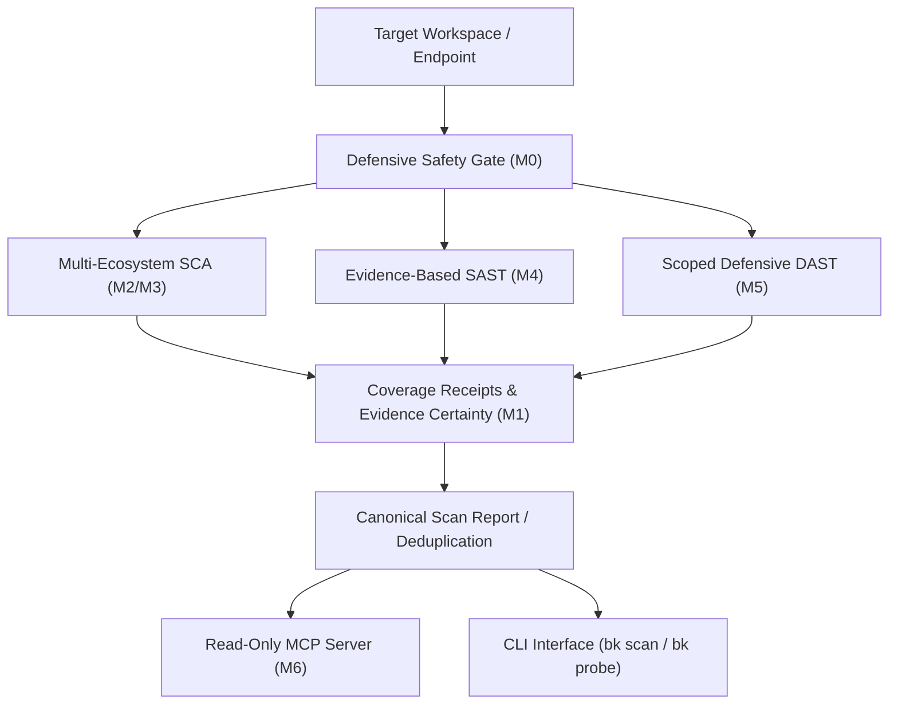

# Solution: Bug Killer Full Security Coverage Engine (SCA, SAST, DAST & Agent MCP)

## Architectural Overview

Bug Killer's full security coverage engine extends the autonomous defense system with comprehensive Software Composition Analysis (SCA), evidence-based Static Application Security Testing (SAST), defensive Dynamic Application Security Testing (DAST), and model-agnostic Agent Model Context Protocol (MCP) tooling.

---

## 1. Safety Boundaries & Cryptographic Gating (M0)

- **Read-Only Invariant:** Fleet scanner execution is strictly read-only and computes SHA-256 digests over scanned files; zero mutating actions or file alterations occur during scan passes.
- **Remediation Boundary:** Autonomous healing cannot be initiated from SCA or SAST findings without explicit operator cryptographic sign-off (`ApprovalReceipt` signed with Ed25519 agent identity).
- **Truthful Coverage Accounting:** Incomplete scans, permission denials, or unreadable files fail closed; they are explicitly recorded in `CoverageStatus::Partial` or `CoverageStatus::Error` and never collapse to a false clean status.

---

## 2. Security Evidence Contracts (M1)

- **Evidence Certainty Hierarchy:**
  - `Confirmed`: Cryptographically or deterministically verified on disk/binary.
  - `StronglySupported`: Validated by structured compiler artifacts or resolved lockfiles.
  - `Suspected`: Manifest declaration without installed lockfile resolution.
  - `PatternIndicator`: Heuristic lexical or syntactic pattern match (SAST sink).
  - `Unknown`: Unclassified or opaque finding source.
- **Coverage Receipts:** Each scan subsystem emits a structured `CoverageReceipt` detailing scanner identity, version, items evaluated, execution limits, skipped reasons, and errors. A scan is only considered complete if all subsystem receipts report `Complete` with zero unhandled errors.

---

## 3. Reliable Multi-Ecosystem SCA & OSV Transport (M2, M3)

- **Exact Version vs Declared Requirement:**
  - Manifest range operators (`^`, `~`, `>=`, `<=`, `*`, `latest`) are strictly classified as `VersionResolution::DeclaredRequirement`.
  - Resolved lockfile entries (`package-lock.json`, `composer.lock`, `Cargo.lock`, `poetry.lock`, `packages.lock.json`, `Gemfile.lock`) are classified as `VersionResolution::ResolvedExact`.
  - Fabricated version lookup prohibition: range constraints are never sent to OSV.dev as exact installed versions.
- **Multi-Ecosystem Coverage:**
  - npm / Node.js
  - Composer / PHP (Packagist)
  - PyPI / Python (`requirements.txt`, `poetry.lock`)
  - Cargo / Rust (`crates.io`)
  - Go Modules (`go.mod`)
  - NuGet / .NET (`packages.lock.json`, `.csproj`)
  - RubyGems (`Gemfile.lock`)
  - Maven / Java (`pom.xml`)
  - SBOM standards: CycloneDX JSON and SPDX 2.3 JSON/tag-value.
- **Failure Semantics:** Network partitions, DNS failures, and API HTTP errors produce structured failure receipts without suppressing errors or fabricating zero-vulnerability clean reports.

---

## 4. Evidence-Based SAST Engine (M4)

- **Pattern Indicator Labeling:** Lexical pattern matches across JavaScript/TypeScript, Python, PHP, and Go are classified with `EvidenceCertainty::PatternIndicator` and `Affectedness::PotentiallyAffected`.
- **Intraprocedural Propagation:** Cross-language taint propagation tracks variable assignments and string concatenations from HTTP query, body, and header sources into dangerous execution sinks (SQL injection, Command injection, Path traversal, SSRF, Reflected XSS).
- **Sanitizer Interception:** Standard sanitizer calls (`parseInt`, `quote`, `filepath.Clean`, `htmlspecialchars`, etc.) purge variables from taint tracking before sink analysis.
- **Explicit Uncertainty Reasons:** All SAST findings carry actionable uncertainty caveats detailing unverified interprocedural control flow and framework-level sanitizers.

---

## 5. Defensive DAST & Destination Firewall (M5)

- **Scope Firewall:** Prohibits probing link-local IP ranges (`169.254.0.0/16`, `fe80::/10`), cloud metadata hostnames (`metadata.google.internal`, `instance-data`), non-HTTP schemes (`file://`, `ftp://`), and URLs containing embedded userinfo credentials (`user:pass@`).
- **Context-Aware Headers:**
  - Evaluates `Content-Type`: non-HTML endpoints (such as `application/json`) do not trigger missing HTML CSP or framing findings.
  - CSP Level 2/3 precedence: `frame-ancestors` directives suppress redundant missing `X-Frame-Options` warnings.
  - HSTS is only evaluated on HTTPS connections.
- **Strictly Gated Sensitive Endpoints:** Probing for sensitive paths (`/.env`, `/.git/HEAD`, `/actuator/health`, `/swagger.json`) is strictly **OFF by default** and requires explicit operator authorization via `--sensitive-paths` or `DastScopeConfig { allow_sensitive_paths: true, .. }`. Discovered responses are never dumped verbatim to logs.

---

## 6. Model-Agnostic Agent MCP Integration (M6)

- **Read-Only MCP Guard:** When Bug Killer runs as an MCP server with `read_only = true`, all mutating tools (`bk.apply_plan`, `bk.rollback`) reject calls with `isError = true`.
- **Rich Diagnostic Queries:** Tools `bk.scan` and `bk.findings` accept `taint: bool` and `evidence_certainty` filter parameters, returning comprehensive coverage receipts and uncertainty metadata directly to AI client tools.

---

## Verification Suite

All guarantees are verified through automated regression suites:
- `tests/m0_safety_boundary_test.rs`: Read-only immutability, auto-heal fencing, fail-closed coverage.
- `tests/m1_evidence_contracts_test.rs`: JSON serialization, backward compatibility with v0.1.0, error-gated completeness.
- `tests/osv_failure_semantics_test.rs`: Range constraints isolation, network partition fail-closed semantics.
- `tests/sca_multi_ecosystem_test.rs`: Multi-ecosystem package extraction and version resolution classification.
- `tests/sast_corpus_test.rs`: Labeled multi-language fixture verification and `taint-sast` coverage receipts.
- `tests/dast_scope_test.rs` & `tests/dast_probe_test.rs`: Metadata IP denial, credentials denial, default-off sensitive paths, context-aware CSP.
- `tests/mcp_evidence_contracts_test.rs`: MCP tool evidence certainty filtering and read-only mutation blocking.
