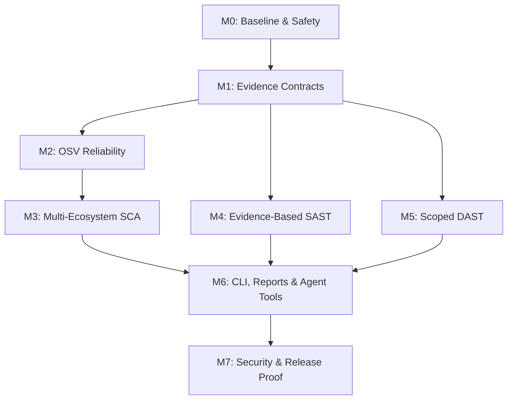

# Bug Killer: Full Security Coverage Engine

## Implementation Plan v1.0: Multi-Ecosystem SCA, Evidence-Based SAST, Safe Defensive DAST

**Planning date:** 2026-10-24  
**Repository:** https://github.com/imMamdouhaboammar/bug-killer  
**Repository snapshot inspected:** `master@6c31c133c7d520e02881dafab89241c881f882da`  
**Input:** `Pasted text(20261024-112901).txt`, *Implementation Plan: Full Security Coverage Engine*.  
**Related parent plan:** `Bug-Killer-Agentic-Master-Prompt.md`.  
**Status:** **READY FOR BOUNDED IMPLEMENTATION after M0 baseline proof**. This document is a plan, not proof that source changes or CI repairs have been executed.

---

## 1. Outcome and scope

Evolve the **existing** Rust/Go Bug Killer application into a credible multi-ecosystem defensive security scanner that supplies truthful, typed, auditable evidence to its later model-agnostic agent investigation and policy-gated remediation engine.

Three product outcomes:

1. **SCA:** identify resolved and declared dependencies across npm, PHP Composer, PyPI, Cargo, Go, Java/Maven, Gradle, .NET/NuGet, Ruby/Bundler, and Python Poetry; correlate *known exact versions* with OSV/vendor advisories; classify unresolved requirements and incomplete network lookups explicitly.
2. **SAST:** identify supported source-to-sink risk flows in JavaScript/TypeScript, Python, PHP and Go through an evidenced, language-aware tool or verified rule pack; provide a trace and confidence label; never claim a lightweight textual heuristic proves exploitability.
3. **DAST:** perform a tightly scoped, low-impact, read-only-by-intent web posture assessment (headers, cookies, carefully selected public endpoints, error-information leakage only where separately approved), without broad discovery or exploit probes.

The output must integrate with the existing CLI, `ScanReport`, evidence history, and future MCP/agent adapters. Detection remains functional without any LLM or hosted provider.

### Explicit non-goals of this initial implementation

- Universal vulnerability discovery or zero-day guarantees.
- Production-safe automatically authorized healing. Privileged changes remain blocked until the parent project's remediation safety gate has independent proof.
- Fuzzing, exploitation, SQLi payloads, command injection attempts, unauthorized URL enumeration, brute force, password testing, SSRF probing against real services, or shell command generation.
- Full custom parsers or analyzers for five programming languages from a one-pass Rust regex engine.
- Executing untrusted Maven/Gradle/NuGet/Bundler install/build scripts merely to resolve packages.
- An unrelated dashboard, new API gateway, message bus, Zig/C++ microservice or sweeping repository rewrite.
- Publishing private maintainer skills in the public repository.

## 2. Evidence snapshot and constraints

The plan is based on *read-only inspection* of the repository at the snapshot above. Source may change before an implementing agent starts; recheck HEAD and diffs first.

| Surface | Observed current behavior | Planning consequence |
| --- | --- | --- |
| CLI | `src/main.rs` has `scan`, `osv`, `heal`, `watch`, `doctor`; no `probe` or `--taint` yet | Add additive CLI contract; preserve old behavior except separately approved safety corrections |
| Rust library | `src/lib.rs` exports scanner, healer, OSV, rules | New modules must be wired consistently through both library and binary targets |
| Inventory | `FleetScanner` scans PHP/Node manifests and selected source/config paths | Add opt-in analysis passes, not a second independent filesystem traversal by default |
| Existing SCA | `src/osv/mod.rs` discovers `package.json`, `composer.json`, `requirements.txt`, `Cargo.lock` | Existing coverage is partial and contains version-resolution uncertainty |
| Declared versions | `clean_version` strips `^`, `~`, comparisons and may treat a range bound as installed | Stop marking declared constraints as resolved exact versions |
| OSV transport | `querybatch` (chunks of 50) falls back to individual queries; errors may be discarded | Use first-class partial/error results; make lookup coverage visible |
| Advisory interpretation | First `fixed` event from affected ranges is selected as upgrade threshold | Derive applicability/fix from package-specific affected entries, ranges and branch context; otherwise unknown |
| Automatic patches | `manifest_patch.rs` rewrites npm/PHP/Docker inputs and `AutopilotHealer` can consume OSV findings | Do not add cross-language dependency auto-upgrades until authorization, package semantics and rollback are proven |
| Healing defaults | CLI `Heal.auto_apply` is currently declared true by default; watcher has a direct auto-heal path | Existing P0 safety boundary must be fixed before routing new scanner results to healer |
| CI | Latest inspected Rust and Go quality jobs failed; dependent E2E skipped | M0 must establish a truthful green baseline or a precisely reproduced blocker |
| Open issues | Six accessibility-labelled issues were listed at the snapshot | Respect them but do not hijack this security plan into unrelated UI work |

**Observed, not proven:** The source suggests error handling, authorization and rollback weaknesses, but each implementing PR must reproduce the behavior or demonstrate the failing security invariant in a test. Do not infer exact CI failure causes from the job-status screen alone.

### Required baseline commands

```bash
git status --short
git rev-parse HEAD
cargo fmt --all -- --check
cargo clippy --workspace --all-targets -- -D warnings
cargo test --workspace
cargo test --manifest-path services/inspector/Cargo.toml
(cd services/orchestrator && go vet ./... && go test ./...)
(cd services/healer && go vet ./... && go test ./...)
make build
make test
```

Run only in a safe build environment. Record actual results, durations, errors, versions and limitations. The root Rust workspace does not automatically cover nested inspector builds or Go suites.

## 3. Corrections to the attached preliminary plan

| Attached assumption | Revised decision | Reason |
| --- | --- | --- |
| Regex/one-pass lexical tracking can be a meaningful general SAST taint engine across JS/TS, Python, PHP and Go | Use rules/AST-aware dataflow adapters first; call purely textual checks `PATTERN_INDICATOR`. If a native Rust taint engine is later justified, start with one grammar and falsification corpus | Real assignments, scopes, closures, calls, aliases, sanitization and multi-language syntax require semantics not available from regex alone |
| Avoid every “heavy” AST dependency | Use the least-cost **correct** method; compare Semgrep, relevant tree-sitter grammar parsers and vetted engine adapters | An incorrect lightweight engine has higher security and maintenance cost than a bounded supported adapter |
| `filepath.Clean`, `encodeURIComponent`, `parseInt`, `Number`, and generic `prepared` tokens are universal sanitizers | Require sanitizer proof specific to the sink, argument position, encoding and execution context | These transformations do not universally prevent path escape, SSRF, SQL injection or XSS |
| Parse all ecosystems line by line | Prefer native lockfiles, structured parsers, resolved SBOMs, or a vetted cataloger; allow bounded subset with `UNRESOLVED` for unsupported syntax | Go replace directives, Maven properties/parents, Gradle code execution, NuGet central package management, Poetry markers and Bundler resolution defeat naive text extraction |
| Every manifest version can be queried as installed | Separate `declared_requirement` from `resolved_version`, with provenance and confidence | A dependency constraint often admits multiple versions |
| Automatically patch `go.mod`, POM, `.csproj`, `Gemfile.lock` | Defer mutation; prepare advisory-only remediation proposals. Gated ecosystem-aware package-manager workflows come after the safety kernel | Manual lockfile/manifest edits can break resolution, hashes and application behavior |
| `GET /.env`, `GET /.git/HEAD`, and `GET /?test=%00` belong in default defensive probing | Default to headers/cookies on explicitly authorized target URLs; sensitive-path and malformed-request tests are separate lab/explicit-scope modes | GET can expose secrets or trigger side effects; benign intent does not guarantee impact |
| Any missing HTTP security header or server banner means a vulnerability | Evaluate header semantics against HTTPS/HTML/API context; classify missing headers as control observations or advisories when appropriate | Not every endpoint needs every header; missing controls are not proof of exploitability |
| A result list of length zero means clean | Distinguish `NO_FINDINGS_WITH_COMPLETED_COVERAGE` from `PARTIAL`, `UNKNOWN`, `UNSUPPORTED`, `ERROR`, `NOT_RUN` | Connectivity, parse and authorization failures must not become false assurance |

## 4. Architectural decisions (ADR packet)

**ADR-01: Reuse the existing Rust core and Go runtime.** No new service is justified for the three features. Keep SCA, SAST and DAST as sandboxable scanner components with shared reports. The existing Go orchestration may schedule fleet work later but is not required for local scans.

**ADR-02: Independent evidence before AI.** A deterministic scanner produces canonical evidence and incomplete-coverage signals. LLMs can explain or propose next checks; they cannot upgrade findings to confirmed or waive policy.

**ADR-03: SCA is lockfile-first.** Prefer exact package versions with provenance from resolved lockfiles or imported SBOMs. Manifests without trustworthy resolution yield requirement observations and warnings, not precise CVEs for an imagined installed version.

**ADR-04: Syntax is not dataflow.** A verified taint adapter may produce a source-to-sink trace; a textual rule emits a lower-confidence indicator. Use a small baseline corpus to decide whether invoking Semgrep or a language-specific engine earns its runtime cost. Tree-sitter is a parser foundation, not a complete taint analyzer.

**ADR-05: DAST begins passive/metadata-only.** Any live probe must use explicit target authorization and a network scope contract. No undocumented path enumeration or crafted anomaly traffic on production.

**ADR-06: Shared coverage schema before new detectors.** A single typed report format prevents silent scans from falsely returning clean and lets agent adapters preserve exact source citations.

**ADR-07: No automatic dependency mutation.** Scan and plan first. Only separately approved executor contracts may modify packages after precondition checks, independently passing tests and a recoverability proof.

**ADR-08: External tool execution is a boundary.** Treat Semgrep, Syft/Grype, OSV results and imported SBOMs as untrusted. Pin/review versions and licenses; disable arbitrary hooks, set resource limits, and sanitize outputs.

### Candidate module seams

```text
src/
  types.rs                    # existing public report types, additive evolution
  scanner/mod.rs              # existing scan coordinator
  osv/mod.rs                  # existing dependency discovery + OSV transport
  sca/                       # only if code size justifies one shared package-catalog boundary
  taint/                     # language-aware SAST adapter and trace normalization
  dast/                      # scoped HTTP transport, safe checks, reporting
  main.rs                    # CLI flags and result status
  lib.rs                     # canonical exports
tests/
  fixtures/sca/              # curated ecosystem manifests/lockfiles
  fixtures/sast/             # labeled source-to-sink and clean controls
  fixtures/dast/             # loopback-only deterministic HTTP server
```

These are proposed seams, not a mandate to create folders before needed. Shared models should be types, not duplicated JSON schemas or repeated engine logic. Inspect the existing `proto/` and Omni skill system before adding another protocol.

## 5. Contracts that must exist before detector expansion

### 5.1 Scan / coverage status

```rust
enum CoverageStatus {
    Complete,
    Partial,
    Unsupported,
    NotRun,
    Error,
}

enum EvidenceCertainty {
    Confirmed,
    StronglySupported,
    Suspected,
    Unknown,
}

struct CoverageReceipt {
    scanner_id: String,
    scanner_version: String,
    target_id: String,
    status: CoverageStatus,
    items_examined: u64,
    skipped_reasons: Vec<String>,
    errors: Vec<String>,
    completed_at: String,
}
```

Illustrative Rust domain shape. Refine it against existing public `ScanReport`/`Finding` backwards compatibility. The meaningful guarantee is that *no failure state is serialized as success*. Keep `Finding` severity independent of certainty, scanner completion and exploitability.

### 5.2 SCA package identity

```text
PackageEvidence:
  package_id, ecosystem, canonical_package_name, purl_if_known,
  source_path, source_type(manifest|lockfile|SBOM|runtime),
  declared_requirement?, resolved_version?, resolution_status,
  direct_or_transitive?, scope_or_group?, platform_markers?,
  replacement_or_override?, lockfile_digest?, provenance?,
  parser_id, parser_version, coverage_status, warnings[]
```

Rules:

- OSV exact-version lookups require an **actually resolved, validated version** or equivalent supported versioned package URL; do not strip a constraint operator and call the result installed.
- OSV advisory and affected range evaluation must be ecosystem- and package-aware. Do not select the first `fixed` event from an unrelated affected entry.
- Path, package name, version, ecosystem, source and response must be traceable through a stable request ID/digest.
- Distinguish maliciously malformed files, unsupported constructs and legitimate absent lockfiles.
- Deduplicate by stable package identity + version + vulnerability ID + target, not arbitrary finding text.

### 5.3 SAST flow evidence

```text
TaintEvidence:
  language, rule_id, rule_version, source_file_digest,
  source_span, propagation_spans[], sink_span,
  trust_source, sink_kind, context_specific_sanitizer_assessment,
  engine_id, engine_version, analysis_scope,
  control_flow_supported, interprocedural_supported,
  certainty, false_positive_caveats[], remediation_guidance
```

A missing trace cannot be represented as a demonstrated source-to-sink vulnerability. It can remain a `PATTERN_INDICATOR`. Reject universal sanitizer allowlists. A sanitizer is valid only for its target encoding and sink context. For example, normalizing a path is not proof of staying inside an authorized directory.

### 5.4 DAST request/response receipt

```text
ProbeEvidence:
  authorized_scope_id, original_target, resolved_destination,
  request_method, safe_path_category, redirect_chain_metadata,
  response_status, selected_header_names_and_sanitized_values,
  response_size_observed, body_was_read?,
  check_id, context, rule_result, confidence,
  evidence_hash, timestamp, resource_limits, errors[]
```

Default logs must not store response bodies, cookies, authorization headers, query tokens or page content. Sensitive evidence requires opt-in secure redacted storage with retention limits.

## 6. Dependency graph and delivery order



M3, M4 and M5 may be investigated in parallel **after** M1 freezes additive evidence contracts. Their PR integration remains ordered through a single owner of `src/main.rs`, `src/lib.rs`, public report schemas and generated completions. The safety gate from M0 applies to every subsequent change.

### Implementation scale

- **Core path:** M0 -> M1 -> M2 -> M3 -> M4 (one pilot language) -> M5 (safe headers/cookies) -> M6 -> M7.
- **Deferred path:** other language packs, live sensitive endpoint checks, cross-file taint, multiple enterprise SCA backends, dashboard, remote fleet DAST, automated package upgrades.
- **Timing:** plan against measured work, not an invented date. Roughly 8-12 small PRs is more reviewable than one cross-repo rewrite; number of commits is not a quality metric.

## 7. Work cards by milestone

Each card has one owner and a falsifiable acceptance oracle. The owner for integration is **Rust core maintainer / security reviewer** unless assigned otherwise. No card authorizes real-system network scans or production mutations.

### M0: Baseline and defensive execution boundary

**M0-A: Reproduce CI failures and protect the existing oracle**

- **Depends on:** none.
- **Owns:** baseline commands, exact failed GitHub Actions job logs and local reproduction, fixture inventory.
- **Must not change:** assertions, required checks, security policies or unrelated files to manufacture green.
- **Acceptance:** recorded HEAD + failing command + root cause; actual green rerun after any fix; clean distinction between existing and introduced failures.

**M0-B: Prevent new scanner results from reaching unauthorized automatic heal**

- **Depends on:** M0-A.
- **Owns:** read-only default contract for newly added `--taint`, SCA and `probe` features; integration with existing `heal`/watcher gates.
- **Must not change:** production system state or approve new privileged actions.
- **Acceptance:** a scan with a newly discovered SCA/SAST/DAST finding cannot trigger an unapproved write through CLI, watcher, gRPC, shell or future agent tool; negative tests deny a forged operation.
- **Note:** coordinate with the parent M1 transaction/authorization hardening. This coverage program must not create an alternate healer.

**M0-C: Freeze observable contracts and supported targets**

- **Depends on:** M0-A.
- **Owns:** characterization tests for `bk scan`, `bk osv`, machine-readable JSON and exit status; OSV offline behavior.
- **Acceptance:** a contract receipt shows what existing users see before additive changes; modifications later disclose intentional compatibility changes.

**Gate M0:** baseline is reproducible; no expanded scanning is wired to privileged auto-heal; no false `all clear` from failed requests.

### M1: Evidence and coverage foundation

**M1-A: Additive report schema and version migration**

- **Depends on:** M0-C.
- **Owns:** `src/types.rs` and serializable `Finding`/`ScanReport` extensions, stable identifiers, `CoverageReceipt` contract and versioning.
- **Must not change:** existing `CveId` JSON representations blindly; security severity definitions used by prior consumers.
- **Acceptance:** old JSON fixtures still deserialize where promised; new data contains coverage states, evidence provenance, warnings and scanner origin; schema roundtrip tests pass.

**M1-B: Shared scan coordination and resource limits**

- **Depends on:** M1-A.
- **Owns:** resource budgets and cancellation for new analyzers, shared target root resolution and opt-in analysis mode flags.
- **Acceptance:** scanners can report `NOT_RUN`, `PARTIAL`, `ERROR` without hidden panics; large files, symlinks and invalid encoding obey documented limits.

**M1-C: Independent fixture corpus and expected outcomes**

- **Depends on:** M1-A.
- **Owns:** labeled fixtures for resolved/unresolved manifests, taint source-sink cases, and local HTTP responses.
- **Acceptance:** oracle data specifies expectation before detector implementation; mutation/negative controls prove tests can fail on incorrect behavior.

**Gate M1:** every new detector reports both findings **and coverage**; no state collapses from incomplete to clean.

### M2: Reliable OSV transport and vulnerability matching

**M2-A: Distinguish resolved versions from ranges**

- **Depends on:** M1-A, M1-C.
- **Owns:** package observation model, existing `clean_version` behavior, explicit source provenance.
- **Acceptance:** `^1.2.0`, `>=2.0`, `~1.4`, `*`, `latest`, environment markers and unsupported selectors are never sent to OSV as a fabricated installed exact version; exact resolved versions still work.

**M2-B: Make querybatch failure honest and bounded**

- **Depends on:** M2-A.
- **Owns:** batch query result correlation, pagination per OSV API, fallbacks, deadlines, retries, quotas, dedupe and error propagation.
- **Acceptance:** API 429/500/timeout/malformed body/out-of-order or partial results produce `PARTIAL/ERROR` with affected package IDs, not an empty clean finding list. Valid batch results map to exactly their original query positions. Offline tests require no OSV network.

**M2-C: Advisory provenance and correct fix-state selection**

- **Depends on:** M2-B.
- **Owns:** ecosystem-aware OSV response interpretation, advisory source/modified timestamp, severity/aliases, package-specific affected ranges.
- **Acceptance:** multiple affected entries with different fixed versions do not produce an arbitrary first-fix recommendation; unknown fix state remains unknown; duplicate aliases consolidate deterministically.

**Gate M2:** one deterministic local OSV transport test suite proves clean, findings, invalid inputs, outage, partial and stale-data outcomes. External live OSV is optional verification, not the test oracle.

### M3: Multi-ecosystem SCA expansion

**M3-A: Go modules and Poetry exact resolution**

- **Depends on:** M2-A, M1-C.
- **Owns:** read-only Go `go.mod`/`go.sum` observation and Poetry `poetry.lock`/`pyproject.toml` handling, using a vetted parser/cataloger if necessary.
- **Acceptance:** Go direct/indirect requirements, multiple `require` blocks, `replace`/`exclude`, and Poetry lock groups/markers are either resolved with provenance or explicitly unknown; no text-derived false exact versions. Fixture cases cover malformed and unsupported constructs.

**M3-B: Ruby/Bundler and .NET/NuGet**

- **Depends on:** M2-A, M1-C.
- **Owns:** Gemfile.lock resolved gems, `.csproj` PackageReference, `packages.lock.json`, and `Directory.Packages.props` semantics.
- **Acceptance:** lockfile exact versions are captured with ecosystem identifiers; central package management and version ranges are not silently treated as installed; no package managers are executed merely for inspection.

**M3-C: Maven and Gradle without arbitrary builds**

- **Depends on:** M2-A, M1-C.
- **Owns:** direct POM dependencies and carefully supported resolved lock/SBOM evidence, property/parent/BOM unresolved tracking, Gradle Groovy/Kotlin DSL coverage policy.
- **Acceptance:** property placeholders and transitive dependencies requiring build evaluation are recorded `UNRESOLVED` absent a trusted SBOM or explicitly authorized resolver; parsing a Gradle file never executes its code. Java OSV package names use correct group/artifact identity when known.

**M3-D: SBOM/catalog adapter and reconciliation**

- **Depends on:** M3-A/B/C contracts; implementation may begin earlier.
- **Owns:** safe import of Syft JSON, CycloneDX or SPDX *only in validated supported versions*, if a vetted parser is available; Grype/Syft/Vuls integration evaluation.
- **Acceptance:** exact-version SBOM entries map to canonical package IDs with source identity; corrupted/oversized imports are rejected; source and lockfile duplicate packages dedupe without losing provenance; no unlicensed code gets copied.

**M3-E: Provenance-preserving advice, no lockfile auto-patch**

- **Depends on:** M3-A/B/C/D, parent remediation guard.
- **Owns:** human remediation guidance with ecosystem commands as non-executed suggestions where safe, plus supported fix availability context.
- **Must not change:** `go.mod`, POM, Gradle, `.csproj`, `Gemfile.lock`, `poetry.lock`, or package caches automatically.
- **Acceptance:** `bk scan --osv` can recommend a reviewable upgrade proposal while leaving all target bytes unchanged; tests assert hashes before/after.

**Gate M3:** labeled fixture corpus covers supported ecosystems, exact version extraction, unresolved syntax, duplicate dependencies, missing files and offline output. Report extractor precision/recall with denominators and do not count unsupported cases as negatives.

### M4: Evidence-based SAST dataflow

**M4-A: Falsification spike for analyzer selection**

- **Depends on:** M1-A/C.
- **Owns:** minimal proof-of-concept comparing existing rules, vetted Semgrep taint-mode adapter, available language parsers and a small Rust prototype if justified.
- **Decision test:** can the candidate correctly distinguish source -> reassignment -> sink, parameterized SQL, context-safe HTML encoding, path containment, aliasing, and unsupported cross-function flow within a reproducible resource budget?
- **Acceptance:** compare accuracy, analysis limits, licensing, startup and memory on the same corpus; select **one first language** for implementation. No engine is adopted merely to avoid a dependency or to satisfy a technology preference.

**M4-B: Implement one honest pilot flow engine**

- **Depends on:** M4-A.
- **Owns:** language-specific rules and typed trace normalization. JavaScript/TypeScript is a sensible first candidate because Bug Killer already scans Node source, but the corpus result controls the choice.
- **Acceptance:** source span, sink span, nontrivial propagation, context-specific sanitizer evidence, engine/mode and uncertainty are emitted. A failing parse or unsupported construct produces `PARTIAL/UNKNOWN`, not a confirmed vulnerability or clean result.

**M4-C: Expand by validated language pack**

- **Depends on:** M4-B.
- **Owns:** separately tested Python, PHP and Go rules, only if the chosen engine genuinely supports the languages and test requirements.
- **Acceptance:** each language has positive, negative, parser error, alias, scope, sanitizer misuse, and interprocedural-unsupported fixtures. If a language fails quality gates, it remains opt-in experimental rather than contaminating the release.

**M4-D: Severity, reachability and explainability contract**

- **Depends on:** M4-B/C.
- **Owns:** false-positive handling, dedupe, confidence scores without invented precision, contextual guidance and read-only report integration.
- **Acceptance:** textual sink matches are labeled `PATTERN_INDICATOR`; source-to-sink traces are labeled `SUPPORTED_FLOW`; neither is automatically called exploitable. A model cannot mark a finding confirmed without new deterministic evidence.

**Gate M4:** every supported language pack independently passes labeled fixtures. Provide a supported-construct matrix and documented no-claim zones (dynamic dispatch, reflection, cross-file flow, aliasing, template contexts) instead of unsupported universal taint promises.

### M5: Defensive DAST endpoint posture

**M5-A: Scope authorization and safe HTTP transport**

- **Depends on:** M1-A/C; security review required.
- **Owns:** explicit target scope, URL parsing, DNS/IP safety, ports, transport timeouts, redirect policy, byte and request limits, no untrusted credentials, cancellation and request receipts.
- **Default:** allow localhost/loopback fixtures. Remote hosts require explicit authorized scope and policy. No arbitrary CIDR/network discovery.
- **Acceptance:** deny link-local/metadata targets, unsupported schemes, userinfo credentials, IP family bypasses, cross-scope redirects, DNS rebinding, non-allowlisted destinations and body-size overruns; unit and loopback integration tests prove denial.

**M5-B: Context-aware headers and cookies**

- **Depends on:** M5-A.
- **Owns:** `HEAD`/minimal `GET` where required, CSP/HSTS/nosniff/frame-ancestors/X-Frame-Options/referrer/permissions policy interpretation, `Set-Cookie` flags and header normalization.
- **Acceptance:** HSTS not falsely required for plain HTTP fixtures; API/HTML applicability is accounted for; valid CSP/frame-ancestors controls avoid simplistic missing-X-Frame-Options critical findings; Secure/HttpOnly/SameSite observations are tied to cookie context; missing signals become hardening advice when not directly exploitable.

**M5-C: Optional sensitive-path checks in controlled scope**

- **Depends on:** M5-A/B and explicit lab/authorization capability.
- **Owns:** separately gated metadata-path allowlist, response classification with tiny size limits, redaction and retention policy.
- **Default:** **OFF** for `/.env`, `/.git/HEAD`, administrative docs and malformed-request tests. `/.well-known/security.txt` is a public metadata document, not a secret leak by itself.
- **Acceptance:** default mode never requests the gated paths; explicit lab permission reaches only a local fixture; any discovered secret-looking response is never persisted or displayed verbatim. No `%00` request in normal mode.

**M5-D: Probe reliability and reporting**

- **Depends on:** M5-B/C.
- **Owns:** report schema, stable JSON output, status/exit codes, request count and coverage receipt, no false `CLEAN` for blocked target.
- **Acceptance:** local server fixtures reproduce redirects, cookies, content types, early disconnects, timeouts, large bodies, content encoding and malformed headers; no unbounded reads or retry storms.

**Gate M5:** the scanner can assess a loopback target end-to-end without mutation, credential use, data leakage or scope escape. Production endpoints are not contacted in automated tests.

### M6: CLI, output, Omni and agent integration

**M6-A: Additive CLI**

- **Depends on:** M2, M3 pilot, M4 pilot, M5 safe mode.
- **Owns:** `bk scan <path> --osv --taint --json`, `bk probe <url> --json`, `--help`, shell completion, legacy compatibility, JSON schema and exit status.
- **Acceptance:** printed help matches actual runtime commands; JSON contains explicit coverage status and timestamps; no added flag silently mutates workspace or leaks secret material.

**M6-B: Common finding and report reconciliation**

- **Depends on:** M6-A.
- **Owns:** unified risk, provenance, sorting, duplicate policy and report summaries. Optionally SARIF mapping for SAST if provenance is sufficient.
- **Acceptance:** an OSV result, taint trace and header finding can coexist in one report with distinct certainty and no impossible CVE identity coercion. Deterministic output ordering enables diff-based CI checks.

**M6-C: Read-only MCP/agent surface**

- **Depends on:** M6-B and existing Omni/agent host contracts.
- **Owns:** typed `scan`, `get_findings`, `get_coverage`, `get_evidence`, `probe_authorized` MCP tools; use existing tool router where possible.
- **Acceptance:** Codex/Claude/Gemini/Kimi or local provider host can invoke read-only tools only if its host supports MCP; model and tool adapters cannot invoke `heal` as a side effect of requesting a finding. Host integration tests are labeled live or mocked accurately.

**Gate M6:** a repository fixture and an authorized local HTTP fixture produce consistent evidence through native CLI and MCP. The LLM explanation may vary, but canonical finding IDs, raw evidence and coverage do not.

### M7: Adversarial review, operations and release readiness

**M7-A: Fault injection and security testing**

- **Depends on:** M6.
- **Owns:** malformed manifests and SBOMs, parser panics, zip/file bombs, symlinks, prompt injection in scanned code, OSV outage, secret responses, redirect-to-metadata and denied privileged tool calls.
- **Acceptance:** fail-closed guards, stable coverage receipts, no real target mutation, no data leaks and bounded resources on all fixtures.

**M7-B: Performance and quality measurement**

- **Depends on:** M7-A.
- **Owns:** reproducible timing/memory benchmark with fixed corpus on disclosed machine, detector/target sizes, false positives/negatives and scan status metrics.
- **Acceptance:** publish measured medians/ranges and corpus denominators. Set release budgets based on actual baseline; do not invent sub-second throughput or universal precision claims.

**M7-C: Distribution and documentation truth**

- **Depends on:** M7-A/B.
- **Owns:** release-supported platforms, optional external scanner requirements, pinned current dependencies, license checks, artifact provenance, `README` CLI examples and known limitations.
- **Acceptance:** clean-room install on a supported host; generated `bk --help` agrees with README; all documented sample commands run against fixtures; private maintainer skills stay out of public distribution.

**Gate M7:** release candidate has green required CI, signed or otherwise verified artifact provenance as adopted by the project, clear runtime/coverage matrix, truthful limitations and no unresolved safety block.

## 8. Test catalog and falsifiable assertions

| Area | Positive fixtures | Negative / uncertainty fixtures | Required oracle |
| --- | --- | --- | --- |
| npm/Composer/Cargo/PyPI existing | Exact lockfile/requirements case | `^`/`~`/`>=` ranges, invalid formats | Version provenance and no fabricated resolved version |
| Go | direct/indirect, replacement to known version | unsupported replaces, malformed `require`, no resolved graph | `resolved` only with evidence; `UNRESOLVED` otherwise |
| Maven/Gradle | explicit Maven group/artifact/version, trusted SBOM | property placeholders, BOM/parent, executable Gradle expressions | no execution or invented effective dependency |
| NuGet | exact packages.lock, central package props | unresolved PackageReference ranges, missing central props | exact vs declared state distinguished |
| Ruby/Poetry | complete gem/poetry lock | markers, groups, lock absent or stale | correct ecosystem and transitive/direct context where known |
| OSV | matched exact version / multiple CVEs | 429, 5xx, timeout, broken JSON, pages, duplicate aliases | partial/error visible; dedupe and match correct |
| JS/TS taint | tainted query to an execution sink through assignment | safe bound parameter, sanitization wrong context, alias/cross-function gap | accurate trace or uncertainty, not regex proof |
| Python/PHP/Go taint | language-supported source to sink | context-specific safe counterexample, syntax errors | bounded supported rule coverage |
| Headers | missing/invalid sensitive response controls | HTTP-only HSTS, JSON API CSP, valid frame-ancestors | context-aware severity |
| Cookies | Set-Cookie missing relevant flag | public non-session cookie, HTTPS vs HTTP | report semantics tied to cookie type/context |
| Network scope | allowed 127.0.0.1 HTTP fixture | redirect to metadata, DNS change, IPv6 mapping, userinfo | no out-of-scope request |
| Sensitive exposure | gated local mock consent | default scan on arbitrary path | no sensitive-path requests by default or secret body display |
| Agent/MCP | read-only tool call on fixture | prompt injection asks for heal or secret export | deterministic refusal; proof in job receipt |

Recommended deterministic fixture suite names (create only as tests are implemented):

```text
tests/osv_multilang_test.rs
tests/osv_failure_semantics_test.rs
tests/taint_analysis_test.rs
tests/dast_scope_test.rs
tests/dast_probe_test.rs
tests/cli_contract_test.rs
tests/mcp_readonly_contract_test.rs
```

The attaching agent's original `tests/osv_multilang_test.rs`, `tests/taint_analysis_test.rs` and `tests/dast_probe_test.rs` names are retained as candidates, not proof those files already exist.

## 9. Threat boundaries and stop conditions

### Scanner and parser safety

- Cap recursion depth, file count, per-file bytes, archive expansion, HTTP response bytes and total scan time.
- Do not follow untrusted symlinks outside the authorized root or execute inspected binaries, build files, Ruby gems, npm lifecycle hooks, Gradle scripts, Maven plugins or package manager upgrades.
- Avoid unbounded OSV request storms; maintain provenance and query correlation when retries/cancellation occur.
- Treat imported advisories, source comments and agent skills as lower-trust text, never instructions.

### Probe safety

- Explicit allowed schemes, hosts, ports, paths and request methods.
- Resolve/recheck destination address on each connection and redirect; reject private/loopback/link-local/metadata targets unless specifically permitted by a local/test scope. A hostname that was allowed before resolution cannot override a prohibited actual destination.
- Timeouts, concurrency ceilings, maximum redirects, one-shot reads and no cookie jar by default.
- Sanitize URLs, userinfo, authorization headers, session cookies and response data in logs/reports.
- Stop on authorization ambiguity or evidence of harmful side effects.

### Remediation isolation

- Findings are advisory data. Never pass model output, scanning rule content or OSV guidance directly as a shell command or a write operation.
- Preserve current P0 remediation risk as a separate blocking parent-architecture gate.
- Do not market the three scanning modules as “fully auto-healing” before typed approval, backup trust, crash recovery and independent post-repair checks have been proven.

### Work-stop classification

`BLOCK` for confirmed unauthorized write, network scope escape, source/credential exfiltration, false clean result from failed scan, fabricated vulnerability confirmation, or broken CI with no documented baseline. `REWORK` for unreviewable broad rewrite, regex-as-dataflow claim, dependency semantics ignored, missing tests or misleading documentation. `PASS` only after all card-specific gates are satisfied with fresh evidence.

## 10. Reference projects: what earns attention now

| Reference | Relevant current decision | Treatment |
| --- | --- | --- |
| `anchore/grype` + Syft | SBOM/package identity, OS/distro and language SCA | Evaluate adapter first, license and supported-target check |
| `future-architect/vuls` | Host package inventory, version/backport interpretation | Concept/adaptor evaluation, not duplicated fleet service |
| `google/oss-fuzz` | Parser regression fuzzing, crash triage | Isolated fixture/test tooling, not runtime exploit engine |
| `semgrep/semgrep-docs` | Verified taint source/propagator/sanitizer/sink semantics | Primary specification for evaluator spike |
| `tree-sitter/tree-sitter` | Grammar-aware parsing when a native Rust need is demonstrated | Parser foundation only, no invented taint semantics |
| `cloudflare/security-audit-skill` | Evidence-based audit phase discipline | Workflow inspiration, not embedded privileged tool |
| `cisco-ai-defense/skill-scanner` | Future Omni/MCP skill trust | Later read-only skill audit integration |
| `Tencent/AI-Infra-Guard` | AI infrastructure / MCP/agent exposure | Future separate adapter after core scanner safety |
| `smicallef/spiderfoot`, `WerWolv/ImHex` | Authorized recon / binary inspection future work | Deferred, not blockers to this plan |
| `pilotty`, `cindy`, `PySpector`, `cargo-crev`, Trail of Bits skills | Specialized references; verify current purpose and licensing | Research inventory; import only if one current card requires it |
| `strix`, `shannon`, `PayloadsAllTheThings`, `hexstrike-ai`, `Claude-Red`, `pentestagent` | Offensive and dual-use mechanics | Defensive understanding only; no exploit automation or payload execution |
| Hardening collections and community skills | Review checklists and examples | Untrusted data until source/licensing and threat review |

The exhaustive upstream list in the user's request remains a **research inventory**, not a mandate to install every project. Deduplicate repeated URLs. Any external tooling shipped or called must pass licensing, provenance, maintenance, resource and security gates.

## 11. Change management, integration ownership and PR queue

Use small, reviewable PRs against `master`, each with explicit contract, focused diff, tests, rollback notes and CI receipt. Branch names are examples, not existing branches.

| Proposed PR | Scope | Depends on | Merge proof |
| --- | --- | --- | --- |
| `fix/bk-ci-baseline` | M0-A, M0-C | none | CI and contract receipts; no test oracle weakening |
| `fix/bk-scan-heal-boundary` | M0-B coordinated with parent M1 safety | baseline | unauthorized mutation denied through every entrypoint |
| `feat/bk-evidence-coverage-v1` | M1-A/B/C | M0 | old/new JSON, partial/error and fixture contracts |
| `fix/bk-osv-accuracy` | M2-A/B/C | M1 | ranges not exact, pagination, network-error fixtures |
| `feat/bk-sca-go-poetry` | M3-A | M2 | supported exact/unknown fixtures |
| `feat/bk-sca-ruby-nuget` | M3-B | M2 | lockfile and central-props fixtures |
| `feat/bk-sca-java-sbom` | M3-C/D/E | M2 | no build execution, SBOM integrity and guidance only |
| `feat/bk-taint-pilot` | M4-A/B | M1 | documented decision spike and literal traces |
| `feat/bk-taint-language-packs` | M4-C/D | taint pilot | per-language positive/negative oracle |
| `feat/bk-dast-safe-probe` | M5-A/B | M1 | scope firewall and header/cookie semantics |
| `feat/bk-dast-gated-exposure` | M5-C/D | DAST safe | default-off gated fixture and body redaction |
| `feat/bk-security-cli-mcp` | M6-A/B/C | M3/M4/M5 | matching canonical findings, CLI/MCP read-only proof |
| `chore/bk-security-release-proof` | M7 | M6 | full CI, independent skeptical review, installer proof |

This is a dependency queue rather than a commitment to thirteen PRs regardless of outcome. Combine adjacent cards only if the diff stays coherent and independently reviewable. Different workers can develop SCA/SAST/DAST after shared schemas settle, but shared `types.rs`, `scanner/mod.rs`, `main.rs`, `lib.rs` and generated artifacts must have one integration owner to avoid semantic races.

## 12. Acceptance and measurement dashboard

Every PR must report:

```text
Commit and target branch:
Baseline commands and observed status:
Changed behavior and preserved behavior:
Source/target coverage and skipped reasons:
Fixtures added or reused:
Exact test commands and results:
False positives / false negatives with denominators:
Runtime and peak memory where measured:
Security boundary checked and negative-path result:
Raw secret/body redaction check:
Any preexisting failures remaining:
New failures:
Changes to prior tests and independent rationale:
Dependencies added and verified licensing:
Review verdict: BLOCK / REWORK / REVIEW / PASS
Next executable card:
```

### Product-level release criteria

1. Existing PHP/Node regression coverage still passes.
2. OSV network failures cannot produce a clean finding state.
3. Declared ranges are never fabricated into a resolved dependency version.
4. At least one labeled fixture suite exists per **actually supported** new ecosystem and supported taint language.
5. DAST's default mode cannot reach disallowed internal networks, redirect outside scope, access sensitive paths, or print a secret-bearing body.
6. New SCA/SAST/DAST findings cannot trigger unauthorized healing through any path.
7. CLI and MCP integration returns the same underlying canonical evidence IDs and coverage statuses.
8. No critical security review finding or hidden required CI failure remains.
9. Documentation and distribution make no unsupported “all clean”, “zero-day proof”, “guaranteed remediation”, “supports every model” or “complete” claims.

## 13. Assumptions, unknowns and future decisions

**Established facts:** the attached plan's proposed modules are not in the inspected source tree; OSV has a batch and individual-query path; the current CLI accepts `--osv`, not `--taint`/`probe`; CI runs were failing at the inspected SHA.

**Design assumptions:** use Rust core, existing `ureq` for small HTTP metadata requests if safe request-level controls can be proved, add read-only detectors incrementally, and prefer parser/catalog adapters over building five language analyzers.

**Unknowns requiring discovery at implementation:** exact CI failure root causes; supported OS/CPU distribution targets; accepted external binary licensing and execution mode; whether an existing scanner catalog or vendor feed supersedes OSV handling in a newer commit; available live model/provider fixtures; long-term JSON schema consumers.

**Default decisions until operator states otherwise:**

- Production/live remote DAST is **not authorized** by this plan. Loopback fixture probing is permitted in a disposable test server.
- Secret file exposure checks and malformed-request probes are disabled by default.
- No package manager or system service mutation is permitted by the new features.
- New external scanner dependencies require license/reproducibility/provenance review.
- No public leakage of private maintainer skills.
- Agent/MCP integration is read-only until the parent policy and healing milestone passes independent security verification.

These defaults allow planning and local tests to proceed without a large question list, while keeping authority-changing decisions visible.

## 14. First executable action: M0-A

**Ticket:** `BK-COVERAGE-M0-A: Restore baseline evidence and isolate CI failures`.

**Branch:** `fix/bk-ci-baseline` (suggested, verify existing work first).

**Procedure:**

1. Record HEAD, dirty state, dependencies/toolchains, current GitHub Actions results and full failed logs.
2. Run every exact root and nested Rust/Go validation command listed in section 2 in a safe local or Codespaces workspace. No real host scan, package upgrade or deployment.
3. Identify actual failing commands/causes. Add the smallest regression demonstration if a source defect is involved.
4. Fix baseline code or CI configuration only where supported by real evidence; preserve old test outcomes and required checks.
5. Independently review source, tests, diff and changes in dependencies, check formatting and build artifacts.
6. Confirm CI on the submitted change; if remote CI cannot run, mark as blocked and give the exact reproduction and required capability.
7. Open a reviewable PR only when authorized; never claim merged or close an issue unless actually performed.

**Acceptance:** a reviewer can reproduce the original failures or documented environmental limitation, review the minimal correction, and verify newly passing Rust, Go, inspector and E2E pathways where available. The downstream M1 evidence-contract work is unblocked.

**Do not start with `src/taint/mod.rs` or `src/dast/mod.rs` before this gate.** A scanner whose core fails CI or whose errors are represented as clean creates false confidence.

---

## 15. Primary sources for implementation

- [OSV API and package/commit querying](https://google.github.io/osv.dev/api/)
- [OSV QueryBatch contract](https://google.github.io/osv.dev/post-v1-querybatch/)
- [Semgrep taint-analysis semantics](https://github.com/semgrep/semgrep-docs/blob/main/docs/writing-rules/data-flow/taint-mode/overview.mdx)
- [OWASP Web Security Testing Guide](https://owasp.org/projects/web-security-testing-guide)
- [Grype vulnerability scanning](https://github.com/anchore/grype)
- [Vuls package/host inventory](https://github.com/future-architect/vuls)
- [Syft SBOM generation](https://github.com/anchore/syft)
- [OSS-Fuzz parser and native code testing](https://github.com/google/oss-fuzz)
- [Cisco Skill Scanner and limitations](https://github.com/cisco-ai-defense/skill-scanner)
- [MCP protocol, tool contracts and permissions](https://modelcontextprotocol.io/specification/2026-07-28)

Versions, applicability and API details must be reverified at implementation time against the repository's actually pinned dependencies.

**Planning completion verdict:** The preliminary three-component idea is viable as a staged security coverage program **after** the initial safety, evidence and CI gates. The first actual implementation task is M0-A, followed by M0-B and M1. Anything beyond that remains a planned outcome, not a shipping claim.
